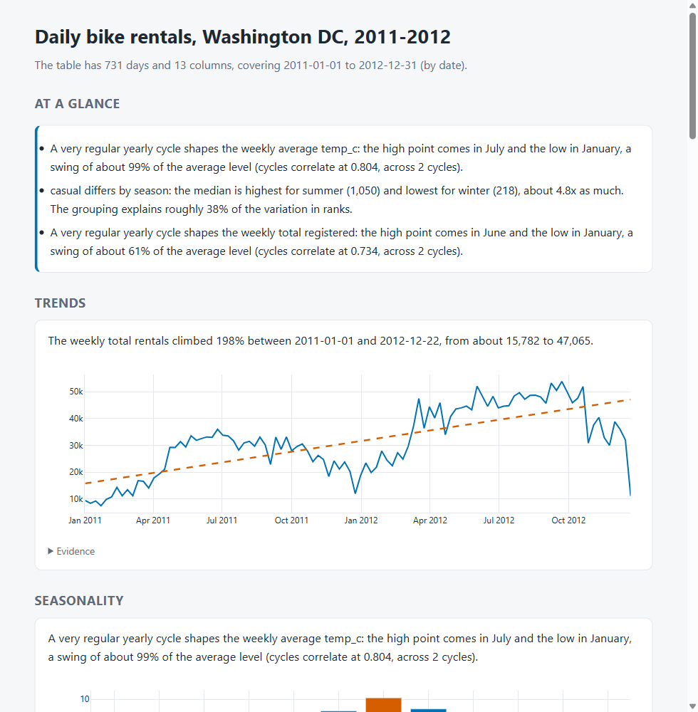

# Automated Report Generator

**Category:** Data Analytics
**Difficulty:** A

**Status:** Implemented (Python)

Source modules live in `src/report_generator/`; the tests are in `tests/`.

Point it at a table and get a short plain-English report of what is worth knowing: the trend, the
seasonal cycle, the step change, the outlier, who dominates, which groups differ, what moves together,
and what is wrong with the data. There is no language model in the loop. A statistics layer finds
candidate findings and gates them on evidence **and** effect size; a template layer writes one
sentence per finding using only numbers the finding declares; and a second engine (DuckDB SQL plus
scipy) **recomputes every number from the raw table** before anything is printed. A statement that
fails either check is dropped, and the report says so.

```bash
uv run autoreport generate bike                 # out/report.md, report.html (one file), report.json
uv run autoreport generate retail -n 6          # keep only the six best findings
uv run autoreport generate my.csv --time day --sum clicks --rows-label visits --title "Q3"
uv run autoreport findings ames --all           # every candidate with its score; picked ones marked
uv run autoreport verify bike                   # each statement beside the numbers recomputed from the table
uv run autoreport datasets                      # the three bundled tables
uv run autoreport fetch                         # rebuild bike.parquet and ames.parquet (needs network)
uv run pytest -q                                # 105 tests
```



## What a report says

From the bundled daily bike-rental table (731 days, UCI Bike Sharing, 2011-2012), unedited:

> - The weekly total rentals climbed 198% between 2011-01-01 and 2012-12-22, from about 15,782 to 47,065.
> - A very regular yearly cycle shapes the weekly average temp_c: the high point comes in July and the
>   low in January, a swing of about 99% of the average level (cycles correlate at 0.804, across 2 cycles).
> - One weekly total registered reading stands out: 2012-12-22, at 8,992 where about 29,979 was
>   expected, 70% below the norm.
> - casual differs by season: the median is highest for summer (1,050) and lowest for winter (218),
>   about 4.8x as much. The grouping explains roughly 38% of the variation in ranks.
> - *Data note:* rentals equals casual plus registered in all 731 rows, so those columns carry the same information.
> - *Every number in this report was recomputed from the raw table with DuckDB and scipy: 49 checks across 14 statements.*

| Table    | Shape                                 | Candidates | Reported | Notes | Checks recomputed | Failed |
| -------- | ------------------------------------- | ---------- | -------- | ----- | ----------------- | ------ |
| `bike`   | 731 days, 13 columns                  | 27         | 12       | 1     | 49                | 0      |
| `ames`   | 2,930 sales, 17 columns               | 41         | 10       | 0     | 33                | 0      |
| `retail` | 87,862 invoice lines of 600 customers | 9          | 9        | 3     | 30                | 0      |

`ames` finds July as the peak and December the low of monthly sales (4 cycles), a 3.6x gap in median price between
the dearest and cheapest neighbourhood (Stone_Brook 319,000 against Meadow_Village 88,250) and no trend, step or
outlier: its last month, July 2010, has 8 sales against a typical 60 (and January 2006 has 18 against 63), so
both edges are dropped as incomplete rather than reported as a collapse. `retail` finds the November peak, the United Kingdom at 93% of lines and 120 of 600 customers
buying 78% of units, 2.2% negative quantities (returns) and 1,248 duplicate lines.

## How it decides

1. **Profile** (`profile.py`). Finds the clock (any text column that parses as dates), calls numeric columns measures
   (summed if the name says additive, else averaged), small categorical or coded columns dimensions, repeated
   high-cardinality columns entities, and leaves ids, years and constants alone. A *series table* has one row per
   date; an *event table* has many, so rows are counted and added up. Every guess can be overridden on the command line.
2. **Series** (`series.py`). Picks the finest grain (day, week, month, quarter, year) that gives 12 to 160 buckets,
   anchors weeks on the first observed day, **drops a partial first or last bucket** (by calendar coverage, and by row
   count when dates cannot show it) and fills quiet buckets.
3. **Detectors** (`detect_time.py`, `detect_cross.py`), each with an evidence gate and an effect-size gate:

   | Finding                                                                           | Evidence                                                                                                                                                | Effect                                                     |
   | --------------------------------------------------------------------------------- | ------------------------------------------------------------------------------------------------------------------------------------------------------- | ---------------------------------------------------------- |
   | trend                                                                             | Mann-Kendall with Hamed-Rao variance correction **and** a block bootstrap of the Theil-Sen slope (the larger p), Benjamini-Hochberg across measures, 1% | fitted line moves >= 10%                                   |
   | seasonality                                                                       | cycles repeat the same pattern of changes: permutation p <= 0.01 and rank correlation >= 0.3                                                            | peak to trough >= 10% of the level                         |
   | step change                                                                       | PELT on the seasonally adjusted, detrended series, BIC-style penalty                                                                                    | >= 10% and >= 3 noise sigmas                               |
   | outlier                                                                           | robust z >= 4.5 on the remainder, scale never below the noise level                                                                                     | >= 20% off expected; none if > 5% of points qualify        |
   | latest period                                                                     | move >= 3.5 noise sigmas against the previous and the year-ago bucket                                                                                   | >= 10%                                                     |
   | concentration                                                                     | top group >= 40% of a total, or top 20% of >= 50 entities >= 60%                                                                                        | by definition                                              |
   | group difference                                                                  | Kruskal-Wallis, Benjamini-Hochberg, 1%                                                                                                                  | epsilon-squared >= 0.06                                    |
   | relationship                                                                      | Spearman, Benjamini-Hochberg, 1%                                                                                                                        | rho >= 0.5 (near-duplicates and total-versus-part skipped) |
   | skew, missing values, duplicates, date gaps, negative counts, additive identities | counts                                                                                                                                                  | thresholds in `config.py`                                  |

4. **Select** (`engine.py`). Greedy by score, at most 3 per section and 12 in all, skipping near-duplicates (two
   measures that move together are one story; a total beats its parts).
5. **Write** (`realize.py`). One template per finding kind, no digits in any template. Findings carry `Fact` objects
   (raw value plus the exact printed text); a sentence can only paste a fact in.
6. **Audit** (`realize.audit`). Templates are digit-free, each numeric fact's text still equals its value, the
   finished sentence is the one its template and facts produce, and the numbers in it are exactly the numbers its facts
   declare (a test slips `99%` into a sentence and watches it get caught).
7. **Verify** (`verify.py`). The report's claims are recomputed with DuckDB SQL aggregation (the bucket values, group
   totals, medians, counts) and scipy/statsmodels called directly (Theil-Sen, Spearman, Kruskal-Wallis, STL), then
   compared. What it checks is that the numbers are right. It cannot tell whether a threshold was a good choice, and
   it re-runs, rather than independently re-derives, the decomposition step.

## Making it not lie

Most of the work went into false claims. Measured on this machine:

- **Seasonality from two years of weekly data.** STL's default seasonal window fits each phase from 2-3 points: it
  reported a pattern that "accounts for 100% of the variation" and a series that "peaks in April and is lowest in
  April". The gate is now cycle repeatability on first differences within each cycle (so a wandering level cannot
  fake one), averaged into 13 blocks of 4 weeks for a 52-week cycle, with a permutation p-value. Simulated false positive
  rate at 104 weekly points: 0 to 3% for white, AR(1) and random-walk noise; power at a seasonal amplitude of
  4 noise sd is 0.88. 100 noise-only tables (300 series) produced 2 spurious seasonal findings and nothing else.
- **Robust STL on three cycles.** It treated a collapsed week as part of the season (residual -54 for a week that
  fell by about 5,000). Robust reweighting is now used only from five cycles, and the seasonal pattern is fixed (periodic).
- **Autocorrelated noise and trend.** On a stationary AR(1) series (phi = 0.85, 100 points) plain Mann-Kendall
  calls a trend 49% of the time, Hamed-Rao 22% and Hamed-Rao plus a block bootstrap about 15%. That is better, not
  solved: a smooth series has few independent points. Trend sentences say "climbed", never "because".
- **Partial last buckets.** Online Retail ends on 2011-12-09 and Ames on a thin July 2010; both would have shown as
  collapses. The latter is caught only by row count.
- **Percentages of nothing.** A series centred on zero (mean below half its sd) gets no percent claims.
- **Trivial relations.** `rentals = casual + registered` in every row, found by test, so "casual correlates with
  rentals" is not reported.

## Data

| Table    | Source                                                                                                                                                | Rows   |
| -------- | ----------------------------------------------------------------------------------------------------------------------------------------------------- | ------ |
| `bike`   | UCI Bike Sharing Dataset, daily file (Fanaee-T and Gama, 2013, CC BY 4.0); weather columns rescaled from the normalised values to C, % and km/h       | 731    |
| `retail` | UCI Online Retail II (Chen, 2019, CC BY 4.0): every line of 600 random customers, copied from the RFM challenge; `revenue` = quantity x price at load | 87,862 |
| `ames`   | Ames, Iowa house sales (De Cock, 2011) through R `modeldata::ames` (Rdatasets); 16 of 74 columns and a `sale_month` built from year and month sold    | 2,930  |

`sample_data/SOURCES.json` records URLs and cleaning. Any CSV, TSV or Parquet file works too; `--time`, `--ignore`,
`--sum`, `--mean` and `--rows-label` override the guesses.

## Limits

- Wording is template-based: it is repeatable and testable, not fluent. Sentences use column names as they are.
- Seasonality needs at least two full cycles, and the test has little power for weak patterns at 52 weeks per cycle
  (it finds them reliably from about 4 noise sd).
- Series are analysed at one grain, chosen by span; a table spanning decades is quarterly. Intra-year weekday patterns
  in a multi-year daily table are not examined.
- Group and correlation findings treat rows as independent; in a series table (bike) they describe the days, not causes,
  and calendar-linked groupings (season, month) are dropped when a seasonal finding already covers the measure.
- Verification re-derives numbers, not judgments: a finding can be correct and unimportant.

## Where this is actually used

Narrative summaries of data are a standard feature of business-intelligence tools. Power BI's Narrative visual
generates text summaries of visuals and reports with dynamic values and says it "analyzes trends" (the example in its
documentation reports 72 percent growth), picks "the most interesting things to summarize" and caps itself at four
summaries per visual and 16 per page; it also has an AI (Copilot) mode, which this challenge deliberately
is not, because a template layer can be audited number by number. The statistics underneath are textbook: Mann-Kendall (Mann 1945, Kendall 1975) with Theil-Sen slopes (Theil 1950,
Sen 1968), STL decomposition (Cleveland et al., 1990) and PELT change-point search (Killick et al., 2012).

## Layout

```text
src/report_generator/
  profile.py       roles, clock, event vs series table
  series.py        grain, buckets, partial edges
  stats_ts.py      Mann-Kendall (+bootstrap), STL, repeatability, PELT and its exact-DP oracle
  detect_time.py   trend, season, shift, outlier, latest
  detect_cross.py  concentration, groups, relationships, shape, data quality
  findings.py      Finding and Fact
  realize.py       templates and the audit
  verify.py        DuckDB + scipy recomputation
  engine.py        pipeline and selection
  render.py        Markdown, HTML, JSON
  cli.py           the `autoreport` command
sample_data/       bike, retail, ames and SOURCES.json
```
