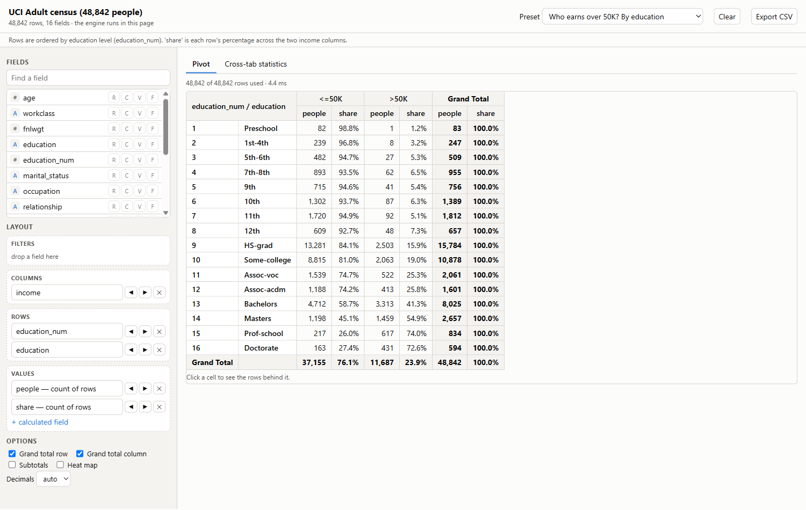
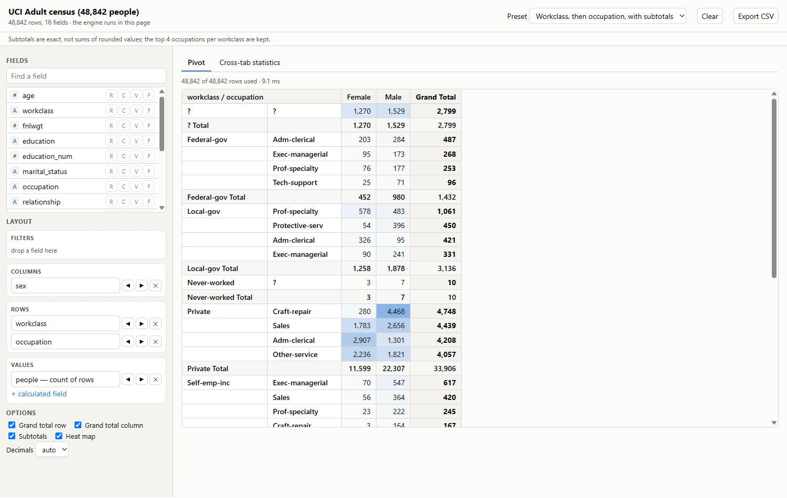
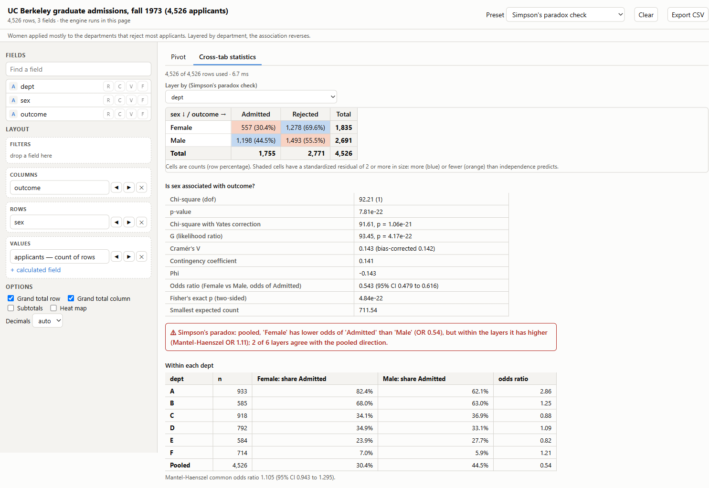

# Cross-Tabulation & Pivot Table Engine

**Category:** Data Analytics
**Difficulty:** A

**Status:** Implemented (Rust engine, Python CLI)

The engine is in `crates/` (Rust); the command line, bindings and page export are in `src/pivot_tool/`
(Python); the tests are in `crates/*/tests`, `crates/*/src` and `tests/`.

Excel-style pivoting built from scratch, not a wrapper: a Rust engine that reads the CSV, types and
dictionary-encodes the columns, aggregates with its own hash tables, builds exact subtotals and grand
totals, applies "show values as", evaluates calculated fields, and computes the cross-tab statistics
(chi-square, Cramér's V, Fisher, Mantel-Haenszel, with its own incomplete-gamma function). The same
compiled code runs three ways: a native library for the Python CLI, a WebAssembly module inside a
self-contained interactive HTML page, and Rust tests.

```bash
uv run pivot demo adult                         # the bundled pivots on the UCI census (48,842 people)
uv run pivot demo berkeley --html berkeley.html # ... and an interactive page for the 1973 admissions
uv run pivot pivot sample_data/adult.csv.gz -r education -c sex -v "mean(hours_per_week)" -v "count() as n"
uv run pivot pivot FILE -r workclass -r occupation -c income -v "count() as n @pct_row" --subtotals --top 5:n
uv run pivot crosstab sample_data/ucb_admissions.csv -r sex -c outcome --layer dept   # Simpson's paradox
uv run pivot drill FILE -r dept -c outcome --row-path A --col-path Admitted           # rows behind a cell
uv run pivot html FILE --out pivot.html -r region -v "sum(sales)"                     # any CSV, in the browser
uv run pivot describe FILE
uv run pivot bench                              # the engine against polars and DuckDB
uv run pytest -q                                # Python tests (builds the engine with cargo on first use)
cargo nextest run --release                     # Rust tests
```

You need Rust (`rustup`) once: the Python commands build `target/release/pivot_ffi.{dll,so,dylib}`
with cargo on first use. `uv run pivot build --wasm` rebuilds the WebAssembly module that is committed
at `src/pivot_tool/web/pivot_ffi.wasm` (needs `rustup target add wasm32-unknown-unknown`).



## What it does

| Piece             | What it gives you                                                                                                                                                                                                                     |
| ----------------- | ------------------------------------------------------------------------------------------------------------------------------------------------------------------------------------------------------------------------------------- |
| Fields            | Any number of row and column fields. Types are inferred (int, float, date, datetime, text); `02134` stays text.                                                                                                                       |
| Aggregations      | sum, count (rows or non-blank values), distinct, mean, median, min, max, std, var, first, last, mode, weighted mean.                                                                                                                  |
| Layout            | Nested subtotals (top or bottom), grand total row and column, sort by label or by a measure's total, keep the top N per parent, hide `(blank)`. `(blank)` always sorts last.                                                          |
| Grouping          | Date parts (year, quarter, month, year-month, year-quarter, weekday, day, hour), equal-width bins, bands at cut points, quantiles.                                                                                                    |
| Filters           | Page-field filters: equals, not, in / not in, `>`, `>=`, `<`, `<=`, between, contains, blank, not blank; dates compare as dates.                                                                                                      |
| Show values as    | % of grand, row, column, parent row, parent column total; index; difference and % difference from the previous item; running total; rank (largest or smallest first); each along rows or columns.                                     |
| Calculated        | `gain / people`, `round([units per order] * 100, 0)`, `if(a > b, a, b)`: a formula over the measures above it, evaluated in every cell including every total. Division by zero leaves the cell empty.                                 |
| Cross-tab         | Counts of two fields with chi-square (Yates for 2x2), G, Cramér's V (and bias-corrected), contingency coefficient, standardized residuals, Fisher's exact test and the odds ratio with its interval for 2x2, warnings for thin cells. |
| Layered cross-tab | A third field repeats the table inside each of its values and compares the pooled association with the Mantel-Haenszel adjusted one: a Simpson's-paradox check.                                                                       |
| Drill-through     | The source rows behind any cell, subtotal or total, found with the same filters and encoding the pivot used.                                                                                                                          |
| Page              | One HTML file with the engine inside (WebAssembly) and the data: field picker, drag or click to Rows / Columns / Values / Filters, per-field settings, heat map, drill-through, cross-tab tab, CSV export. No network request.        |

## How it works

1. **Load** (`csv.rs`, `table.rs`). A from-scratch RFC 4180 reader writes every cell into one text
   arena per column; an unquoted field is a slice of the input and costs no allocation. A column is
   then typed by scanning it, and text is dictionary-encoded (each distinct string stored once, rows
   hold a `u32`).
2. **Encode** (`encode.rs`). Every row and column field becomes small integer codes in display order,
   with grouping applied here, so the rest of the engine never sees a string.
3. **Aggregate** (`pivot.rs`). A row's row-field codes pack into one `u64` and its column-field codes
   into another (mixed radix); one pass assigns each row to a cell, then one tight loop per measure
   updates that cell's accumulator.
4. **Totals by merging** (`acc.rs`). Subtotals and grand totals are built by *merging* the finest
   cells into coarser ones, not by rescanning rows: sums add, a variance combines exactly (Chan et al.),
   a distinct count unions its sets, a median concatenates its values. So the mean of a subtotal is
   the mean of all its rows, not the mean of its group means.
5. **Lay out, finish, transform.** Items are ordered (sort, top-N, subtotals, totals), each cell is
   finished, calculated measures are evaluated per cell, and "show values as" looks up the numbers it
   needs (a row total, the parent, the previous sibling) from the same merged cells.

`pivot-ffi` puts this behind three C functions (`pt_alloc`, `pt_call`, `pt_free`) with JSON in and
JSON out; Python calls them through `ctypes` and the page through the WebAssembly instance, which is
why every host gets the same answers.



## What the data says

**Simpson's paradox, found by the engine.** The 1973 Berkeley graduate admissions (4,526 applicants,
the six largest departments) pooled show men admitted 44.5% of the time and women 30.4%: an odds ratio
of 0.54 for women (95% CI 0.48 to 0.62, chi-square 92.2, p about 8e-22). Layered by department the
direction flips: women were admitted at a higher rate in four of six departments (department A: 82.4%
against 62.1%), the Mantel-Haenszel odds ratio is 1.11 (95% CI 0.94 to 1.30, so no evidence of bias
against women), and only 2 of the 6 department tables agree with the pooled direction. Women applied
mostly to the departments that reject most applicants. `crosstab ... --layer dept` reports it as a
reversal and says so in a sentence.



**A gap that shrinks without reversing.** In the Adult census the odds of earning over 50K are 3.56
times higher for men than for women (chi-square 2,250, Cramér's V 0.215). Layered by marital status,
the Mantel-Haenszel odds ratio falls to 1.34 and 5 of the 7 layers agree with the pooled direction:
most of the raw gap is *who is married*, but the engine correctly does not call it a reversal.

**Where the money is, by education.** The first bundled pivot (rows `education_num` then `education`,
columns income, `count` and `count @pct_row`) shows the share earning over 50K rising from 1.2% for
preschool to 74.0% for a professional school and 72.6% for a doctorate, with
bachelor's degrees at 41.3% and a high-school diploma at 15.9%.

## How fast

Adult census repeated to 2,000,000 rows (227 MB of CSV), best of 5, one laptop. polars and DuckDB are
timed on the plain group-by that gives the same numbers; the engine also builds totals and the grid.

| Task                                        | Pivot engine | polars  | DuckDB  |
| ------------------------------------------- | ------------ | ------- | ------- |
| parse and type the CSV                      | 1.095 s      | 0.191 s | 0.781 s |
| sum of hours by education x sex             | 0.031 s      | 0.007 s | 0.016 s |
| mean age by workclass x occupation x income | 0.033 s      | 0.045 s | 0.031 s |
| median hours by occupation x sex            | 0.134 s      | 0.041 s | 0.025 s |

`cargo bench` (Criterion, a million synthetic rows): parse 182 ms, sum by region x year 28 ms, two row
fields with subtotals and two measures 40 ms, median by product x region 46 ms.

The engine is single-threaded and the others are not, so it loses where the work is parallel and
cheap (a plain sum, the median) and is level where the work is hashing (the mean over three fields).
It was slower before it was measured: the first version took 3.5 s to parse and 118 ms for the
sum, because it allocated a `String` per CSV cell and hashed every row twice with SipHash. A
zero-allocation reader (3x), a direct lookup table for dense keys, a remap instead of a per-row key
list for text, and a hash per row instead of per measure (4x on the pivot) fixed that.

## How it is checked

- **Property test against a naive reference** (`crates/pivot-core/tests/oracle.rs`): random tables
  with missing values, random row and column fields, all 12 aggregations, subtotals on and off; for
  every header of every layout the rows are filtered with a plain loop and aggregated with the
  textbook formula, and every cell must agree. Three properties, 300 cases each by default
  (`PROPTEST_CASES=20000` was run clean).
- **Independent engines** (`tests/test_engine_oracles.py`): on the real census, every leaf cell,
  row total, column total and grand total for nine aggregations on three fields against polars;
  subtotals at every level; bins, filters, percentages, top-N and a calculated field against polars;
  group and grand totals against DuckDB `GROUP BY CUBE`.
- **Statistics against scipy** (`tests/test_crosstab.py`): chi-square, expected counts, G, Cramér's
  V, Yates and Fisher on the census, on small tables, and the Berkeley table (the published rates, the
  Mantel-Haenszel odds ratio by the textbook formula).
- **The browser engine is the native engine**: the committed `.wasm` is run under Node against four
  pivots, a layered cross-tab and a drill, and every number must equal the native answer.
- The page itself was checked by hand in a browser (presets, drill-through, the cross-tab tab, heat
  map); there is no automated click-through. 108 Rust tests and 132 Python tests.

## Design notes

**Totals cover the filters, not the top-N.** A "top 4 occupations" cut hides the other items but the
subtotal above them still covers every row of its group, so a subtotal can be larger than the sum of
the rows shown (Excel excludes hidden items from totals; this engine keeps the totals true to the
data and the preset says so). Filters, by contrast, remove rows from everything.

**Empty means empty.** A cell with no rows is blank, not zero; a sum of nothing but missing values is
blank; a count is zero only when rows exist. A missing value never matches a comparison (it does
match `not equal`), `(blank)` is its own item and sorts last in both directions.

**Calculated fields run after aggregation.** `gain / people` in a total is the total gain over the
total people, not a sum of per-row ratios. That is what a spreadsheet does and it is the only reading
that makes the totals consistent.

**One calling convention, three hosts.** Keeping the boundary to JSON in and JSON out meant the
WebAssembly build needed no bindings generator and the Python side is one small module. It costs a
JSON round trip per call, and means a result is plain data any host can read.

**What looking at the page found.** The first top-N preset showed a `Private Total` of 33,906 above
four occupations that add up to 17,452. That is the rule above working as designed, and it is why the
preset's description now says so. The same pass replaced a value chip that read `count()` with
`count of rows`.

## Not done

- CSV only (and gzip): no Excel, Parquet or database source.
- One thread. Parallel aggregation by splitting rows and merging the cells (the merge already
  exists) is the obvious next step.
- A pivot is rebuilt from scratch on every change; there is no incremental update.
- No field with more than a few million distinct combinations: the row key is a `u64` and the engine
  refuses a layout it cannot pack, or one over `max_cells`.
- No "other" bucket for top-N, no custom sort orders, no calculated *items* (only calculated fields),
  no multi-table pivots or relationships.
- A one-column CSV cannot hold an empty value on its own line (it reads as a blank line).
- The page loads the whole file into memory in the browser; a few hundred MB is the practical limit.

## Sources

- UCI Machine Learning Repository, *Adult* (Becker and Kohavi, 1996), CC BY 4.0: train and test files
  stacked, 48,842 rows. `uv run python -m pivot_tool.fetch_data` rebuilds the committed sample; the
  download's SHA-256 is in `sample_data/SOURCES.json`.
- Bickel, Hammel and O'Connell, "Sex bias in graduate admissions: data from Berkeley", *Science* 187
  (1975); the 24 cell counts as in R's `datasets::UCBAdmissions`, expanded to one row per applicant.
