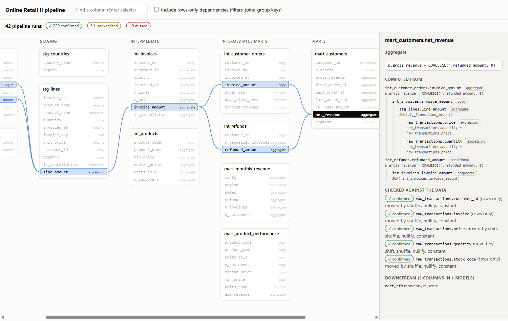
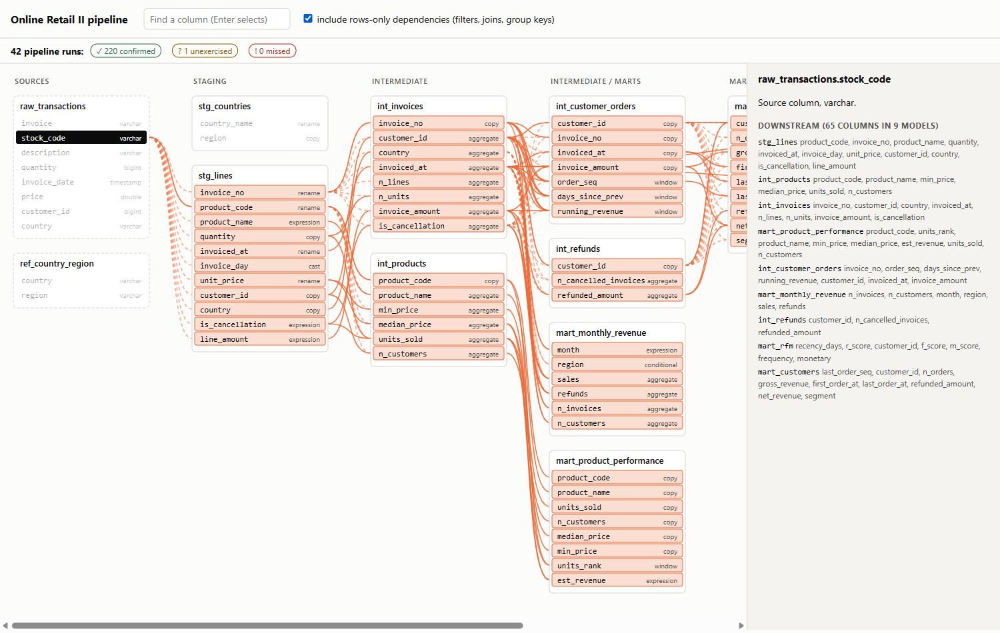

# Data Lineage Tracker

**Category:** Data Analytics
**Difficulty:** A

**Status:** Implemented (Python)

Source modules live in `src/data_lineage/`; the tests are in `tests/`.

Column-level lineage for a SQL pipeline: pick any column of any model and see which source columns its
value comes from, hop by hop, and which downstream columns change if it changes. The lineage is read
from the SQL (sqlglot), then **checked against the data**: every source column is deliberately changed,
the whole pipeline is rerun in DuckDB, and the columns that actually moved are compared with what the
static analysis claimed. The bundled pipeline is 10 SQL models over the real UCI *Online Retail II*
invoice lines (87,862 lines from 600 customers, CC BY 4.0), in staging, intermediate and mart layers.

```bash
uv run lineage build --verify               # out/lineage.html (open it) + lineage.json + verification.json
uv run lineage trace mart_rfm.monetary      # where the value comes from, hop by hop
uv run lineage impact raw_transactions.price          # everything that changes if price changes
uv run lineage trace mart_rfm.monetary --indirect     # plus the columns that only shape the rows
uv run lineage verify --source raw_transactions.price --strategy shift    # one column, one change
uv run lineage models                       # tables in dependency order
uv run lineage verify -p examples/blind_spots         # a pipeline the parser cannot fully read
uv run pytest -q
```

A pipeline is a folder: `sources.toml` names the raw files (CSV or Parquet), and every `.sql` file in a
layer folder is one model, named after its file and written as plain DuckDB SQL that refers to other
models and sources by table name. `pipeline/` is the bundled one; `-p` points the tool at another.



## What it does

1. **Static analysis** (`analyze.py`). For each model, in dependency order, sqlglot's `lineage()` gives
   the **direct** dependencies of every output column: through CTEs and subqueries, joins (including
   `USING`), unions, window functions, `FILTER` clauses and `SELECT *`. Each edge carries what happens
   on the way (`copy`, `rename`, `cast`, `expression`, `conditional`, `subquery`, `window`,
   `aggregate`) and the expression, one step per CTE or subquery crossed.
2. **Rows-only dependencies.** A column used in a `WHERE`, a join condition, `GROUP BY`, `HAVING` or
   `QUALIFY` is in no output expression but decides which rows exist, so changing it can change every
   column of the model. These are kept separate (OpenLineage calls them indirect), found by walking
   sqlglot's scopes and resolving each column through CTEs and subqueries to the real table. This also
   recovers what `lineage()` alone drops: in `(SELECT max(v) FROM u WHERE u.k = t.a)` the correlated
   key `t.a` is not in the value lineage of anything.
3. **Empirical check** (`verify.py`, `execute.py`). For each source column and each of four changes,
   the whole pipeline is rebuilt in DuckDB with that one column altered and each model column is
   fingerprinted:

   | Change     | What it does                                     | What it wakes up                                 |
   | ---------- | ------------------------------------------------ | ------------------------------------------------ |
   | `shift`    | numbers `x*3+7`, text `x\|\|'~'`, dates +11 days | arithmetic, keys                                 |
   | `shuffle`  | same values, other rows (seeded)                 | filters and joins, without inventing values      |
   | `nullify`  | every 7th row NULL                               | the fallback branch of `COALESCE`, null handling |
   | `constant` | every row gets the column's minimum              | join keys and group keys                         |

   A pair (source column, model column) is **confirmed** if the lineage links them and some change
   moved the column; **unexercised** if it links them and nothing moved it; **missed** if a change moved
   a column the lineage does *not* link to that source. Missed is the one that matters: a dependency
   the static analysis cannot see.
4. **Report** (`report.py`, `assets/`). One self-contained HTML file with no external requests: the
   layered graph, click a column to light up upstream (blue) and downstream (orange), a toggle for the
   rows-only dependencies (dashed), a search box, and the check's verdict next to every source column.



## What the data says

The pipeline has 67 model columns over 10 columns of sources: 83 direct column edges and 13 rows-only
links. Forty-two pipeline runs (two unchanged, then 10 source columns times 4 changes) take about 21
seconds on the 87,862-line sample.

**The check agrees with the lineage.** 220 pairs confirmed, 0 missed, 1 unexercised, no noise, no
failed run, and the column list the static analysis derived equals what DuckDB produced for all 10
models.

**Values and rows are different questions.** How many model columns each source column reaches:

| Source column                   | By value | Including rows-only |
| ------------------------------- | -------- | ------------------- |
| `raw_transactions.quantity`     | 18       | 18                  |
| `raw_transactions.price`        | 18       | 18                  |
| `raw_transactions.invoice`      | 16       | 46                  |
| `raw_transactions.customer_id`  | 16       | 31                  |
| `raw_transactions.invoice_date` | 13       | 18                  |
| `raw_transactions.country`      | 2        | 8                   |
| `raw_transactions.stock_code`   | 4        | 65                  |
| `raw_transactions.description`  | 3        | 3                   |

`stock_code` is copied into 4 columns, but it is also the filter that removes `POST`, `BANK CHARGES`,
`ADJUST` and the other non-product codes before anything is computed, so changing it can change 65 of
the 67. An impact analysis that only follows values would call it a low-risk column.

**Dependencies that are not obvious from reading the SQL.** `mart_customers.customer_id` depends on
*two* upstream columns, `int_customer_orders.customer_id` and `int_refunds.customer_id`, because the
`LEFT JOIN ... USING (customer_id)` makes it `COALESCE(p.customer_id, r.customer_id)`. `mart_rfm.m_score`
depends on `customer_id` as well as on revenue, because the `ORDER BY monetary, customer_id` inside
`ntile()` uses it as the tiebreak.

**The one unexercised pair is real, and harmless.** `raw_transactions.invoice_date` is linked to
`mart_customers.last_order_seq`, and no change ever moved it. `last_order_seq` is `max(order_seq)`,
the highest `row_number()` per customer, which is the number of orders. The window's
`ORDER BY invoiced_at` decides which order is number 1, never how many there are. The lineage is
right that the date appears in the expression and the value is right not to move: the check says
"the data does not exercise this", which is the correct level of claim.

**One change is not enough.** Counting the confirmed pairs by which change moved them: `shift` alone
moves 79 of 220, `shuffle` 212, `nullify` 216, `constant` 215, and 3 pairs are moved by `nullify` and
nothing else. A check with only the obvious arithmetic change would have left 141 pairs
"unexercised" and taught nothing about filters.

**What a parser blind spot looks like.** `examples/blind_spots/` has two models over one table;
`SELECT order_id, COLUMNS('_amount$') * 2 FROM orders` is one of them. sqlglot cannot expand `COLUMNS`
and says nothing: its lineage for that model is a single column called `_col_1` with no inputs.
`lineage build` warns that the model uses `COLUMNS`, and `lineage verify` finds the rest:

```text
schema mismatch: amounts_doubled: static analysis lists ['order_id', '_col_1'],
                 DuckDB produced ['order_id', 'net_amount', 'tax_amount']
! orders.net_amount -> amounts_doubled.net_amount: moved by shift, shuffle, constant, not in the lineage
! orders.tax_amount -> amounts_doubled.tax_amount: moved by shift, shuffle, constant, not in the lineage
```

and exits 1. The fully traced model next to it raises nothing.

## Design notes

**What "moved" means.** Each column is hashed twice: as the sorted list of its values (row order is
ignored), and, when the model has a column that identifies each row, as the sorted list of
`(key, value)` pairs. The second is needed for ranks and scores: `rank()`, `ntile()` and
`row_number()` are a permutation of 1..N whatever the data, so a plain hash can never see them move
(the first version of the check reported seven such pairs as unexercised). Two guards keep the second
hash honest. A key must not be a float (a float that happens to be unique is not an identifier), and
for a model whose key is itself downstream of the changed source column the aligned hash is not used,
because changing what a row is called re-pairs it with its other columns, which is not a dependency of
those columns on the source. Without that guard `ref_country_region.country` was reported as a missed
dependency of `stg_countries.region`.

**Noise is measured, not assumed.** The pipeline is run twice unchanged first, with one DuckDB thread
and insertion order preserved; any column that differs between those runs is reported and excluded.
Floats are rounded to four decimals before hashing. The bundled pipeline has none, and its window
functions all end their `ORDER BY` in a unique column on purpose.

**Absence of change is evidence, presence is proof.** If changing a column moves another, they are
connected, and the lineage had better say so. If nothing moves, the data may simply never reach that
branch: a `COALESCE` fallback when the first argument is never NULL, a filter that never rejects. So
unexercised is a report, not an error, and `verify` exits 1 only for a missed dependency or a static
column list that DuckDB disagrees with.

**Scopes, not just lineage().** sqlglot's `lineage()` is the value half. The rows-only half comes from
walking the qualified query's scopes, with one simplification: a rows-only dependency anywhere in a
model is attached to every output column of that model. That over-reports for a filter inside a CTE
that only feeds one output, and it is why the check, not the analysis, is the arbiter of whether a
given pair is real.

**The viewer is not trusted with the data.** Table, column and expression names reach the page as JSON
inside a `<script type="application/json">` block with `<`, `>`, `&` and the JavaScript line
separators escaped, and the viewer builds its DOM with `textContent` only (a test greps its source for
the HTML-injecting APIs). A column named `a</script>` is a test case.

## How it is tested

107 tests. The static analysis against 24 small queries with known answers (every role, every kind of
indirect dependency, `COLUMNS`, table functions, bad SQL). The graph (order, cycles, unknown tables,
closures). The perturbations (each strategy keeps the shape and every other column; the date shift
once silently turned a `DATE` into a `TIMESTAMP`, which a test caught). The check on tiny pipelines
whose true behaviour the test planted: a clean one, `COLUMNS`, an unexercised `COALESCE` branch and the
same branch reached when the data has NULLs, a non-deterministic column, a run that fails under a
change, a rank, a re-keyed column. The real pipeline, once. The report: self-containment, the
embedded JSON round trip, hostile names, and, when `node` is installed, the viewer's own
upstream/downstream functions compared with the Python graph for all 77 columns in both modes. The
click-through itself (drawing, the panel, the toggle) was checked by hand in a browser, not by an
automated test.

The hostile-name test failed on the first version: the escape table had been written out as no-ops, so
`</script>` in a column name would have ended the data block. That is exactly what the test is for.

## Not done

- DuckDB SQL only, plain files only: no Jinja, `ref()`, macros, or dbt project loading, and no models
  that are views, incremental, or read from another database.
- Column level only. There is no row-level provenance (which source rows produced this output value).
- Only source columns are perturbed, so an edge between two models is verified through the end-to-end
  pairs it supports, not on its own.
- The check runs on a sample (87,862 lines). Another dataset could exercise branches this one does not;
  `unexercised` is relative to the data given.
- `COLUMNS('regex')`, table functions that read files and anything else sqlglot cannot expand are
  flagged or found by the check, but not repaired: the lineage of such a model stays incomplete.
- Not a catalog: no persistence, no scheduling, no OpenLineage export.

## Where this is actually used

Column-level lineage is what data catalogs and transformation tools draw as a graph of where a
column comes from. OpenLineage is the open standard for emitting it. Its column-lineage dataset
facet maps each output column to the input fields it is derived from, and it types each
transformation as DIRECT or INDIRECT. This tool's split between value lineage and rows-only
dependencies follows that distinction. A column used only in a WHERE clause or a join condition
decides which rows exist, which OpenLineage treats as indirect.

The check against the data is the part most lineage tools skip. Static lineage read from SQL misses
dependencies that appear only at run time, such as a COALESCE fallback that is never reached or a
column that drives a join key. So this tool reruns the pipeline with each source column altered and
compares what moved with what the parser claimed. A "missed" pair is a dependency the static
analysis could not see, which is the case that breaks impact analysis.

The gap is scope. The pipeline is DuckDB SQL over plain files, with no Jinja, macros, views or dbt
project loading, and it runs on a sample. Production lineage usually reads the metadata that engines
and jobs emit while they run, across many systems, and does not rerun the pipeline to check it.

## Sources

UCI Machine Learning Repository, *Online Retail II* (Chen, 2019, CC BY 4.0), in the 600-customer
sample used by DA #13 (`sample_data/transactions_sample.parquet`). `sample_data/ref_country_region.csv`
is a hand-written country-to-region lookup for the 43 countries in the data (the only non-source
input; it is a convenience for the join, not a dataset).
