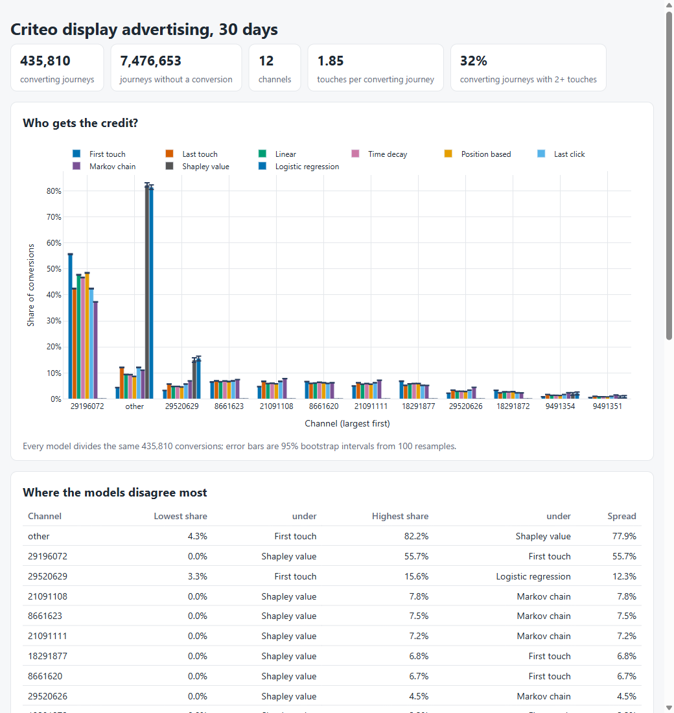

# Marketing Attribution Model Comparator

**Category:** Data Analytics
**Difficulty:** A

**Status:** Implemented (Python)

Source modules live in `src/attribution/`; the tests are in `tests/`.

Nine attribution models run on the same customer journeys, and compared two ways: how far apart they
are, and how far each is from the truth. The models: first touch, last touch, linear, time decay,
position based (40/20/40), last click, a first-order **Markov chain** (removal effect), a **Shapley value**
and a **logistic regression** counterfactual. They are run on 16.5M real ad impressions
(Criteo, 435,810 converting journeys) and in simulated worlds where each channel's real effect is known
exactly, so "which model is right" has an answer.

```bash
uv run attribute fetch                          # one-off: 623 MB Criteo download into data/ (gitignored)
uv run attribute compare criteo --draws 100     # out/report.html + results.json (about 75 s)
uv run attribute compare sim:retargeting        # a simulated world; or your own CSV of paths
uv run attribute compare paths.csv -m first_touch -m last_touch -m markov
uv run attribute simulate                       # the known-truth study: 4 scenarios x 5 seeds x 100k customers
uv run attribute models                         # list the models
uv run pytest -q                                # 61 tests (the real-data one runs when data/ exists)
```

A paths CSV has `path` (channels joined by `>`), `conversions` and optionally `nulls` (journeys that did not convert).



## What the models do

Rule-based models split one conversion across the touches of its journey, and the fractions in a journey sum
to one, so every model hands out the same total and shares are comparable. The data-driven models also use
the journeys that did *not* convert, which is where a channel's effect would show.

| Model               | Rule                                                                                                                                                                                                                         |
| ------------------- | ---------------------------------------------------------------------------------------------------------------------------------------------------------------------------------------------------------------------------- |
| first / last touch  | all credit to the first / last touch                                                                                                                                                                                         |
| linear              | equal share to every touch                                                                                                                                                                                                   |
| time decay          | credit halves for every half-life (7 days) between touch and conversion                                                                                                                                                      |
| position based      | 40% first, 40% last, 20% over the middle                                                                                                                                                                                     |
| last click          | the last click; a journey with no click falls back to its last touch                                                                                                                                                         |
| Markov chain        | journeys as a chain over START, channels, CONVERSION and NULL; a channel's credit is how much the chance of converting falls when its visits are redirected to NULL (the removal effect), scaled to the observed conversions |
| logistic regression | `converted ~ which channels the journey touched`, fitted on the distinct channel sets; credit is the conversions lost if the channel is removed from the journeys that had it                                                |
| Shapley value       | the same fitted model as a cooperative game: the value of a coalition is the conversions expected if only its channels were ever present; exact over all 2^K coalitions (K <= 12)                                            |

Everything has a slow reference or an independent check in `tests/`: each rule against a per-journey loop;
the Markov conversion probability against a Monte Carlo walk of the same chain; Shapley against brute force over
every ordering (and efficiency, `sum(phi) = v(all) - v(none)`); the logistic fit against its own score equations.

## Real data: Criteo, and what it can and cannot say

Criteo's *Attribution Modeling for Bidding* data (Diemert, Meynet, Galland and Lefortier, AdKDD 2017): 30 days of
display impressions, each carrying the conversion it led to. Licence CC BY-NC-SA 4.0, so it is downloaded
by `fetch` and never committed, and the real-data test skips when it is missing.

**Campaigns cannot be the channels.** 99.3% of converting journeys (432,951 of 435,810) involve one campaign:
Criteo records a conversion against the campaign that earned it, so first, last and linear would agree by
construction. The only dimension on which one journey meets several "places" is the nine anonymised context columns
`cat1`..`cat9`, whose meaning Criteo does not give. `cat9` is used as an opaque placement context (30 values, 11
kept and the rest pooled as `other`), chosen because 31% of converting journeys span two or more of its values. A journey is the
impressions one user saw of one campaign; it converted if they carry a `conversion_id`, and impressions of a converting pair
that did not convert are dropped as ambiguous. That gives 435,810 converting journeys, 7,476,653 that never converted
and 1.85 touches per converting journey (68% are a single touch).

| Context                     | First touch | Last touch | Linear | Time decay | Position | Markov |
| --------------------------- | ----------- | ---------- | ------ | ---------- | -------- | ------ |
| `29196072` (56% of touches) | 55.7%       | 42.4%      | 47.7%  | 46.7%      | 48.5%    | 37.3%  |
| `other`                     | 4.3%        | 12.1%      | 9.4%   | 9.3%       | 8.7%     | 11.1%  |
| `29520629`                  | 3.3%        | 5.7%       | 4.8%   | 4.8%       | 4.6%     | 7.0%   |

- **The models disagree by far more than sampling noise.** Across 100 bootstrap resamples of the journeys the 95%
  intervals are at most 0.15 percentage points wide on either side, while the dominant context ranges from 37% to 56%
  of all conversions depending on the model. Up to 16.5% of conversions move to a different channel between two
  rule-based models, and the channel ranking itself changes (Kendall tau between first touch and Markov: 0.42).
- **Last touch pushes credit onto the long tail.** `other` triples from 4.3% (first touch) to 12.1% (last touch):
  the touches that close a journey come from rarer contexts than the ones that open it.
- **Spend moves the answer too.** The report divides each channel's cost by the conversions each model credits to it,
  so the cheapest conversion is not the same channel under every model.
- **The logistic and Shapley models fail here, and say so.** They credit 4 of 12 contexts and put 81 to 82% on `other`,
  because a journey that touched the biggest contexts converts *less* often than average. That is mostly which
  campaign the user belonged to (campaign conversion rates differ widely), which the model cannot see. The report
  adds a warning whenever a model zeroes a third of the channels. Do not read these two columns as a finding about contexts.
- Nothing here says which model is right: there is no ground truth in Criteo. That is what the next section is for.

## A world with a known answer

`simulate.py` creates customers with a hidden intent; five channels (display, email, retargeting, search, social) deliver
random exposures over 30 days; the chance of converting is logistic in intent plus each exposure's
fading effect. A channel's **true incremental conversions** are the sum over customers of the chance with its exposures
minus the chance without them, holding intent fixed. The score is the share of conversions a model puts on the wrong
channel (half the L1 distance to the true share; 0 is perfect), averaged over 5 seeds of 100,000 customers:

| Scenario                                                             | First | Last touch / click | Linear | Time decay | Position | Markov | Shapley | Logistic | Best        |
| -------------------------------------------------------------------- | ----- | ------------------ | ------ | ---------- | -------- | ------ | ------- | -------- | ----------- |
| independent: channels reach people at random and all work a bit      | 6.5%  | 5.8%               | 6.1%   | 5.9%       | 6.2%     | 4.8%   | 4.9%    | 4.7%     | logistic    |
| retargeting: aimed at likely buyers, adds nothing, shown last        | 15.2% | 56.9%              | 35.3%  | 46.0%      | 30.7%    | 27.1%  | 43.5%   | 41.1%    | first touch |
| awareness: display plants the idea early, long effect                | 17.4% | 67.4%              | 37.8%  | 57.5%      | 28.4%    | 34.6%  | 45.7%   | 43.9%    | first touch |
| closing: display does nothing, search and email at the end do it all | 95.2% | 7.5%               | 51.2%  | 23.8%      | 51.1%    | 54.4%  | 14.9%   | 10.6%    | last touch  |

- **No model wins everywhere**, and the winner is the one whose assumption happens to match the world: first touch
  when the early channel matters, last touch when the closing one does. When channels reach people at random every model
  is within 6.5% and the choice hardly matters.
- **Last touch gives the retargeting channel more than half the credit in the world where retargeting does nothing.**
  The data-driven models only reduce this (27 to 44% misplaced), because they see which channels a journey touched but not
  *why* the customer was targeted. Removing that confounding needs an experiment, not a better formula.
- Time decay and position-based hedge: never best, never worst.
- These are properties of four stylised worlds, not of marketing in general; the ordering of the models is the
  lesson, not the percentages.

## Limits

- Journeys are summarised by touches in time order; no cross-device identity, no organic or direct traffic, no view-through
  versus click weighting beyond `last_click`. `clicked` and `cost` are used where the source has them.
- The Markov chain is first order. The Shapley and logistic models see presence, not order or timing, and Shapley is exact only to 12 channels.
- Bootstrap intervals resample converting journeys and redraw the (aggregated) non-converting side as Poisson counts.
- Real-data conclusions depend on the unexplained `cat9` column and on Criteo's definition of a conversion.

## Where this is actually used

Attribution models are what ad platforms report. Google Analytics lists three: data-driven, paid and organic last
click, and Google paid channels last click, and its help page says the first click, linear, time decay and
position-based models "are no longer available as of November 2023", which is the same comparison this challenge
runs. The R package ChannelAttribution (CRAN, maintained by Davide Altomare) provides a k-order Markov model and
three heuristics (first-touch, last-touch, linear); Criteo released the dataset used here with their paper on
attribution for bidding. The Shapley and logistic approaches follow the literature on algorithmic attribution.

## Layout

```text
src/attribution/
  journeys.py   converted journeys in full, the rest as counts; from_paths
  build.py      from_touches: a flat table of touches to journeys
  rules.py      first, last, linear, time decay, position based, last click
  markov.py     absorbing-chain removal effect
  logistic.py   presence regression and its counterfactual credit
  shapley.py    exact Shapley values of the fitted model's coalition game
  compare.py    run every model, shares, distances, rank agreement, bootstrap
  simulate.py   customers with known incremental effects, four scenarios
  evaluate.py   score models against that truth
  criteo.py     download, slim to Parquet, build journeys
  report.py     HTML and JSON
  cli.py        the `attribute` command
data/           Criteo files (gitignored)
```
