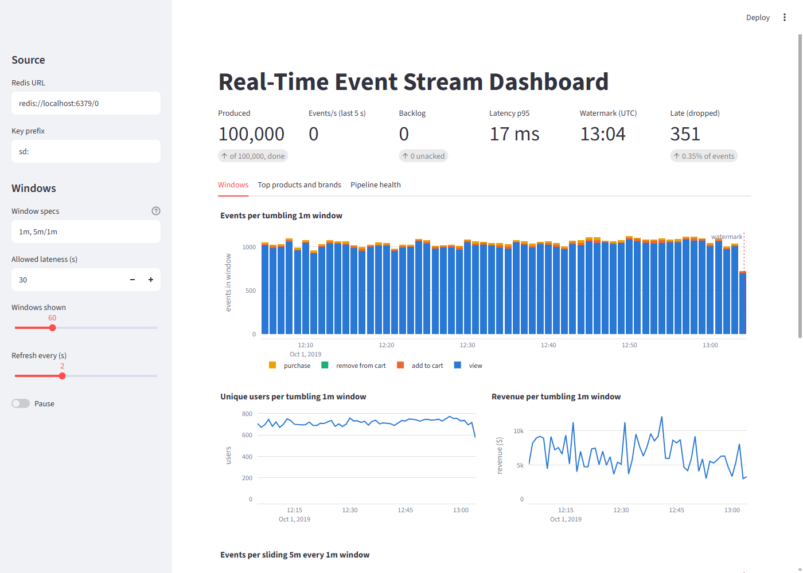
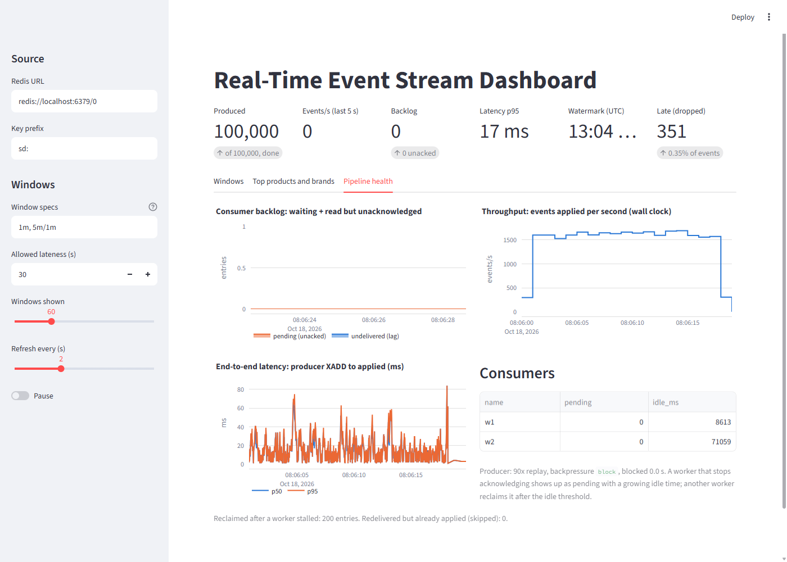
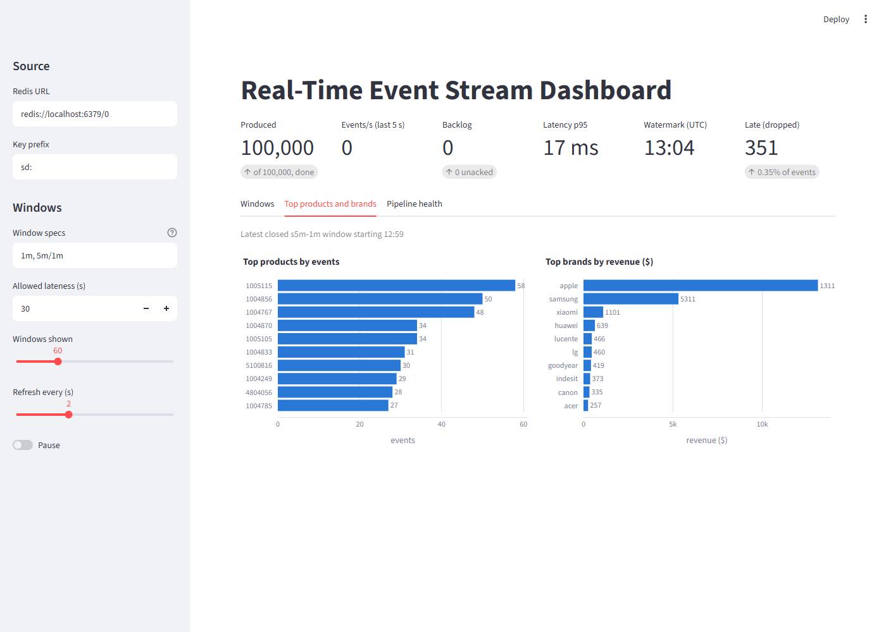

# Real-Time Event Stream Dashboard

**Category:** Data Analytics
**Difficulty:** A

**Status:** Implemented (Python)

Source modules live in `src/stream_dashboard/`; the tests are in `tests/`.

A real clickstream replayed through **Redis Streams** into a live Streamlit dashboard. A producer
writes the events at an accelerated speed, a consumer group of workers keeps event-time window
aggregates (tumbling and sliding, with a watermark and late-event handling) in Redis, and the
dashboard reads those windows plus the pipeline's own health: lag, throughput, latency, who is
holding unacknowledged work. The data is a contiguous 95-minute slice of the REES46 online store
(2019-10-01, 100,000 events from 20,714 users), so the traffic shape is real, not generated.

```bash
uv run stream-dash demo                     # producer + 2 worker processes, then verify against polars
uv run streamlit run src/stream_dashboard/app.py    # the dashboard (or: uv run stream-dash dashboard)
uv run stream-dash demo --crash             # kill worker w2 mid-run: w1 must take over its entries
uv run stream-dash verify                   # compare Redis with the offline answer
uv run stream-dash sweep                    # how many events each allowed lateness drops
uv run stream-dash produce / worker / status / reset      # the pieces on their own
uv run python -m stream_dashboard.fetch_data  # a bigger slice into data/ (24 MB, 187,050 events)
uv run pytest -q
```

It needs a Redis-compatible server on `redis://localhost:6379/0` (`--url` or `REDIS_URL`): Redis 7,
Valkey, or Memurai on Windows (`winget install Memurai.MemuraiDeveloper`). The committed
`sample_data/events.csv.gz` (3.4 MB) is the default input; `data/events_raw.csv` is used instead when
`fetch_data` has been run.



## How it works

```text
events.csv.gz --> producer --XADD--> [stream] --XREADGROUP--> worker w1 --+
  (real, time-sorted,   replay at Nx,    one group, many     worker w2 --+--> Lua script per entry:
   + injected disorder)  backpressure    consumers                           dedupe, apply, XACK
                                                                                     |
                             dashboard <-- reads window hashes, lag, telemetry <-----+
```

- **Producer** (`producer.py`) replays at `--speed` event-seconds per wall-second (`0` = as fast as
  possible). The real file is sorted, so it could never exercise a watermark: a seeded fraction of events
  is *delayed in transit* (default 5% by up to 20 s, 0.2% by up to 5 minutes). Event times stay the real
  ones; only the arrival order changes.
- **Windows** (`windows.py`, pure): epoch-aligned `[start, start+size)`. A tumbling window holds an
  event once; a sliding `5m/1m` window holds it in five windows. The watermark is
  `max event time seen - allowed lateness` and never moves back; a window is closed once its end is at or
  below it. An event is added to every window of a spec that is still open, and counted in `late` (and
  dropped) when none is.
- **Per-window results** (`engine.py`): events by type, revenue, unique users (a Redis set), top products
  (a sorted set) and top brands by revenue. The same operation lists run on Redis and, for the reference,
  on plain dicts (`MemorySink`).
- **Workers** (`worker.py`) keep no aggregate state. Everything is in Redis, so killing a worker loses
  nothing: its read-but-unacknowledged entries wait in the group's pending list until another worker
  claims them with `XAUTOCLAIM` after `--claim-idle`.
- **Exactly-once effect on at-least-once delivery** (`broker.py`). One Lua script per entry checks the
  entry id against a `done` set, applies the event's operations, raises the max-event-time register and
  `XACK`s, atomically. A redelivered entry finds its id in `done` and is only acknowledged. The script
  runs only an allow-list of four commands.
- **Backpressure**: with `--backpressure block` the producer stops while `lag + pending` is above
  `--high-water` and resumes below `--low-water`, and pauses its replay clock so it does not burst to
  catch up afterwards.
- **Dashboard** (`app.py`, `snapshot.py`, `charts.py`) reads only Redis, refreshes with `st.fragment(run_every=...)`,
  and keeps each event type in its own colour whatever else is shown. Three tabs: windows, top products
  and brands, pipeline health.



## What the runs say

All on one laptop, Memurai 7.2 on localhost, the committed sample.

**Throughput is consumer-bound, at about 4,000 events/s per worker.** One worker takes 100,000 events in
25 s with the producer blocked for 20 of them. Replayed at 90x with two workers (about 1,600 events/s) the
end-to-end latency, from the producer's `XADD` to the result being applied, stays around 12 to 17 ms at
p95.

**Backpressure turns an unbounded queue into a bounded one at no loss, for a price in producer time.**
A deliberately slow consumer (0.25 ms per entry), 20,000 events produced as fast as possible:

| Producer                      | Max backlog | Producer wall time    | Latency p50 / p95 | Applied |
| ----------------------------- | ----------- | --------------------- | ----------------- | ------- |
| `none`                        | 19,483      | 0.4 s                 | 4,937 / 9,295 ms  | 20,000  |
| `block` (2,000 high, 500 low) | 2,455       | 9.9 s (9.3 s blocked) | 808 / 1,286 ms    | 20,000  |

Both lose nothing. Without backpressure the producer is done in 0.4 s and every event then waits an
average of five seconds; with it the backlog stays within the high-water mark plus one producer batch
(2,000 + 500) and the latency of every event is six times lower, because the waiting happens before the
broker instead of inside it.

**A crash costs nothing in correctness.** `demo --crash` kills worker `w2` after it has read 400 entries
without acknowledging the last batch. Worker `w1` reclaims those 200 entries after the idle threshold, and
all 100,000 events end up in the windows exactly once: 96 of 96 tumbling and 100 of 100 sliding windows
match the polars oracle, with 0 over-counted and 0 mis-attributed.

**But a crash is also a lateness event.** The same crash with the default 30 s of allowed lateness, at
90x replay, makes the reclaimed events arrive about two wall seconds (three event-minutes) after their
neighbours, so most are past the watermark: 351 events (0.35%) were dropped as late against 151 for a
single healthy worker. Nothing is unaccounted for (the tumbling spec still holds
`events in windows + late = 100,000`), but "no data loss" and "no data dropped" are different claims,
and the allowed lateness has to cover recovery time, not just network jitter.

**How much lateness to allow.** Dropped events for the injected disorder (5% up to 20 s, 0.2% up to 5
minutes), computed by `stream-dash sweep` on one worker:

| Allowed lateness | Dropped, tumbling 1m | Dropped, sliding 5m/1m |
| ---------------- | -------------------- | ---------------------- |
| 0                | 915 (0.92%)          | 21 (0.02%)             |
| 10 s             | 361 (0.36%)          | 19 (0.02%)             |
| 20 s             | 155 (0.15%)          | 10 (0.01%)             |
| 30 s             | 151 (0.15%)          | 5 (0.01%)              |
| 1 min            | 134 (0.13%)          | 0                      |
| 2 min            | 98 (0.10%)           | 0                      |
| 5 min            | 0                    | 0                      |

The 20 s of ordinary disorder is absorbed by 20 s of lateness; after that the remaining drops are the
stragglers, and each extra minute of waiting buys little. The sliding spec drops far fewer because an
event only has to find *one* open window out of five.



## How it is checked

`oracle.py` computes what every window must contain without touching the stream or the engine: each event
is expanded into its windows with vectorised polars arithmetic and grouped. `verify` compares Redis with
it. With no late drops every window must match exactly (counts by type, revenue, unique users). With late
drops a window may legitimately hold fewer events, so the checks become conservation ones: a tumbling spec
must account for every event (in a window or in `late`), and no window may ever hold more than the oracle.

The 82 tests (`tests/`) cover the window arithmetic (a random property test of `starts_containing`),
the engine against the oracle, the Redis pipeline against both, redelivery and replay of the whole stream
(`applied 0, duplicates N`), a crashed worker, two workers sharing a stream, backpressure with and
without, the Lua allow-list, `verify` catching a corrupted window / a lost event, the CLI, a
multi-process `demo --crash`, and the Streamlit app through `AppTest`. They use a real server when
`STREAM_TEST_REDIS_URL` is set (these numbers are from Memurai 7.2.5), otherwise a `redis-server` on `PATH`
(CI installs one), and otherwise an in-process fakeredis, which skips only the tests that need a URL.

Testing found two real bugs: `lag()` raised on a stream that did not exist yet (the dashboard opened
before the producer showed an error instead of "the stream is empty"), and a fakeredis TCP server that
hangs on Windows at shutdown, which is why the fallback is in-process.

## Design notes

**Exactly-once is an effect, not a delivery guarantee.** Redis Streams deliver at least once. The
`done` set makes applying idempotent, and doing the check, the update and the `XACK` in one Lua script
removes the only window in which a crash could double-count (applied but not yet acknowledged). The cost
is one set member per event; a long-running deployment would prune `done` below the group's oldest
pending id. Telemetry (reclaimed and duplicate counters, latency) is written next to the script, not
inside it, so it can undercount after a crash; the windows cannot.

**The watermark is global and the interleaving is not.** With several workers, which stragglers count
as late depends on how batches interleave, so a multi-worker run is not byte-reproducible. A single
worker is: its result equals the in-memory `simulate` of the same arrival order, which is a test.

**Event time everywhere.** Windows are in event time; the throughput and latency charts are in wall time.
They are different clocks, and the dashboard labels each.

**One axis per chart.** Throughput and latency are two charts rather than one with two scales, and
colour follows the entity (view, add to cart, remove from cart, purchase keep their slot when a filter
changes). The four colours pass the lightness, chroma, colour-blind (worst adjacent pair, protan, 9.1) and
normal-vision checks. Two of them, aqua and yellow, are under 3:1 contrast against white, so the legend
is always shown and the chart has no table view: that is a known gap, not a pass.

## Not done

- One stream, one partition: no sharding by key, so one consumer group's throughput is the ceiling.
- Redis Streams only. A Kafka adapter would need only `Broker` swapped, but it is not written.
- Sessions and funnel conversion are not computed here (DA #9 does that on the same data); the windows
  count events, revenue and users.
- The slice has no `remove_from_cart` events, so that series is in the legend and always zero.
- The injected disorder is synthetic. The traffic is real, but its arrival order was already sorted.
- No persistence beyond Redis; no replay of results after a flush.

## Sources

REES46 Marketing Platform, "eCommerce behavior data from multi-category store", free for research and
education with attribution (Kaggle `mkechinov/ecommerce-behavior-data-from-multi-category-store`,
mirrored on Hugging Face). How the slice was cut and its SHA-256 are in `sample_data/SOURCES.json`.
