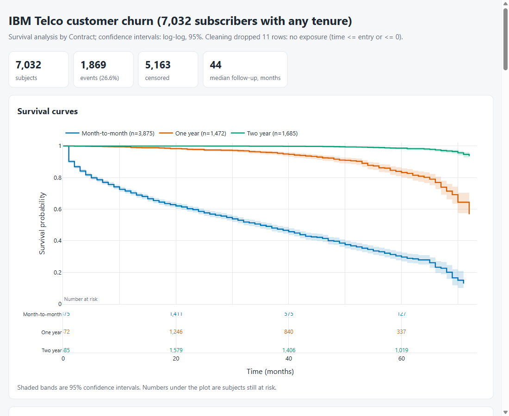

# Survival Analysis Toolkit

**Category:** Data Analytics
**Difficulty:** A

**Status:** Implemented (Python)

Source modules live in `src/survival_toolkit/`; the tests are in `tests/`.

Time-to-event analysis written from the estimators up: Kaplan-Meier curves with four confidence-interval
transforms, medians with intervals, restricted mean survival time, the weighted log-rank family,
and a Cox proportional hazards model (Efron or Breslow ties, late entry, strata, ridge penalty)
with the proportional-hazards test and Schoenfeld residuals. Everything is checked number for number against
**R's `survival` package** (R 4.6.1, survival 3.8.6), then cross-checked against lifelines and scikit-survival.
The bundled data is the IBM Telco churn table (subscriber tenure until churn), plus two clinical sets that
have published reference results.

```bash
uv run survival datasets                       # the three bundled tables
uv run survival km telco                       # curves by contract: median, S(t) at horizons, RMST
uv run survival compare telco                  # five weighted log-rank tests, pairs, RMST differences
uv run survival cox telco --strata Contract    # hazard ratios, concordance, PH test; also stratified
uv run survival report telco                   # out/survival_report.html (one file) + analysis.json
uv run survival km lung --by sex -H 365        # NCCTG lung cancer by sex
uv run survival cox gbsg                       # German breast cancer study, 8 covariates
uv run survival km my.csv --time days --event churned --event-value yes --by plan   # any file
uv run survival fetch                          # re-download the three tables (needs network)
uv run pytest -q                               # 132 tests, no R needed
```



## What it does

1. **Kaplan-Meier** (`kaplan_meier.py`). Counts at each event time with `entry < t <= time` as the risk set, so
   delayed entry works. Greenwood variance; `log-log` (default), `log`, `plain` and `arcsin` intervals;
   quantiles with R's midpoint rule when the curve sits exactly on 0.5; Brookmeyer-Crowley median
   intervals; restricted mean survival time with its standard error; Nelson-Aalen hazard.
2. **Comparing curves** (`logrank.py`). One implementation of the weighted log-rank test for K groups:
   log-rank, Gehan-Breslow-Wilcoxon, Tarone-Ware, Peto-Peto and Fleming-Harrington `fh:rho,gamma`, each
   sensitive to a different part of follow-up. Optional strata, a trend test for ordered groups,
   pairwise tests with Holm or Benjamini-Hochberg, and an RMST difference with a confidence interval.
3. **Cox regression** (`cox.py`). Newton-Raphson with step halving on standardised covariates; risk-set sums
   come from cumulative sums over sorted exit times minus later entrants, so a fit is `O(n p^2)` per
   iteration. Likelihood-ratio, Wald and score tests, Harrell's concordance (within strata), Breslow or
   Efron baseline hazard and predicted survival curves, Schoenfeld residuals, and `cox.zph`'s score test of
   proportional hazards (`km`, `rank`, `identity`, `log` time scales, per covariate and global).
4. **Design matrices** (`design.py`). Numeric and boolean columns pass through, text columns become dummies
   against a named (or the most common) reference level, rows with a missing covariate are reported, and
   collinear covariates are rejected with the redundant column named.
5. **Report** (`report.py`, `analysis.py`). Curves with bands and a risk table, group table, tests, cumulative
   hazard and log-log plots, a forest plot, PH tables and scaled-residual plots. One HTML file, plotly.js
   inlined, all labels escaped (a test feeds it a `</script>` group name).

## Data

| Dataset | Rows                          | Events                    | Source                                                             |
| ------- | ----------------------------- | ------------------------- | ------------------------------------------------------------------ |
| `telco` | 7,043 (7,032 with tenure > 0) | 1,869 churned             | IBM Telco customer churn sample dataset                            |
| `lung`  | 228                           | 165 deaths                | NCCTG advanced lung cancer, `survival::lung` (via Rdatasets)       |
| `gbsg`  | 686                           | 299 recurrences or deaths | German Breast Cancer Study Group, `survival::gbsg` (via Rdatasets) |

They are committed in `sample_data/` (`SOURCES.json` has URLs and the cleaning applied). Telco's 11
zero-tenure subscribers carry no exposure time and are dropped, and the "No internet service" level of the
add-on columns is folded into "No" because it duplicates `InternetService = No` and made the Cox design
exactly collinear.

## Checked against R

`scripts/make_reference.R` runs `survfit`, `survdiff`, `coxph`, `cox.zph` and `survfit.coxph` on the same
files and writes `tests/reference/r_survival.json` (committed, so the tests do not need R). What is asserted:

| Quantity                                                    | Cases                                                                 | Tolerance         |
| ----------------------------------------------------------- | --------------------------------------------------------------------- | ----------------- |
| KM survival, n at risk, events, Greenwood se                | lung (all, men, women), gbsg, lung with random late entry             | rel 1e-12 / 1e-10 |
| Intervals, all four transforms                              | lung, plus the other cases in log-log                                 | rel 1e-9          |
| Quartiles, median interval, RMST and its se                 | the same curves                                                       | exact / rel 1e-8  |
| `survdiff` chi-square, df, observed, expected               | 2 groups, 3 groups, `rho = 1`, strata                                 | rel 1e-9          |
| `coxph` coefficients, se, covariance, log-likelihood, score | lung (Efron, Breslow, late entry), gbsg (8 covariates, stratified)    | rel 1e-6          |
| `cox.zph` chi-square, every term and GLOBAL                 | all four time scales on lung; km/rank on gbsg; stratified; late entry | rel 1e-5          |
| `survfit(coxph)` survival for new covariates                | Efron and Breslow                                                     | rel 1e-6          |

Also tested: Klein & Moeschberger's 6-MP leukaemia KM values; a naive one-event-at-a-time Kaplan-Meier
loop on random data with heavy ties and late entry; the Gehan, Tarone-Ware, Peto and Fleming-Harrington
weights against lifelines; Cox against lifelines (Efron) and scikit-survival (both tie methods);
analytic gradient and information against finite differences; the penalised fit as a stationary point;
Schoenfeld residuals summing to zero at the optimum; and a planted hazard ratio of 3 that turns into 0.3, which
the PH test must flag. Two things differ from R by construction: lifelines stops at a coarser step size
than R (its coefficients agree to about 1e-4, not 1e-6), and `survdiff` reports weighted or per-stratum
counts for `rho` or `strata()`, so the observed/expected vectors are only compared for the plain case.

## Results

**Telco contracts** (`survival compare telco`). Retention is S(t), the share still subscribed, with
the naive reading that `tenure` is the time to churn and active subscribers are censored:

| Contract       | n     | S(12) | S(24) | S(48) | Median (months) | RMST to 60 months |
| -------------- | ----- | ----- | ----- | ----- | --------------- | ----------------- |
| Month-to-month | 3,875 | 0.703 | 0.586 | 0.397 | 35 (32 to 38)   | 33.5              |
| One year       | 1,472 | 0.991 | 0.978 | 0.917 | not reached     | 57.3              |
| Two year       | 1,685 | 1.000 | 1.000 | 0.996 | not reached     | 59.9              |

All five tests give p < 0.001 (log-rank chi-square 2,353 on 2 df; Wilcoxon 1,857, so the gap is not only
late) and every pair differs after Holm. A month-to-month subscriber is expected to be subscribed for 24 fewer
months than a one-year one within five years (95% CI 22.8 to 24.9).

**Telco Cox model** (14 covariates, `survival cox telco --strata Contract`). One-year and two-year contracts
cut the hazard to 0.19 and 0.04 of month-to-month, fibre optic raises it 3.1x, a partner 0.58x, and
tech support or online security 0.75x and 0.58x. Concordance 0.858. **The proportional-hazards assumption fails**:
global chi-square 271 on 14 df, with `MonthlyCharges` (108), `Contract[One year]` (60) and `TechSupport` (43)
worst. Stratifying by contract gives the same hazard ratios to within a few percent (fibre 2.97) but
only cuts the global statistic to 173; `MonthlyCharges` stays at 116. So the reported hazard ratios are averages
over tenure, not constants, and the report says so. Concordance falls to 0.700 when stratified because
it is then counted only within a contract type, so the two numbers are not comparable.

**An observation-window caveat.** IBM's own description of the Telco table says the churn flag marks
customers who "left within the last month" in one place and "left the company this quarter" in another. Either way
the file is a window of a customer base, so a customer who churned long ago is absent. That is late entry,
which the estimators support. Entering each subscriber at `tenure - 1` months (`--entry entry_1m`) moves
month-to-month S(12) from 0.703 to 0.001, and entering at `tenure - 3` (`--entry entry_3m`) gives 0.085, because the
risk set at tenure `t` shrinks to the customers observed at that tenure. I cannot tell from the data
which reading is right, and neither number is a trustworthy lifetime, so the reports treat the naive curves as
a description of this file and carry that warning.

**Lung cancer** (the R vignette dataset): women's median survival 426 days (345 to 524) against men's 270
(210 to 306); log-rank chi-square 10.33; `coxph(~ age + sex + ph.ecog)` gives HR 0.575 for women and 1.59
per ECOG point, concordance 0.637, and the proportional-hazards test does not reject (global p = 0.216).

**GBSG breast cancer**: grade matters (log-rank chi-square 21.1 on 2 df, trend test stronger than the
omnibus), hormonal therapy has HR 0.71 (0.55 to 0.92), and `age`, `meno`, `grade`, `pgr` and `er` violate proportional
hazards (global chi-square 22.1 on 8 df, p = 0.005). The weights disagree about how much: Wilcoxon 27.2
against Fleming-Harrington (0,1) 7.3, consistent with curves that separate early rather than late.

## Limits

- Right censoring and left truncation only: no interval censoring, competing risks (Aalen-Johansen),
  time-varying covariates, frailty or parametric models.
- No robust (sandwich) variance, so clustered data is not supported. The ridge penalty is applied to standardised
  coefficients, and the reported log-likelihood includes the penalty.
- Cox memory is `O(K p^2)` for `K` events (each event's risk-set matrix is held at once), and concordance is an
  `O(n^2)` chunked comparison; both are fine to tens of thousands of rows and not beyond.
- Exact ties handling (`exact`/discrete) is not implemented; Efron and Breslow only.

## Where this is actually used

Kaplan and Meier's product-limit estimator (1958) and Cox's partial likelihood (1972) are the standard
tools for clinical time-to-event data, which is where the lung and breast-cancer sets here come from. In
Python and R they live in R's `survival` package (Terry Therneau; its CRAN description lists Kaplan-Meier and
Aalen-Johansen curves, Cox models and accelerated failure time models), in lifelines ("a complete survival analysis
library, written in pure Python") and in scikit-survival, which puts the same models behind scikit-learn's
interface. The same machinery applies to anything with a clock and an event, such as the subscriber churn
analysed here. This toolkit is a worked, verifiable re-derivation of those pieces, not a replacement for them.

## Layout

```text
src/survival_toolkit/
  types.py         Survival (time, event, entry) and risk-set counts
  kaplan_meier.py  KM, Nelson-Aalen, quantiles, RMST
  logrank.py       weighted log-rank family, trend, pairwise, RMST difference
  cox.py           Cox model, Schoenfeld residuals, PH test, baseline, concordance
  design.py        dummy coding and complete-case filtering
  data.py          bundled datasets and generic table loading
  analysis.py      one analysis from data to numbers (CLI, report and JSON share it)
  report.py        the HTML report
  cli.py           the `survival` command
scripts/make_reference.R   regenerates tests/reference/r_survival.json
sample_data/               the three tables and SOURCES.json
```
