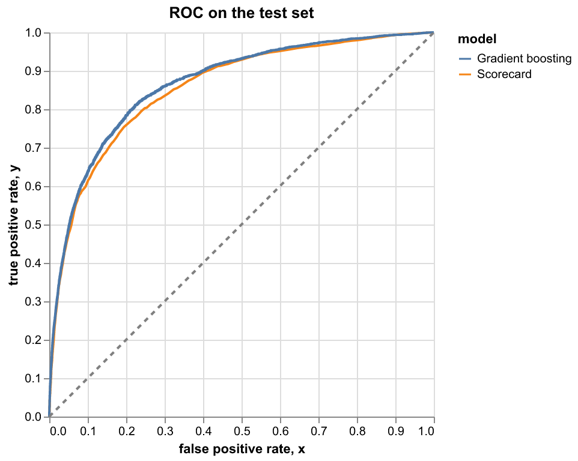
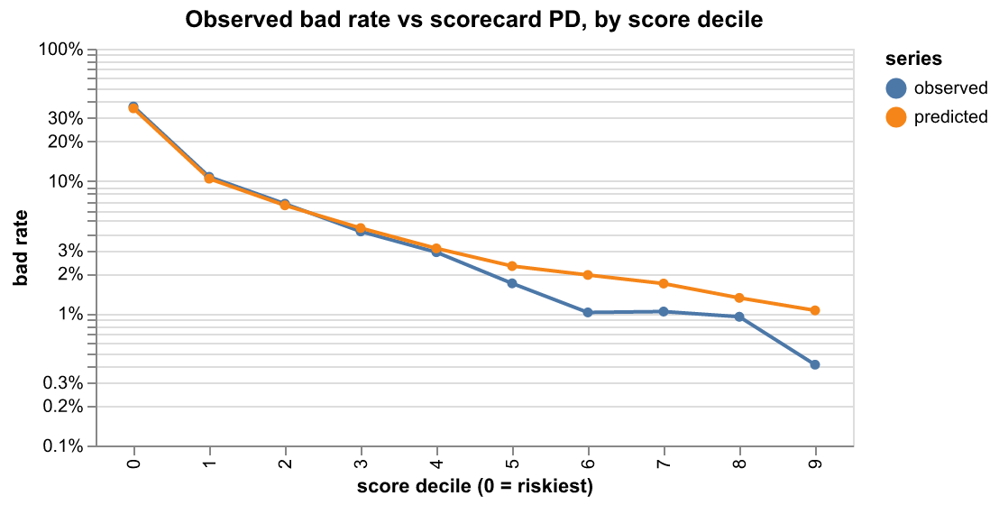
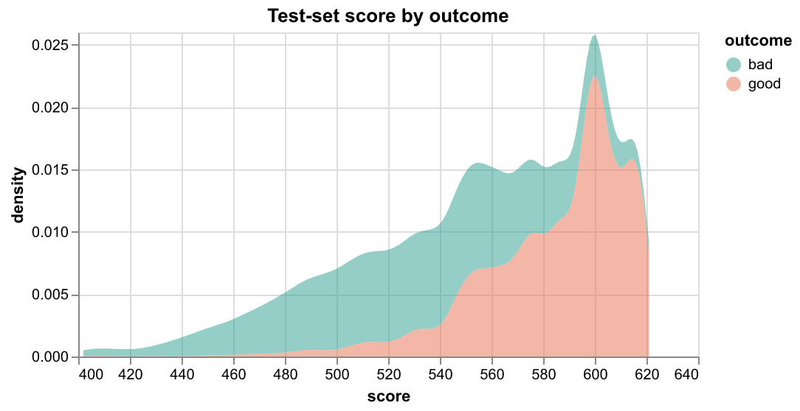
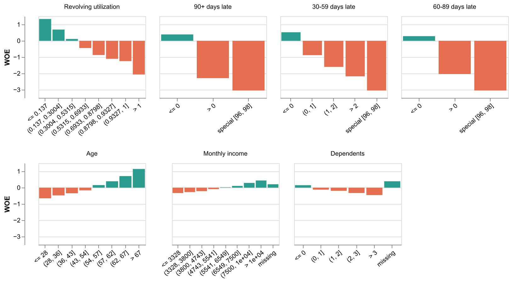

# Credit risk scorecard: results

Give Me Some Credit, 104,573 train / 44,817 test rows (stratified random split),
bad rate 6.70%.

## Discrimination (test set)

| model                       | AUC    | Gini   | KS     |
| --------------------------- | ------ | ------ | ------ |
| Scorecard                   | 0.8562 | 0.7123 | 0.5596 |
| Gradient boosting (untuned) | 0.8665 | 0.7330 | 0.5871 |

Scorecard AUC 95% bootstrap interval: [0.8493, 0.8637]. Train AUC 0.8518.

## Stability

Score PSI, train vs test: **0.0003** (below 0.1 is stable).

| feature               | PSI     |
| --------------------- | ------- |
| Revolving utilization | 0.00025 |
| 90+ days late         | 0.00001 |
| 30-59 days late       | 0.00008 |
| 60-89 days late       | 0.00001 |
| Age                   | 0.00052 |
| Monthly income        | 0.00000 |
| Dependents            | 0.00000 |

## Calibration

Mean predicted PD 6.88% against observed 6.70%; Brier 0.0503.

| band | score_min | score_max | n    | observed_bad_rate | predicted_pd |
| ---- | --------- | --------- | ---- | ----------------- | ------------ |
| 0    | 402       | 537       | 4531 | 36.55%            | 35.41%       |
| 1    | 538       | 557       | 4614 | 10.75%            | 10.41%       |
| 2    | 558       | 570       | 4359 | 6.72%             | 6.54%        |
| 3    | 571       | 581       | 4626 | 4.15%             | 4.40%        |
| 4    | 582       | 591       | 4702 | 2.89%             | 3.09%        |
| 5    | 592       | 598       | 4877 | 1.68%             | 2.27%        |
| 6    | 599       | 602       | 4143 | 1.01%             | 1.95%        |
| 7    | 603       | 607       | 4080 | 1.03%             | 1.68%        |
| 8    | 608       | 615       | 5211 | 0.94%             | 1.31%        |
| 9    | 616       | 621       | 3674 | 0.41%             | 1.05%        |

## Feature selection

| feature               | iv    | status  | reason                       |
| --------------------- | ----- | ------- | ---------------------------- |
| Revolving utilization | 1.143 | kept    |                              |
| Age                   | 0.266 | kept    |                              |
| 30-59 days late       | 0.728 | kept    |                              |
| Debt ratio            | 0.019 | dropped | IV 0.019 < 0.02              |
| Monthly income        | 0.071 | kept    |                              |
| Open credit lines     | 0.103 | dropped | negative coefficient (-0.03) |
| 90+ days late         | 0.845 | kept    |                              |
| Real-estate loans     | 0.043 | dropped | negative coefficient (-0.08) |
| 60-89 days late       | 0.565 | kept    |                              |
| Dependents            | 0.038 | kept    |                              |

## The scorecard

Base score 600 at 50:1 good:bad odds, 20 points to double the odds.

| feature               | bin              | n     | bad rate | WOE    | points |
| --------------------- | ---------------- | ----- | -------- | ------ | ------ |
| Revolving utilization | <= 0.137         | 50195 | 1.85%    | +1.335 | 105    |
| Revolving utilization | (0.137, 0.3004]  | 14640 | 3.49%    | +0.685 | 93     |
| Revolving utilization | (0.3004, 0.5315] | 12549 | 6.03%    | +0.112 | 82     |
| Revolving utilization | (0.5315, 0.6933] | 6274  | 10.04%   | -0.441 | 72     |
| Revolving utilization | (0.6933, 0.8798] | 6274  | 14.65%   | -0.871 | 64     |
| Revolving utilization | (0.8798, 0.9327] | 2092  | 17.83%   | -1.106 | 60     |
| Revolving utilization | (0.9327, 1]      | 10216 | 19.98%   | -1.246 | 57     |
| Revolving utilization | > 1              | 2333  | 36.18%   | -2.066 | 42     |
| 90+ days late         | <= 0             | 98794 | 4.64%    | +0.390 | 86     |
| 90+ days late         | > 0              | 5628  | 41.47%   | -2.289 | 46     |
| 90+ days late         | special [96, 98] | 151   | 60.26%   | -3.047 | 34     |
| 30-59 days late       | <= 0             | 87797 | 4.08%    | +0.525 | 88     |
| 30-59 days late       | (0, 1]           | 11287 | 14.75%   | -0.879 | 67     |
| 30-59 days late       | (1, 2]           | 3194  | 26.24%   | -1.600 | 57     |
| 30-59 days late       | > 2              | 2144  | 38.85%   | -2.180 | 49     |
| 30-59 days late       | special [96, 98] | 151   | 60.26%   | -3.047 | 36     |
| 60-89 days late       | <= 0             | 99301 | 5.13%    | +0.283 | 83     |
| 60-89 days late       | > 0              | 5121  | 35.50%   | -2.037 | 58     |
| 60-89 days late       | special [96, 98] | 151   | 60.26%   | -3.047 | 47     |
| Age                   | <= 28            | 4859  | 12.14%   | -0.655 | 72     |
| Age                   | (28, 36]         | 11893 | 10.35%   | -0.475 | 74     |
| Age                   | (36, 43]         | 14395 | 9.23%    | -0.348 | 76     |
| Age                   | (43, 54]         | 27863 | 7.82%    | -0.166 | 78     |
| Age                   | (54, 57]         | 7142  | 5.80%    | +0.154 | 82     |
| Age                   | (57, 62]         | 11943 | 4.63%    | +0.391 | 85     |
| Age                   | (62, 67]         | 10023 | 3.41%    | +0.708 | 89     |
| Age                   | > 67             | 16455 | 2.24%    | +1.143 | 94     |
| Monthly income        | <= 3328          | 20182 | 9.08%    | -0.330 | 78     |
| Monthly income        | (3328, 3800]     | 5204  | 8.63%    | -0.274 | 78     |
| Monthly income        | (3800, 4743]     | 9935  | 8.20%    | -0.219 | 79     |
| Monthly income        | (4743, 5541]     | 8407  | 7.30%    | -0.093 | 80     |
| Monthly income        | (5541, 6549]     | 8411  | 6.59%    | +0.018 | 80     |
| Monthly income        | (6549, 7500]     | 6918  | 6.07%    | +0.105 | 81     |
| Monthly income        | (7500, 1e+04]    | 12203 | 5.10%    | +0.290 | 82     |
| Monthly income        | > 1e+04          | 12832 | 4.43%    | +0.438 | 84     |
| Monthly income        | missing          | 20481 | 5.52%    | +0.206 | 82     |
| Dependents            | <= 0             | 60561 | 5.82%    | +0.150 | 81     |
| Dependents            | (0, 1]           | 18441 | 7.54%    | -0.127 | 79     |
| Dependents            | (1, 2]           | 13583 | 8.05%    | -0.198 | 79     |
| Dependents            | (2, 3]           | 6617  | 9.05%    | -0.327 | 78     |
| Dependents            | > 3              | 2707  | 10.16%   | -0.455 | 77     |
| Dependents            | missing          | 2664  | 4.62%    | +0.391 | 83     |

