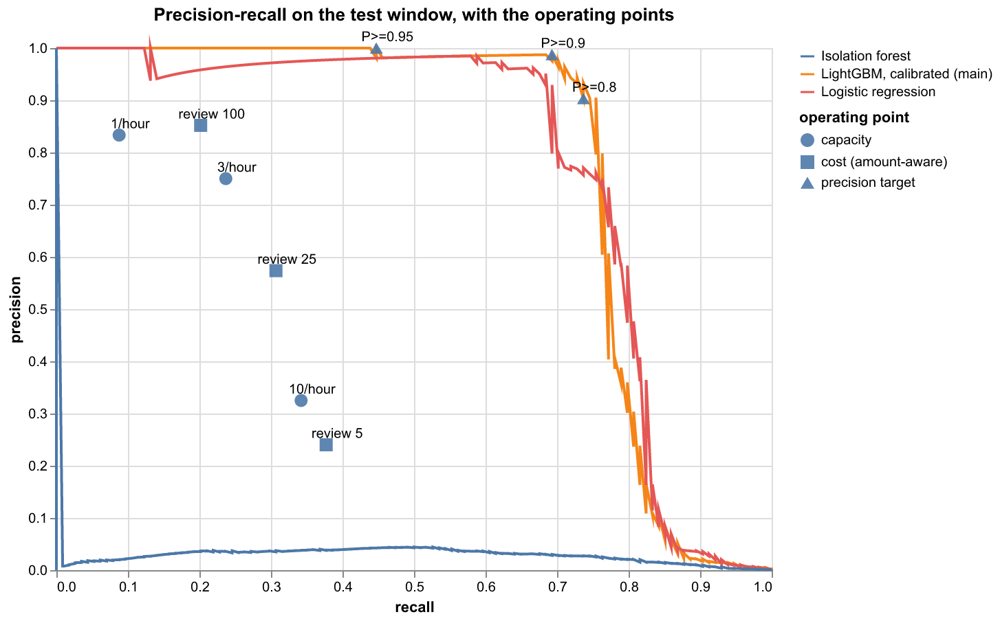
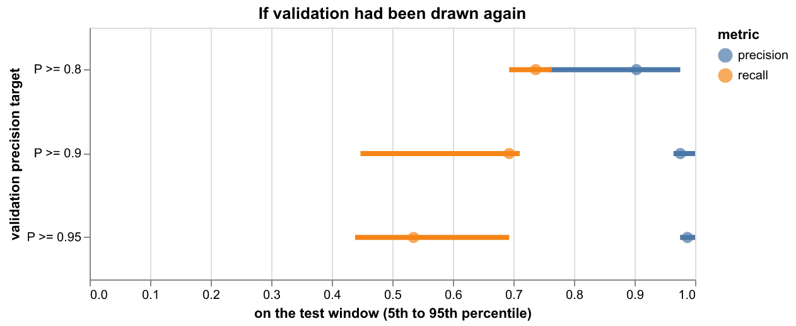
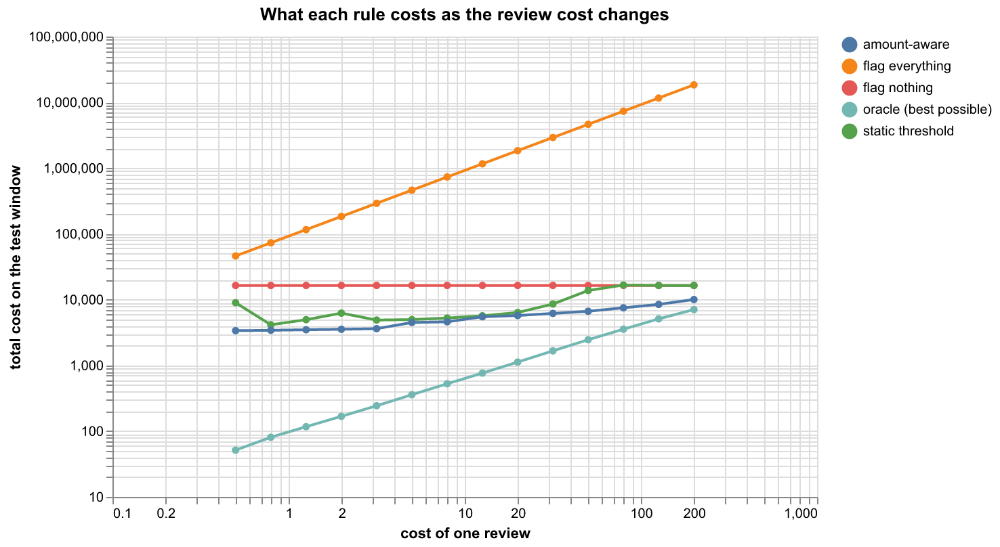

# Fraud Transaction Flagging System

**Category:** Practical ML
**Difficulty:** I (brief: "Imbalanced classification; tune the precision/recall trade-off deliberately.")

**Status:** Implemented (Python)

Source modules live in `src/fraud_flagging/`; the tests are in `tests/`; the written report, metrics and charts are in `results/`.

Fraud is 0.17% of the transactions, so accuracy is useless and "the model" is only half the system: the other half is deciding **which transactions to flag**. This challenge builds the scorer, then treats the operating point as the main design question and answers it four ways on the same scores: a fixed-precision target, a fixed-recall target, an explicit cost model, and a fixed number of analyst reviews per hour. Each is chosen on a validation window and judged on a later test window, with confidence intervals and a measurement of how much the choice would have moved had the validation window been drawn again.

```bash
uv run fraud data                                  # download (md5 and sha256 checked) and summarise the data
uv run fraud evaluate                              # models, calibration, every operating point, write results/ (about 3 minutes)
uv run fraud score --row 243848                    # one transaction of the data: risk, decisions, reasons
uv run fraud flag new.parquet --policy cost --review-cost 25 --out flagged.csv --only-flagged
uv run fraud flag new.csv --policy precision --precision 0.9
uv run fraud flag new.csv --policy capacity --per-hour 3
uv run streamlit run src/fraud_flagging/app.py     # pick a policy, see precision, recall, cost and review load
uv run pytest -q
```

`fraud flag` reads a `.csv` or `.parquet` with the columns `Time`, `V1` to `V28` and `Amount`, checks it (missing columns, non-numeric, missing or infinite values, negative amounts and times, files over 500 MB are all refused with a message), scores each row from its own fields, and prints how many it flagged. It will not overwrite `--out` without `--force`. The `precision` and `recall` policies accept the targets the evaluation tabulated (precision 0.5, 0.8, 0.9, 0.95; recall 0.6, 0.7, 0.8, 0.9); `cost` and `capacity` accept any value. Data is read as parquet with polars (never pandas) and kept in `data/`; the model is LightGBM's text format plus a JSON file (nothing is pickled).

## Data

[Credit card fraud detection](https://www.openml.org/d/1597) from the ULB Machine Learning Group (OpenML 1597; Dal Pozzolo, Caelen, Johnson and Bontempi, 2015; OpenML lists the licence as "Public"): 284,807 card transactions by European cardholders over 48 hours in September 2013, 492 of them fraud (0.173%). `V1` to `V28` are principal components of the original features, which are not published, so no feature has a meaning a person can read. `Time` is the seconds since the first transaction and `Amount` the amount (the currency is not stated, so amounts are in "currency units" and every cost below is in those units). **There is no card, merchant or customer id**, so velocity and per-card history features cannot be built and every transaction is scored on its own.

OpenML publishes no checksum. The server's ETag is the file's md5, which is checked, and the sha256 pinned in `data.py` was computed at the first download (trust on first use).

Things in the data that change the answer:

- **1,081 exact duplicate rows** (32 of them frauds), identical in every column including the time. A copy is not a second observation and would sit on both sides of a random split, so duplicates are dropped (first kept): 283,726 transactions and 473 frauds remain.
- **Only 473 frauds in 48 hours.** Any window holds about a hundred. Every number below that depends on the frauds carries that uncertainty, which is why the report has intervals.
- **Fraud is small.** The median fraud is 9.25 against 22.00 for a legitimate transaction, and amount alone ranks no better than chance (PR-AUC 0.002 against a 0.001 base rate, ROC-AUC 0.42). Amount matters for the cost, not for the score.
- **The fraud rate fell.** 0.189% of the training day, 0.184% of the validation window, 0.124% of the test window.

## Method

**Time split.** Train on hours 0 to 24, validate on 24 to 36, test on 36 to 48; nothing random.

| Window     | Transactions | Frauds | Fraud rate | Fraud amount |
| ---------- | ------------ | ------ | ---------- | ------------ |
| train      | 144,236      | 272    | 0.189%     | 32,469       |
| validation | 47,292       | 87     | 0.184%     | 9,711        |
| test       | 92,198       | 114    | 0.124%     | 16,412       |

**Features** (`features.py`): the 28 components, `log(1 + Amount)`, the cents part of the amount, a zero-amount flag, and the time of day as sin and cos (relative to the start of the data, whose clock time is not published). Each depends only on its own transaction, so scoring is stateless; a test checks that a row gets the same features alone as among others.

**Models.** An isolation forest (never sees a label), a standardised logistic regression with and without balanced class weights (the regularisation picked on validation PR-AUC), and LightGBM under four ways of handling the imbalance: no weighting, the fraud class weighted by the square root of the class ratio, by the full ratio, and undersampling the legitimate rows to 20 per fraud. LightGBM stops early on the validation window's PR-AUC. The main model is the LightGBM variant with the best validation PR-AUC, chosen on validation and not on test.

**Calibration.** Weighting and undersampling shift a model's probabilities, and the cost rule needs probabilities. Platt scaling (two numbers, fitted on validation) puts them back on the scale of the real fraud rate.

**Operating points**, each chosen on validation and judged on test:

1. *Fixed precision*: the lowest threshold whose validation precision reaches the target (the most recall at that precision).
2. *Fixed recall*: the highest threshold that reaches the target recall (the most precision).
3. *Cost*: a review costs `c`; a missed fraud costs its amount (a flagged fraud is assumed stopped in full, which makes the savings an upper bound). Two rules: a static threshold, the exact minimiser of the validation cost, and an amount-aware rule that flags when `p * amount > c`, which needs no validation threshold at all if `p` is calibrated.
4. *Capacity*: analysts can review `k` transactions per hour; flag the `k` with the highest expected loss `p * amount` each hour.

## Results (test window: 92,198 transactions, 114 frauds)

| Model                                 | Validation PR-AUC | Test PR-AUC (95% interval) | Test ROC-AUC |
| ------------------------------------- | ----------------- | -------------------------- | ------------ |
| Random                                | -                 | 0.001                      | 0.500        |
| Amount only                           | -                 | 0.002                      | 0.423        |
| Isolation forest (no labels)          | 0.192             | 0.028 (0.02 to 0.03)       | 0.937        |
| Logistic regression                   | 0.839             | 0.770 (0.69 to 0.85)       | 0.979        |
| Logistic regression, balanced weights | 0.840             | 0.771 (0.69 to 0.85)       | 0.981        |
| LightGBM, no weighting                | 0.772             | 0.768 (0.70 to 0.85)       | 0.979        |
| LightGBM, sqrt weighting              | 0.752             | 0.712 (0.63 to 0.79)       | 0.954        |
| LightGBM, balanced weighting          | 0.688             | 0.697 (0.61 to 0.78)       | 0.931        |
| **LightGBM, undersampled 20:1**       | 0.806             | **0.781 (0.70 to 0.86)**   | 0.983        |

The intervals resample the frauds and the legitimate transactions separately and treat transactions as independent, which frauds arriving in bursts is likely to make too narrow. Read the table like this:

- **There is no winner.** Logistic regression, unweighted LightGBM and undersampled LightGBM sit within 0.013 of each other with intervals about 0.15 wide. Weighting the fraud class did not help (0.71 and 0.70 against 0.77 for no weighting); undersampling did no harm. The two weighted LightGBM models also ran to near the 1,000-tree cap (best iteration 997 and 979), so they may not have converged.
- **ROC-AUC hides the difference that matters.** The isolation forest scores 0.937 ROC-AUC and 0.028 PR-AUC.
- **A strongly regularised linear model is as good as the trees.** Validation chose `C` = 0.001 for the unweighted model and the smallest value offered, 1e-5 (the grid's edge), for the balanced one; as `C` shrinks the coefficients point along the difference between the two class means, so this is close to the simplest linear scorer there is. In the rolling check below it beats LightGBM in 3 of 4 blocks. The system uses LightGBM because the validation-chosen variant is the one with a SHAP explanation and room to grow, not because it was measurably better.

**Calibration.** Platt scaling cuts the main model's test log-loss from 0.01046 to 0.00253 and Brier from 0.00143 to 0.00038 (the raw undersampled scores are far too high: transactions scored 0.20 are fraud 0.97% of the time and those scored 0.64 are fraud 5.9% of the time). After scaling the bins sit near the diagonal, with some over-prediction in the middle (64 transactions predicted 0.21 were fraud 14% of the time).

### The precision/recall trade-off



The curve has a cliff, not a slope. The best precision available is 98.8% at 50% recall, 97.6% at 70%, 90.5% at 75%, 30.4% at 80%, 11.0% at 83% and 8.5% at 85%. About 70% of the frauds are caught almost perfectly and the rest are, as far as this model can tell, indistinguishable from legitimate transactions: at the precision-0.9 point the 35 missed frauds have a median score of 0.005. The decision that matters is therefore *where on that cliff to stop*.

**Fixed precision** (threshold from validation, shown on test; 95% intervals):

| Target | Threshold | Validation precision / recall | Test precision          | Test recall            | Flagged | Fraud amount caught |
| ------ | --------- | ----------------------------- | ----------------------- | ---------------------- | ------- | ------------------- |
| 0.5    | 0.0663    | 50.0% / 81.6%                 | 43.1% (38.5% to 48.4%)  | 77.2% (69.3% to 85.1%) | 204     | 12,157              |
| 0.8    | 0.3205    | 80.0% / 78.2%                 | 90.3% (84.2% to 95.6%)  | 73.7% (65.8% to 81.6%) | 93      | 11,907              |
| 0.9    | 0.5889    | 90.8% / 67.8%                 | 98.8% (95.9% to 100.0%) | 69.3% (60.5% to 78.1%) | 80      | 10,579              |
| 0.95   | 0.8832    | 95.6% / 49.4%                 | 100.0% (100% to 100%)   | 44.7% (36.0% to 53.5%) | 51      | 7,642               |

Test precision lands above the target for 0.8 to 0.95 and below it for 0.5. I did not separate the causes. Two likely ones: the threshold is the deepest point that cleared the bar on only 87 validation frauds, and the top of the test ranking happens to be very clean; and the test fraud rate is lower than validation's, which would hurt the low-precision end first.

**Fixed recall:**

| Target | Threshold | Test precision | Test recall | Flagged | Alerts per 10,000 |
| ------ | --------- | -------------- | ----------- | ------- | ----------------- |
| 0.6    | 0.7873    | 98.6%          | 61.4%       | 71      | 7.7               |
| 0.7    | 0.5266    | 97.5%          | 69.3%       | 81      | 8.8               |
| 0.8    | 0.1866    | 84.3%          | 75.4%       | 102     | 11.1              |
| 0.9    | 0.0040    | 7.3%           | 85.1%       | 1,331   | 144.4             |

Going from 70% to 90% recall costs 16 times the alerts for a fall in precision from 97% to 7%, and a recall target of 0.9 set on validation delivered 85.1% on test.

**How firmly a threshold is known.** Resampling the validation window and re-picking the threshold for a precision target, then applying it to the test window:



| Precision target | Threshold, 5th to 95th percentile | Test precision | Test recall    |
| ---------------- | --------------------------------- | -------------- | -------------- |
| 0.8              | 0.157 to 0.513                    | 75.7% to 97.6% | 69.3% to 76.3% |
| 0.9              | 0.434 to 0.883                    | 96.4% to 100%  | 44.7% to 71.1% |
| 0.95             | 0.527 to 0.890                    | 97.5% to 100%  | 43.9% to 69.3% |

With about 90 validation frauds the threshold itself is nearly unpinned (0.43 to 0.88 for the same target), but what it costs is mostly recall (45% to 71%), because precision at the top of the ranking is high wherever the threshold lands. A team that sets a threshold once on a day of data should expect its recall to be a range.

**Cost** (a review costs `c`, a missed fraud costs its amount; test window, total cost; lower is better):



| c   | Flag nothing | Flag everything | Static threshold (flagged) | Amount-aware (flagged) | Oracle | Amount-aware, 95% interval |
| --- | ------------ | --------------- | -------------------------- | ---------------------- | ------ | -------------------------- |
| 1   | 16,412       | 92,198          | 4,503 (1,741)              | 3,440 (602)            | 99     | 1,292 to 6,562             |
| 5   | 16,412       | 460,990         | 4,970 (93)                 | 4,484 (179)            | 357    | 2,012 to 7,649             |
| 25  | 16,412       | 2,304,950       | 8,089 (71)                 | 5,916 (61)             | 1,356  | 3,196 to 9,561             |
| 100 | 16,412       | 9,219,800       | 16,752 (5)                 | 8,009 (27)             | 4,259  | 5,214 to 11,580            |

The oracle flags exactly the frauds worth more than a review, so it is the floor. The amount-aware rule beats the static threshold at every `c` and beats doing nothing at every `c`, with the interval below 16,412 throughout. The static threshold's weakness is that it is picked on validation: at `c` = 100 its best validation threshold flagged 5 test transactions and ended up costing more than flagging nothing (16,752). The amount-aware rule uses the calibrated probability and the amount directly, so there is no threshold to mis-pick. The two rules also pick *different* transactions. At `c` = 5 the static threshold flagged 93 transactions with a median amount of 2.0 and a median probability of 0.90 (precision 90%); the amount-aware rule flagged 179 with a median amount of 470 and a median probability of 0.025 (precision 24%). That is why the amount-aware points sit well below the precision-recall curve above: they spend reviews on large amounts at low probability, which the curve does not reward.

**Review capacity** (`k` reviews per hour, highest expected loss first; the test window has 12 hours):

| Per hour | Flagged | Frauds caught | Precision | Recall | Fraud amount caught (of 16,412) |
| -------- | ------- | ------------- | --------- | ------ | ------------------------------- |
| 1        | 12      | 10            | 83.3%     | 8.8%   | 6,152                           |
| 3        | 36      | 27            | 75.0%     | 23.7%  | 11,263                          |
| 10       | 120     | 39            | 32.5%     | 34.2%  | 12,314                          |

Three reviews an hour catch 69% of the fraud *amount* while seeing 24% of the fraud *count*; ten an hour add 6 points of amount for 84 more alerts. By amount, capacity is the most efficient way to spend a small review budget.

### Other checks

- **Rolling origin.** Training on everything before each 6-hour block and scoring the block gives LightGBM PR-AUC of 0.860, 0.725, 0.821 and 0.762 against logistic regression's 0.893, 0.762, 0.823 and 0.744 (60, 27, 62 and 52 frauds). The swing between blocks (0.73 to 0.86) is as large as any gap between models.
- **Feature groups** (drop one and refit; test PR-AUC): without the 28 components 0.004 (everything is in them), without the amount features 0.784 (+0.003), without time of day 0.773 (-0.008). V14 alone carries 66% of the main model's gain; V4, V10 and V12 follow. The components cannot be named, so these say where the signal is, not what it is.
- **Drift.** The population stability index from train to test is 0.22 for V4 (moderate), below 0.08 for V10, V12, V14 and V17, and 0.003 for the amount.
- **What it misses.** At the precision-0.9 point 79 test frauds are caught and 35 are not. A missed fraud has a median score of 0.005. One of them, a 1,096.99 transaction (row 249239), was scored 0.01%:

```text
$ uv run fraud score --row 249239
row 249239: amount 1096.99 at hour 42.9, 0.01% chance of fraud (it was fraud)
  precision  pass
  recall     pass
  cost       pass
  largest contributions (log-odds; V1..V28 are anonymised components):
    +0.79  V7
    -0.49  V14
    ...
```

The three highest-scored frauds in the test window are all exactly 1.00. The highest-scored legitimate transaction is a 2.00 at 88%, and the second is the largest amount in the whole file (25,691.16) at 55%, which is the kind of false alarm a cost-aware rule would still choose to review.

## Caveats

- **Two days, 473 frauds.** The test window has 114. Intervals are wide, treat transactions as independent, and do not capture the validation draw or the choice of split; a different cut at 36 hours would give different numbers.
- **The validation window does four jobs**: early stopping, choosing the main model, fitting the calibrator and choosing thresholds. Validation numbers are therefore optimistic (logistic regression's 0.839 against 0.770 on test), and the selection of the main model among near-ties is close to arbitrary.
- **Labels are assumed to be instant.** Real fraud labels arrive days or weeks later (chargebacks), so the model would be trained on stale labels and the newest fraud would be unlabelled.
- **Anonymised features and no entity.** Nothing about a card's history is available, which is where much of real-world fraud detection gets its signal. This is a 2013 European dataset.
- **The costs are illustrative.** The currency is unknown, the review cost is swept rather than known, and a flagged fraud is assumed stopped in full; real losses also include friction for false alarms (the code takes a `friction` parameter; the tables use 0).
- **Single seed, small grids.** One training seed per model and no search beyond early stopping and the logistic regularisation grid.

## Where this is actually used

**Cost-based thresholds.** Elkan (IJCAI 2001) gives the cost-sensitive decision rule: with
calibrated probabilities, the right action depends on the cost ratio, not on a fixed 0.5. The
`cost` policy here is that rule with a missed fraud costed at its amount, so a flag is worth a
review only when the expected loss of letting it through exceeds the review cost.

**Calibration after resampling.** Undersampling or class weighting shifts a classifier's
probabilities. Dal Pozzolo et al. (2015) study that shift on card-transaction data and propose a
correction that uses the undersampling ratio. Platt scaling (Platt, 1999), a two-parameter sigmoid
fitted on held-out scores, is the simpler fix this project uses, fitted on validation only.

**An unsupervised baseline.** The isolation forest is Liu, Ting and Zhou (ICDM 2008). It isolates
points with random splits and scores each point by how few splits it needs. It never sees a label,
so it shows whether the supervised models learn more than outliers.

**Which metric.** Saito and Rehmsmeier (PLOS ONE, 2015) argue that precision-recall plots are more
informative than ROC plots on strongly imbalanced data. That is why the data section compares
PR-AUC against the base rate, and why the operating points are reported as precision and recall.

**Gap.** Production card-fraud scoring runs in real time over many signals, including activity
across merchants and time windows. This build scores a two-day snapshot of 28 anonymized components
plus amount and time, so it cannot show those effects.

## Layout

`data.py` (download, checks, duplicates), `features.py` (the three feature groups, input validation), `models.py` (split, models, imbalance strategies, Platt scaling, saving), `evaluate.py` (metrics, threshold rules, cost, capacity, bootstrap and stability), `pipeline.py` (the experiment), `policy.py` (scoring and the four policies), `report.py` (report and charts), `cli.py`, `app.py`. Tests run offline on a synthetic table in the published schema (`tests/helpers.py`), never the 70 MB download.
