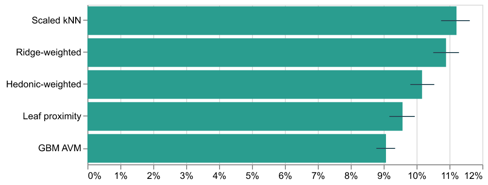
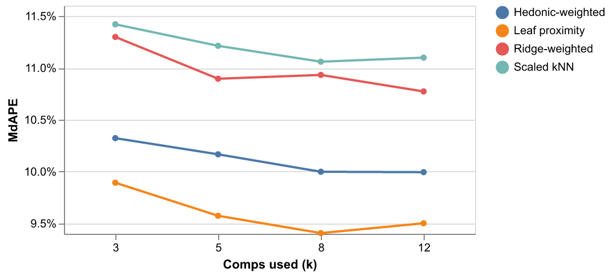

# Real Estate Comparable Listings Finder

**Category:** Practical ML
**Difficulty:** I (brief: "Nearest-neighbor search over engineered property features.")

**Status:** Implemented (Python)

Source modules live in `src/comp_finder/`; the tests are in `tests/`; the written report, metrics and charts are in `results/`.

Given a property and a sale date, find the earlier sales that make the best comparable listings, adjust each comp's price the way an appraiser would, and combine them into an estimate. The question the challenge answers is *what should "similar" mean?* Three definitions are built and measured on the same real sales, against a plain gradient-boosting valuation that uses no comps at all:

1. **Scaled kNN**: standardised features, Euclidean distance.
2. **Hedonic-weighted distance**: the same distance with each feature scaled by how much it moves price in a gradient-boosting hedonic model (mean absolute SHAP value). A ridge-coefficient version is kept as an ablation.
3. **GBM leaf proximity**: two sales are alike when the boosted trees put them in the same leaves. Proximity is the share of trees (weighted by how much each tree moves the prediction) where they share a leaf. This is the random-forest proximity idea applied to a boosted model; trees as adaptive nearest-neighbour weights are discussed in [Enhanced Local Explainability and Trust Scores with Random Forest Proximities](https://arxiv.org/pdf/2310.12428) and [Case-based Explainability for Random Forest](https://arxiv.org/pdf/2408.06679). It is not the full GAP weighting (which also divides by leaf size), and no paper I found uses it for comp retrieval, so treat it as this challenge's own design.

```bash
uv run comps data                                  # fetch and summarise the sales table
uv run comps evaluate                              # tune on validation, score the test window, write results/
uv run comps find --sale-id 7891600245             # comps for a test-window sale, with the reasons for each
uv run comps find --sale-id 7891600245 --method knn --k 8 --bracket --json
uv run comps find --property '{"lat": 47.68, "long": -122.35, "sqft_living": 1800, "sqft_lot": 4500, "bedrooms": 3, "bathrooms": 2, "floors": 1.5, "grade": 8, "condition": 3}'
uv run streamlit run src/comp_finder/app.py        # map, comps table, per-comp explanations
uv run pytest -q
```

`--property` needs `lat`, `long`, `sqft_living`, `sqft_lot`, `bedrooms`, `bathrooms`, `floors`, `grade`, `condition`. Optional fields (`waterfront`, `view`, `sqft_basement`, `yr_renovated`, `yr_built`, `sqft_living15`, `sqft_lot15`, `zipcode`) default to 0 / the median year built / the property's own size / the zip of the nearest sale. `--date` defaults to the day after the last sale and may not be earlier than the last sale. Data is read as parquet with polars (never pandas) and cached in `data/` on first use. Charts are Altair, exported to PNG with `vl-convert`.

## Data

[King County house sales](https://www.openml.org/d/42092) (OpenML 42092, the public-domain Kaggle copy of King County's records, CC0): 21,613 sales from 2014-05-02 to 2015-05-27, 70 zip codes, with price, living and lot size, bedrooms, bathrooms, floors, view, waterfront, condition, grade, year built/renovated, latitude/longitude and `sqft_living15`/`sqft_lot15` (the neighbours' living and lot size).

Things in the data that change the answer, and what is done about them:

- **Repeat sales.** 177 sales are a property's second (176) or third (1) sale in the year. A house's own earlier sale is a near-perfect comp that an appraiser rarely has, so the headline evaluation uses first sales only and the resales are analysed separately.
- **Outliers.** One row has 33 bedrooms on 1,620 sq ft. Rows are never edited; every feature is winsorised at the 0.1 and 99.9 percentiles of the fit window. Prices are not trimmed, so the 11 sales over $4M are scored like any other.
- **Zip code vs latitude/longitude.** Similarity uses kilometres east/north of downtown Seattle computed from latitude/longitude (checked against haversine in the tests). Zip codes enter only the linear hedonic model, as location controls. A zip-code feature for the pure GBM is measured below.
- **Attributes as of today, not as of the sale.** 6 rows list a renovation after the sale year and 12 a build year after it. They are left as they are.
- **No sale date inside a day.** Same-day sales are never comps of each other.

## Method

**Features.** Fifteen columns: east/north km, log living area, log lot, bedrooms, bathrooms, floors, basement flag, grade, condition, view, waterfront, effective year (later of built and renovated), and the neighbours' log living and lot size.

**Protocol.** Sales are sorted by date and split by time: fit on sales before 2015-01-01 (14,633), tune on January-February 2015 (2,228), report on 2015-03-01 onward (4,752 sales, 4,654 of them first sales). Everything fitted (scaler, winsorising limits, linear hedonic model, market index, GBM, similarity weights) sees only the fit rows. Validation chooses two settings (index extrapolation and mean vs median combination); then everything is refit on fit plus validation and the test window is scored once with those settings frozen.

**The one rule.** A subject's comps are drawn only from sales *strictly earlier* than its sale date. With the table sorted by date that is a prefix, so no later row is ever scored. The pool grows with time (a March subject can use February sales); `pool="fit"` freezes it to the fit window for comparison.

**Estimate.** For subject `s` and comp `c`:

```text
adjusted_c = price_c * exp(index[month_s] - index[month_c])      market time
                     * exp(sum_f beta_f * (z_s,f - z_c,f))       per-attribute adjustments
```

`index` and `beta` come from one ridge-solved linear hedonic model, `log price ~ attributes + location controls + zip + month`. Location is a control and never an adjustment: a distant comp is a worse comp, not one that needs a dollar figure for its address. Months after the fit window are extrapolated (flat or the trend of the last six months). The estimate is the geometric mean or median of the five adjusted comps. Gross adjustment (sum of absolute line items) is reported per comp.

**Explanations.** Each comp's similarity is split over the features in the same units and with the same total: for the Euclidean measures `(weight * difference)^2` per feature (sums to the squared distance); for leaf proximity each shared leaf passes its tree's weight to the features on its decision path (sums to the proximity). A reason is a feature where the comp is closer than a random earlier sale would be, worded from raw table values ("1,730 sq ft living area (subject 1,860, -7%)"). Everything is recomputed on demand, never stored.

## Results

Test window, 4,654 first sales, k = 5, adjusted comps. Validation picked a flat market index and the geometric mean. Intervals are 95% bootstrap over subjects (1,000 resamples).

| Method                               | MdAPE | 95% CI         | Within 10% | Within 20% | Median bias |
| ------------------------------------ | ----: | -------------- | ---------: | ---------: | ----------: |
| Scaled kNN                           | 11.2% | [10.7%, 11.6%] |      45.4% |      72.5% |       -3.3% |
| Ridge-weighted distance              | 10.9% | [10.5%, 11.3%] |      46.4% |      73.7% |       -3.3% |
| Hedonic-weighted distance (GBM SHAP) | 10.2% | [9.8%, 10.5%]  |      49.3% |      77.4% |       -3.8% |
| GBM leaf proximity                   |  9.6% | [9.2%, 9.9%]   |      51.7% |      79.8% |       -3.7% |
| GBM AVM (no comps)                   |  9.1% | [8.8%, 9.3%]   |      54.3% |      82.4% |       -4.2% |



Paired bootstrap on the same subjects (first minus second; negative MdAPE means the first is better):

| Pair                               | MdAPE difference (pts) | 95% CI         |
| ---------------------------------- | ---------------------: | -------------- |
| Hedonic-weighted vs scaled kNN     |                  -1.05 | [-1.46, -0.58] |
| Leaf proximity vs scaled kNN       |                  -1.64 | [-2.11, -1.20] |
| Leaf proximity vs hedonic-weighted |                  -0.59 | [-0.98, -0.25] |
| Leaf proximity vs GBM AVM          |                  +0.50 | [+0.16, +0.83] |

What the numbers say:

- **"Similar" should be learned from price, and the tree model does it best.** Weighting features by what moves price takes the median comp from 3.9 km away (35% in the same zip) to 1.7 km (56%). Leaf proximity picks comps about as near (1.9 km, 55%) but more accurate ones. Both steps (kNN to hedonic-weighted, hedonic-weighted to leaf) are paired improvements whose interval excludes zero.
- **Comps do not beat the plain model.** The GBM valuation with no comps is 0.5 points better than the best comps method. Letting the GBM price every difference between a comp and the subject (instead of the linear grid) lands at 9.1 to 9.3% for every similarity definition, i.e. at the AVM: once the model does the adjusting, the choice of comps barely matters.
- **Adjustments help, market time most.** Rolling comps to the subject's month takes 0.5 to 0.7 points off every method, and the linear attribute grid takes a further 0.0 to 0.3:

| Method                  |  none | + market time | + attributes | GBM-adjusted |
| ----------------------- | ----: | ------------: | -----------: | -----------: |
| Scaled kNN              | 12.1% |         11.5% |        11.2% |         9.3% |
| Ridge-weighted distance | 11.5% |         11.0% |        10.9% |         9.1% |
| Hedonic-weighted        | 10.9% |         10.2% |        10.2% |         9.2% |
| Leaf proximity          | 10.5% |          9.9% |         9.6% |         9.1% |

- **More comps help only a little.** From k = 3 to k = 8 MdAPE falls by 0.3 to 0.5 points, and k = 12 moves it by at most 0.2 points either way (leaf: 9.9, 9.6, 9.4, 9.5%).
- **Error is highest in the urban core and where the market moved.** Median error against distance from downtown: under 8 km (769 sales) 11.7% for leaf proximity and 11.2% for the AVM; 8-20 km (2,085) 10.8% and 10.1%; over 20 km (1,800) 7.4% and 7.3%. The AVM has the lowest MdAPE in every band and every price third (thirds by its own estimate).
- **The market moved after the fit window and the flat index missed it.** The fitted index rises 3.8 log points from May 2014 to February 2015, 2.1 of them in February. Under the flat extrapolation the AVM's median error by test month is -2.7% (March), -5.1% (April), -6.2% (May). Extrapolating the trend of the last six months instead was not chosen on validation (the four validation settings differ by under 0.0003 in mean MdAPE, which is noise), but on the test window it gives AVM 8.8%, leaf 9.4%, hedonic 9.9%, kNN 11.1%. Reported for information; the headline keeps the setting validation chose.
- **Fresher sales help the comps a little.** Restricting the pool to the fit window costs 0.1 to 0.2 points (kNN 11.4 vs 11.2%, hedonic 10.4 vs 10.2%, leaf 9.7 vs 9.6%).
- **Bracketing.** Plain top-5 comps already include a better and a worse property than the subject for 74% (leaf) to 78% (kNN) of subjects. Swapping in a better or worse comp to force it raises that to 95-97% without changing accuracy (11.2 to 11.2%, 10.2 to 10.2%, 9.6 to 9.5%).
- **Zip code.** Adding zip as a categorical to the GBM takes its MdAPE from 9.1% to 8.9% (no interval computed for this 0.2-point gap).
- **A house's own earlier sale is a poor anchor.** Across the 177 resales the later price is a median 54% above the earlier one and differs by more than 10% for 80% of them, at the same listed attributes (id 123039336: $148,000 on 2014-06-11, $244,900 on 2014-12-08, both 620 sq ft). The table does not say why. On the 98 test-window resales the AVM's MdAPE is 18.2%; kNN is 14.2% when the property's own earlier sale is excluded and 17.7% when it is allowed, leaf proximity 18.1% and 18.5%. With n = 98 those are indicative only.
- **Speed.** Finding and adjusting comps takes 0.7 ms per subject for the distance measures and 4.0 ms for leaf proximity (brute force over up to 21,000 earlier sales, one process on CPU). No approximate-nearest-neighbour index or accelerator is used: at this size none is needed, and none was benchmarked.



The full tables (adjustments, k sweep, comp quality, pool, extrapolation, bracketing, segments, resales, market index) are in `results/report.md`, the raw numbers in `results/metrics.json`.

## Tests

`uv run pytest -q` runs 99 tests (about 90 seconds; the first run downloads the dataset and runs the whole experiment once). The ones that matter most:

- **Date rule.** Every comp of every method (and both pools) was sold strictly before the subject, same-day sales and the subject's own earlier sale are excluded, and a future copy of the subject with an absurd price never reaches an estimate. A companion test switches the date rule off and checks that the copy then does get picked, so the test is known to be able to fail.
- **Fit-window isolation.** Multiplying every price and living area after the fit window and refitting leaves the scaler, hedonic coefficients, market index, SHAP weights, tree weights and GBM predictions identical; a model fit on 300 more rows is shown to differ, so the equality is a real constraint. A subject's estimate is unchanged by its own price and by every later price.
- **Explanations are checkable.** Distances and proximities add up to the sum of their per-feature parts, copying the subject's value of a feature into a comp lowers the distance by exactly that feature's share, every reason sentence is compared with the raw table values, the price grid reproduces the adjusted price from first principles, and on synthetic prices that ignore bedrooms, floors, condition and the basement the leaf attribution gives them under 8% of the credit.
- **The experiment.** Ranking of the three definitions, the validation grid's pick, the paired interval for leaf vs kNN, the segment counts, the report files, and the Streamlit app driven headlessly.

## Caveats

- One metropolitan area over 13 months, and a market that moved: the test window is three months after the fit window. Conclusions about which similarity is best are for this data; the size of the gaps is not a general constant.
- k = 5 was fixed in advance (appraisal practice); only the index extrapolation and the combination rule were tuned, on validation, where the choices were not distinguishable.
- Appraisal "adjustments" here come from a linear model with no interactions. The GBM-adjusted variant shows how much that costs (comps at 9.1 to 9.3% vs 9.6 to 11.2%).
- Prices are recorded sale prices; there is no information about condition at sale beyond the listed grade and condition scores, and the data cannot say why a resold house changed price.
- Leaf proximity compares trees fit on a time-adjusted log price; its similarity depends on that model and its seed (`seed: 0`, deterministic mode). Exact digits can differ slightly across platforms.

CI downloads the dataset from OpenML on the first test run; no other special setup is needed.

## Where this is actually used

**The sales comparison approach is an appraisal method.** Appraisers pick recent sales similar to
the subject property and adjust each price for differences in size, condition and location. The IAAO
Standard on Automated Valuation Models (2018) describes automated versions of that process, and the
adjustment in this challenge's method is a linear, automated form of the same step.

**Leaf co-membership has a random-forest origin.** Random-forest proximity, a measure usually
credited to Breiman, counts how often two cases share a leaf across trees. This challenge applies
the same counting to a boosted model, which the README treats as its own design rather than a
published method.

**Where the gap is.** Commercial valuation models draw on far more sales, property records and
market-time data than a single county extract. The comp list is best read as an explanation for a
person, with the model carrying the estimate.
