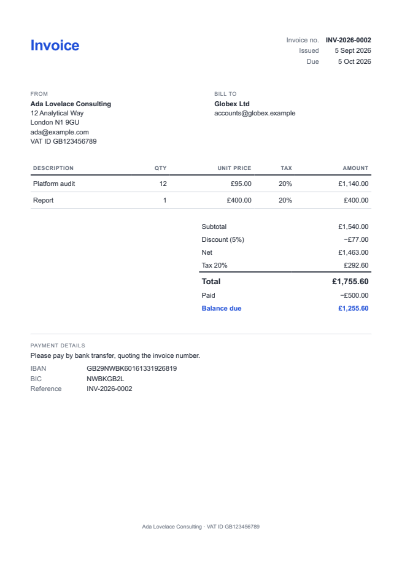
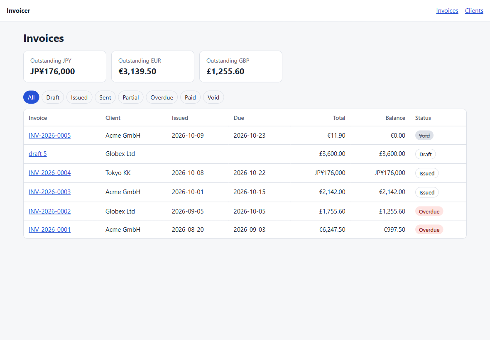
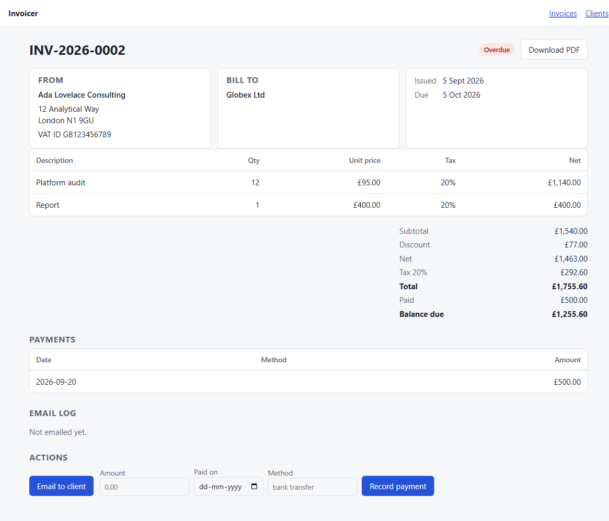

# Automatic Invoice Generator & PDF Emailer for Freelancers

**Category:** Practical Software
**Difficulty:** Intermediate
**Status:** Implemented (Python)

Source modules live in `src/invoicer/`; the tests are in `tests/`.

`invoicer` turns a client and some line items into a numbered invoice, renders it as a **PDF/A-3b with an embedded Factur-X e-invoice**, emails it over SMTP, and tracks what happened afterwards: sent, failed, partly paid, overdue, reminded. It has a CLI for daily use and a small local web UI.





## Quick start

```bash
cd "challenges/Practical Software/Automatic Invoice Generator & PDF Emailer for Freelancers"
uv run invoicer init                  # writes invoicer.toml and the database
uv run invoicer config-check          # tells you what would stop PDFs or email working

uv run invoicer client add "Acme GmbH" --email ap@acme.example --country DE --currency EUR
uv run invoicer invoice new --client acme --item "Design | 10 | 85.00 | 19" --discount 10% --issue
uv run invoicer invoice send INV-2026-0001            # dry run: shows what would be sent
uv run invoicer invoice send INV-2026-0001 --send     # really sends it
uv run invoicer invoice pay INV-2026-0001 500 --method bank
uv run invoicer remind --send         # one email per overdue invoice per reminder stage
uv run invoicer serve                 # web UI on http://127.0.0.1:8000
```

| Command                                                   | What it does                                                                                                                           |
| --------------------------------------------------------- | -------------------------------------------------------------------------------------------------------------------------------------- |
| `client add\|list\|edit\|rm`                              | The client book. A client with invoices is archived, not deleted.                                                                      |
| `invoice new`                                             | A draft from `--item "description \| qty \| price \| tax%"` (repeatable) and/or `--file job.toml\|json`; `--issue` numbers it at once. |
| `invoice issue\|pdf\|send\|pay\|void\|delete\|show\|list` | The life of an invoice; `list` and `show` take `--json`.                                                                               |
| `recurring add\|list\|run\|stop`                          | Invoices that repeat weekly, monthly, quarterly or yearly.                                                                             |
| `remind [--send]`                                         | Reminder emails for overdue invoices.                                                                                                  |
| `summary`                                                 | What is outstanding per currency, and how much of it is overdue.                                                                       |
| `serve`                                                   | The web UI (loopback only).                                                                                                            |

Money is written the way you would write it (`85.00`, `10%`); more decimals than the currency has, or a negative amount, is an error rather than a silent rounding.

## Money is exact

Amounts are integer minor units (cents), looked up per currency from ISO 4217 through `babel`, so yen have no decimals and dinar have three. Quantities are integers in ten-thousandths and tax rates are integers in basis points, so no float ever touches an amount. The rules, spelled out in `calc.py` so they can be audited:

- a line's net is `quantity x unit price` rounded half-up to the minor unit (Python's own `round()` would round 2.5 to 2);
- an invoice-level discount, percentage or fixed, is spread over the lines in proportion to their nets with largest-remainder allocation, so the shares add up to the discount exactly;
- tax is computed **once per rate on the sum of the discounted nets of that rate**, not per line. That is how the VAT breakdown on an e-invoice is defined, and it avoids per-line rounding drift: three 0.33 lines at 20 % give 0.20 tax, not 0.21.

Prices and payments are capped at 10^13 whole units and quantities at 10^8. Beyond about 28 digits Python's `Decimal` silently rounds, and SQLite integers overflow at 2^63, so the limits are refused with a clear message, and the arithmetic runs at 60 digits so the largest allowed invoice is still exact. Randomised tests check the identities (`subtotal - discount = net`, `net + tax = total`, shares sum to the discount) over hundreds of generated invoices.

## Numbering and immutability

A draft has no number. **Issuing assigns the next one and freezes the invoice.** Numbers come from a format in the config (`INV-{year}-{seq:04d}`), and the sequence restarts whenever the rest of the number changes (new year, or new month if the format has `{month}`). The counter update, the number and the status change commit in one transaction, so a failure leaves no gap; voiding keeps the number used. Only `{year}`, `{month}` and one `{seq}` are accepted in the format, since `str.format` on arbitrary templates can reach object attributes.

An issued invoice stores a **snapshot of the seller and the buyer** as they were at issue time. Renaming a client or changing your address later does not alter an invoice already sent: the PDF, the e-invoice XML and the email text all read the snapshot. No code path edits an issued invoice's lines or amounts; to correct one, void it and issue another.

State changes are race-safe, and the tests prove it with threads and by mutation (removing the fix makes them fail):

- two sessions that both loaded a draft cannot both issue it, and the loser does not burn a number;
- four concurrent payments of 60 against a 100 invoice record exactly one;
- 12 concurrent issuers get 12 distinct, gap-free numbers.

SQLite's write lock is taken with a no-op `UPDATE` before each check-then-write, and the row is reloaded.

## Statuses and payments

Stored status is only `draft`, `issued` or `void`. Everything else is **derived** from the payments, the due date and the email log: `paid`, `overdue` (even if partly paid), `partial`, `sent`. Overpayments are refused, an invoice with payments cannot be voided, and a zero-value invoice is paid immediately. The web UI and CLI show the same status.

## PDF/A-3b with Factur-X

The invoice is an HTML template (Jinja2) rendered by WeasyPrint to PDF/A-3b. For an issued invoice the `factur-x` library then builds a **Factur-X BASIC WL** XML (header, parties, VAT breakdown, document-level allowances, totals, payment means), validates it against the **official XSD**, and embeds it with the associated-file and XMP metadata PDF/A-3 requires. Accounting software that reads Factur-X/ZUGFeRD can import the invoice without OCR; a person just sees a normal PDF.

What is and is not verified:

- **PDF/A-3b compliance: verified with veraPDF 1.30.3**, the industry reference validator: the generated invoice passes 146 rules with 0 failures. A control test confirms the validator does reject a plain WeasyPrint PDF, so the pass means something. The test runs wherever `verapdf` and `java` are installed (`tests/test_verapdf.py`) and is skipped elsewhere, including CI.
- **Factur-X XSD: verified on every generated XML**, in the code (a structural error raises) and in tests, for several tax rates, a discount, a zero-decimal currency, a part payment and Unicode names.
- **Factur-X business rules (Schematron): not run.** That needs a Saxon server. The XML is schema-valid, but do not assume it passes every national rule; a real deployment should validate with the Mustang project or your accounting software. BASIC WL has no invoice lines, only totals and the VAT breakdown.
- BASIC WL requires a non-empty delivery section; the XSD check caught this in development, and the buyer is stated as the delivery party rather than inventing a delivery date.

Drafts get a plain PDF (no number or frozen parties yet), as does `--no-facturx`.

### Rendering is safe by construction

- Templates run in Jinja's **sandbox with autoescaping**: a client called `<script>` or `{{ 7*7 }}` appears as text, and a user template in `template_dir` cannot reach Python internals. Undefined variables in a template are errors, not blanks.
- WeasyPrint may only load `data:` URLs (`URLFetcher(allowed_protocols=("data",), allow_redirects=False)`). Without that, an `` in a template or field would read local files, or call internal services, while the PDF is built. The logo is embedded as a data URI, capped at 2 MB, and checked to be an image.

WeasyPrint needs the Pango libraries, which pip cannot install on Windows. On Linux install `libpango-1.0-0`; on macOS `brew install pango`; on Windows install MSYS2 (`scoop install msys2`, then `pacman -S mingw-w64-ucrt-x86_64-pango`), which `invoicer` finds on its own, or set `WEASYPRINT_DLL_DIRECTORIES`. `config-check` reports it. The CI workflow installs the Pango runtime for challenges that depend on WeasyPrint.

## Email and tracking

`invoice send` is a **dry run unless `--send` is given**: it builds the message and shows the recipient, subject and attachment size, and nothing leaves the machine. With `--send`:

- the message is a plain-text body plus the PDF, with a Message-ID; subject and body templates are sandboxed;
- **every real attempt has one `EmailLog` row**: `pending` while in flight, then `sent` or `failed` with the error, the number of attempts and the Message-ID. Dry runs are not logged, because nothing happened;
- transient failures (connection trouble, 4xx replies) are retried with exponential backoff; permanent ones (5xx, a refused recipient, a bad login) are not;
- a failure is recorded, not raised: it exits non-zero, shows in `invoice show` and the web UI, and is retried by the next run, because only `sent` rows count as delivered;
- **an invoice already sent needs `--resend`**, and the `pending` row is committed *before* the slow SMTP conversation, so a double-clicked button or two overlapping `remind` runs cannot send the same message twice. A claim older than 15 minutes is treated as abandoned by a crashed process, and Ctrl-C marks its own claim failed.

Mail transport follows the conservative defaults: STARTTLS (or implicit TLS) with **certificates and host names always verified** (`ca_file` adds a private CA; there is no switch to turn verification off), no silent fallback to plaintext when STARTTLS is missing, and the password read from the environment (`password_env`), never from argv or the config file and never written to the log. Recipients are validated narrowly (no quoting, comments, groups or route syntax) and checked with `email.utils.parseaddr`, so `a(b@c.co` or `grp:evil@x.co` cannot turn into a different recipient. Delivery tracking means what SMTP can tell you: **accepted by the server**. A bounce that arrives later is not seen.

Tests run against an in-process `aiosmtpd` server (so no test sends real mail), including STARTTLS with a throwaway CA, login, refusals, scripted 4xx/5xx replies and concurrent sends.

## Reminders and recurring invoices

`remind` looks at overdue invoices (balance > 0, past due) and the config's `days_after_due = [7, 14, 30]`. Each invoice gets **at most one reminder per stage**, and only the highest stage reached is sent, so a long silence produces one email, not three. A failed reminder is retried. Paid and void invoices are skipped; a partly paid invoice that is overdue is reminded for the balance.

`recurring run` creates and issues every invoice that is due on or before today and is safe to run daily from cron: each definition's `next_date` moves forward in the same transaction as the invoice, so a second run creates nothing. Month arithmetic is calendar-safe and remembers the anchor day, so a schedule on the 31st goes Jan 31, Feb 28, Mar 31 (not drifting to the 28th). After a long gap at most 12 invoices per definition are created per run. `--auto-send` plus `recurring run --send` emails them as they appear.

## Web UI

`invoicer serve` starts a small Litestar + HTMX app: invoices with outstanding totals per currency and a status filter, the invoice page with lines, totals, payments, the email log and buttons (issue, email, record payment, void, download PDF), and the client book.



It has **no login**, so `serve` refuses to bind to anything but loopback (`--host 0.0.0.0` is an error, with a pointer to a reverse proxy or SSH tunnel). Within that model:

- every template is autoescaped and there is no `|safe`; the page loads nothing from a third party (htmx 2.0.4 is vendored, byte-identical to the jsDelivr build), with a strict CSP (`default-src 'self'`, no inline script or style, `frame-ancestors 'none'`), `nosniff`, `no-referrer` and `no-store` on every response, error pages included;
- **CSRF**: a token on every POST (cookie plus header or form field), an HttpOnly cookie, and a same-origin check, because cookies are shared across localhost ports and a page on another port is the realistic attacker for a local tool;
- **DNS rebinding**: the Host header must be `localhost`, `127.0.0.1` or `[::1]`;
- refused actions come back as a readable message (409) and failed sends as 502, never a traceback, and buttons disable while a request is in flight.

## Configuration

`invoicer init` writes a commented `invoicer.toml`: your business details, the number format, SMTP settings, reminder stages, locale and whether to embed Factur-X. `INVOICER_HOME` moves the config, database and generated PDFs elsewhere. Your own `invoice.html` in `template_dir` replaces the built-in template.

## Security review

The first version was reviewed by an independent read-only pass. It found no High issues, and these were fixed with regression tests (`tests/test_hardening.py`), each confirmed to fail without its fix:

- two races (double issue, a duplicate real email on a double submit) and the unlocked payment check;
- the CSRF cookie readable from another localhost port, plus a cross-origin POST with a valid token;
- an over-permissive email regex, amounts that lost precision or overflowed SQLite, mail text that could disagree with the PDF, and a client with a recurring invoice that crashed on delete.

Two real bugs were found by the author's own tests: a `LIKE` wildcard in client-name matching (`%` matched everything), and SQLAlchemy not ordering deletes by foreign key.

## Layout

| File                                                    | Role                                               |
| ------------------------------------------------------- | -------------------------------------------------- |
| `money.py`, `calc.py`                                   | Exact money and the totals rules.                  |
| `models.py`, `db.py`, `service.py`                      | Tables, SQLite sessions, and every business rule.  |
| `render.py`, `facturx_xml.py`, `templates/invoice.html` | HTML to PDF/A-3b, and the Factur-X XML.            |
| `mailer.py`                                             | Message building, SMTP, retries, the delivery log. |
| `config.py`, `paths.py`                                 | `invoicer.toml` and where files live.              |
| `cli.py`, `present.py`                                  | The Cyclopts command line and plain-data views.    |
| `web.py`, `templates/web/`, `static/`                   | The Litestar + HTMX UI.                            |

## Performance

Measured on this machine (Windows 11, Python 3.14), median of several runs:

| Operation                                              | Time    |
| ------------------------------------------------------ | ------- |
| Render a 1-line invoice, plain PDF                     | 116 ms  |
| Render a 1-line invoice, PDF/A-3b + Factur-X           | 127 ms  |
| Render a 100-line invoice, PDF/A-3b + Factur-X (54 KB) | 313 ms  |
| Build and XSD-validate the Factur-X XML                | 2 ms    |
| Totals for 100 lines                                   | 0.27 ms |
| Create and issue 200 invoices                          | 0.18 s  |

Rendering is dominated by WeasyPrint; the Factur-X step adds about 10 ms.

## Tests

```bash
uv run pytest -q
```

264 tests: money and totals (including randomised identities), every service rule (numbering across years and formats, concurrency, payments, statuses, recurring calendars, reminder stages), configuration validation (including format-string injection attempts), rendering (escaping, sandbox, blocked resources, the logo), the Factur-X data and XSD, the mailer against a real SMTP server, the CLI end to end, 23 web tests (XSS, CSRF, host and CSP headers, the send flow), and a hardening suite. `tests/test_verapdf.py` (2 of the 264) validates PDF/A-3b with veraPDF when Java and veraPDF are installed and skips otherwise.

## Stack

Python 3.14 (3.12+), `uv`, SQLModel 0.0.48 over SQLite (WAL, foreign keys on), Pydantic 2, Jinja2, WeasyPrint 70, `factur-x` 7, `babel`, Cyclopts, Litestar with HTMX 2.0.4, `smtplib`, and `aiosmtpd`, pypdfium2 and `cryptography` (the throwaway test CA) for tests. The web layer uses Litestar, a newer framework than the FastAPI of earlier challenges, because the stack was chosen for being modern.

## Limits

- Factur-X is the BASIC WL profile only (no per-line detail), and its Schematron business rules are not checked; see above.
- One seller, one tax regime: tax rates are per line, with no reverse-charge or exemption reason codes, and prices are net of tax.
- No credit notes: void and reissue.
- No login on the web UI, by design; it is loopback-only.
- Email tracking ends at "accepted by the server": no bounce handling, no read receipts.
- `mailer.deliver` sleeps between retries inside the request thread, so a failing send in the web UI can take a few seconds to answer.
