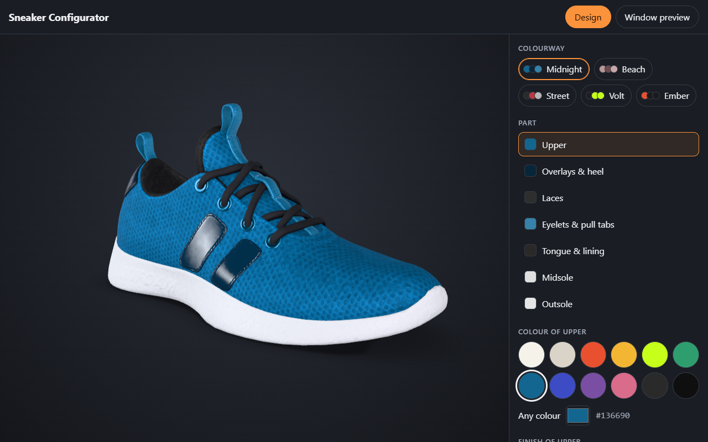
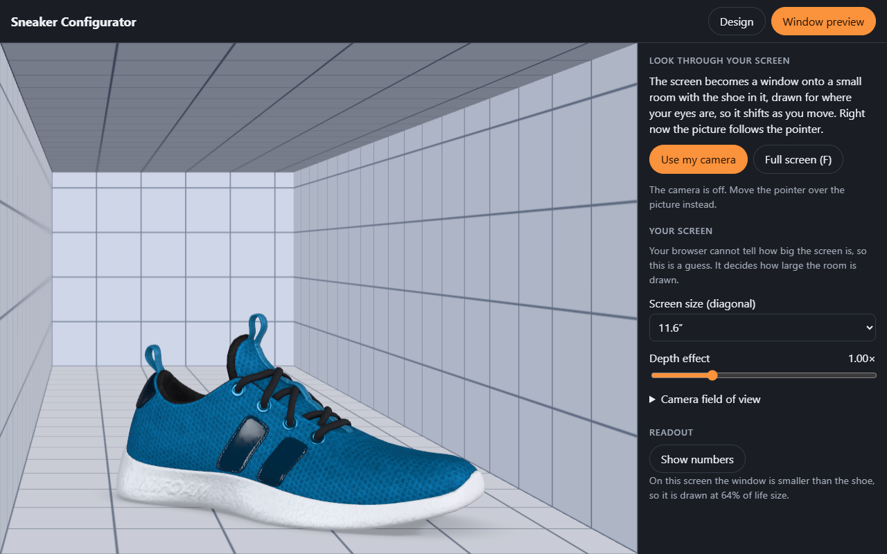
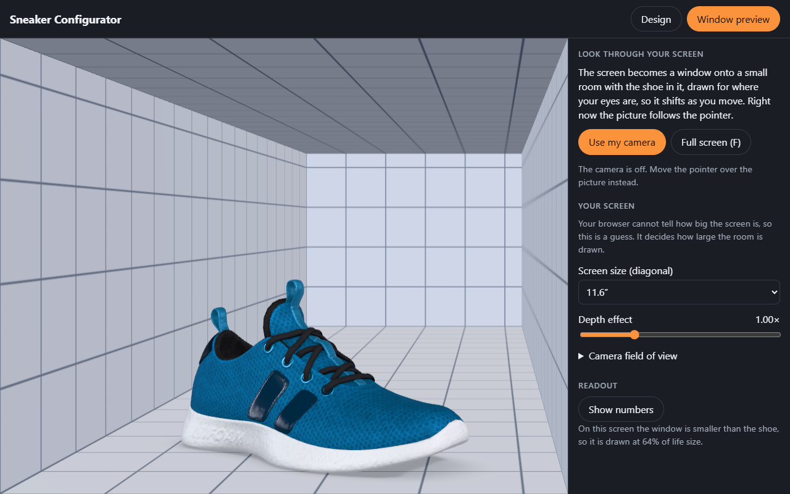
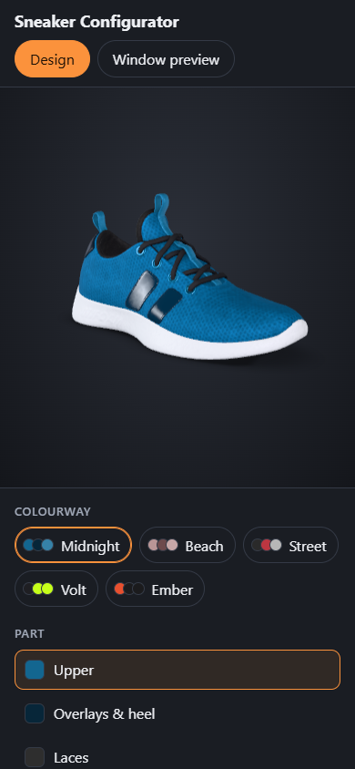

# 3D Product Configurator

**Category:** Web Development Showcase
**Difficulty:** A

**Status:** Implemented (TypeScript, Svelte 5)

A sneaker you can recolour part by part in 3D, and a second view that turns your screen into a window:
a small room with the shoe standing in it, drawn for where your eyes are, so the picture shifts as you
move your head and the shoe sits behind the glass. The webcam is optional (the pointer works too), runs
a face model in the page, and nothing it sees leaves your machine.








## Where this is actually used

The window preview is head-coupled perspective: the picture is drawn for where the eye is, so a flat
screen reads as a window onto a room. The construction is the off-axis frustum in Robert Kooima's
"Generalized Perspective Projection", which is written for projection-based VR displays and does not
assume the viewer sits centred in front of the screen. The page rebuilds that frustum every frame from
the eye position and the canvas rectangle.

- **Head-tracked VR displays.** Projection-based VR rigs compute one off-axis frustum per eye from the
  tracked head and the physical screen corners. Here the screen is a laptop canvas, and the eye position
  comes from a webcam instead of a headset tracker.
- **Face tracking in the browser.** The head position comes from MediaPipe's face model, which returns
  478 3D landmarks; the last ten are the irises. The page uses the iris spacing to measure pupil distance
  through a pinhole camera model. A production tracker would add camera calibration, sensor fusion and
  far more failure handling than this one.
- **Smoothing noisy input.** The head position is smoothed with the 1 euro filter (Casiez, Roussel and
  Vogel, CHI 2012), a low-pass filter whose cutoff rises with speed. That keeps the room still when the
  head is still and lets it follow fast movement without much lag.

The gap is scale and robustness rather than the maths. Real head-tracked displays use calibrated
hardware, measured screen geometry and per-user calibration. This page guesses the field of view and
screen size and lets the user correct them with a slider, because a wrong guess only changes how strong
the depth effect looks.

## Run it

Built and tested with Node v26.11.1 and pnpm 11.5.0 (the `packageManager` field pins it). The browser
tests drive an installed Chrome or Edge; set `CHROME_PATH` if it is not in a standard location.

```bash
pnpm install
pnpm run dev            # Vite on :5173
pnpm run build && pnpm run preview
pnpm test               # unit tests (vitest): the maths, the model file, the design state
pnpm run test:e2e       # builds, then drives real Chrome: both drawing paths, a fake webcam, axe
pnpm run typecheck      # svelte-check on the native TypeScript 7
pnpm run bench          # sizes, start-up, frames per second, the face model's cost
pnpm run assets         # rebuilds public/models from the Khronos sample (needs network once)
pnpm run screenshots    # rewrites docs/*.png
```

With `CI=true` the browser tests run as a GPU-less CI runner does (`--disable-gpu`, so the page takes its WebGL 2 path in software, and every result printed as it finishes); `E2E_CHROME_ARGS` adds Chrome flags.

Add `?renderer=webgl` to force the WebGL 2 path, `?mode=window` to open the window preview. The
camera needs `https` or `localhost`, and only starts when you press **Use my camera**.

## What it does

- **Design:** seven parts (upper, overlays and heel, laces, eyelets and pull tabs, tongue and lining,
  midsole, outsole), each with its own colour (twelve swatches or any colour) and finish (matte, satin,
  gloss, patent). Five colourways: the model's three own (Midnight, Beach, Street) and two new. Drag to
  turn, wheel or pinch to zoom, arrow keys and plus/minus from the keyboard. The design is remembered.
- **Window preview:** the shoe at life size (29.8 cm) standing in a grid-walled room as deep as a
  forearm. The room's near edges are the edges of the canvas, so the glass is exact from every eye. Without a camera the pointer
  stands in for your head. With one, a small preview shows what the face model sees, with its landmarks
  drawn over it and a red "Camera on" bar with a Stop button. Full screen (F) makes the canvas the whole
  screen, which is where the effect is most accurate. **Show numbers** adds a readout.
- **Drawing:** WebGPU where the browser has it, WebGL 2 where it does not, one code path (three.js's
  `WebGPURenderer` does both). The picture is drawn only when something changes in the design view, and
  every frame in the window preview.

## How it works

### One mesh becomes seven parts (`scripts/prepare-shoe.ts`)

The model is Khronos's `MaterialsVariantsShoe` sample: one mesh, three whole-texture variants. To
colour it part by part it had to be taken apart, and the parts are not named in the file. What it does
have is 83 connected pieces of surface (UV islands), and each sits on one flat region of the colour
texture. So the script finds the pieces, samples the texture under each, and groups them: the knit
upper, the straps and heel patch, the laces, the eyelets and pull tabs (the same pale blue), the
lining and tongue, the midsole and the outsole. It drew every piece in a colour of its own, from four
sides, to check the grouping by eye, and then pinned it: the group of each piece is a table in the
script, and the script refuses to run on a file whose hash or piece count differs.

Recolouring cannot just tint the colour texture (the pink knit would stay pink under blue). The script
replaces the three colour textures by one grey **detail map**: for each piece, every texel divided by
that piece's own average brightness, averaged over the three variants. At run time a part's colour is
one multiplier on that map, so the weave, stitching and shading survive any colour, and the three
original colourways come out of the model as the average colour each part had in each texture. The
shoe is metres, on `y = 0`, centred, so it can stand in a room at life size. Output: 1.2 MB (WebP
textures at 2048 and 1024 pixels, meshopt geometry), and a picture of the shoe's shadow on the floor
(sole footprint sharp, whole shoe soft and weaker the higher a part is) so there is no shadow map to tune.

### The window preview

The picture on a screen belongs to one eye. For a screen that is a window onto a scene behind it, the
right picture is the one whose view frustum has the screen rectangle at its near end: a frustum that is
lopsided whenever the eye is off to one side (Kooima, "Generalized Perspective Projection"). `offaxis.ts`
builds it, and one fact falls out of the maths that the tests pin down: **a point on the glass lands in
the same place from every eye**, so the window frame never swims; only what is behind it moves, and
the further back, the more.

Two details that took finding. The camera has to be an `OffAxisCamera` that makes its own projection in
`updateProjectionMatrix`: the WebGPU renderer calls that method itself whenever its depth convention
differs from the camera's, and an ordinary camera would turn back into a plain perspective on the first
frame. And the window is not the screen: `frame.ts` turns the canvas's position and size into metres,
so the room is built to the canvas's physical size and the eye is measured from the canvas's middle.
Move or resize the window and it stays true.

### Finding the head with no calibration step

You said "less friction, same accuracy", so the rule was: ask for nothing, and be as exact as the
camera can be about everything that can be measured.

- **Where the eyes are in the picture** comes from MediaPipe's 478 face landmarks (the last ten are the
  irises). **How far away they are** comes from the one length that is known, the distance between the
  pupils, through the pinhole camera model. `measure` solves it exactly in 3D from the two iris rays
  and MediaPipe's depth difference between them, so a turned head is not read as a far one (the simple
  `focal length x pupil distance / pixels` was out by up to 20% at 30 cm for a head turned 10 degrees,
  and 45% at 20 degrees, on synthetic heads; the exact one is exact, up to the landmarks).
- **Your pupil distance is measured, not assumed.** The visible iris is 11.7 mm across in nearly
  everyone, and its size in pixels against the pupil distance in pixels gives the pupil distance in
  millimetres. It is the median over frames where you face the camera. On five public-domain NASA
  portraits (not in the repository) the model found a face in all five and this gave 67, 61, 64, 59 and 63 mm: mean 63.0,
  the textbook adult average.
- **The camera's field of view** is a prior (66 degrees, a laptop's). **The screen's size** is a guess from
  its CSS pixel size at a typical density (110 per inch; Macs run at exactly 127). Both are shown and
  one tap changes them.

What a wrong guess costs was worked out rather than hoped (`parallaxRatio` in `calibration.ts`, tested):
a wrong field of view only changes how far away you are taken to be; a wrong pupil distance scales
everything alike and cancels; a wrong screen size rescales the whole room. For an object 15 cm behind
the glass seen from 55 cm, how much too strong or weak the depth effect looks:

| The guess is off by                           | Depth effect shows as |
| --------------------------------------------- | --------------------- |
| pupil distance +5% / -5%                      | 1.01x / 0.99x         |
| field of view: focal length +14% / -12%       | 0.90x / 1.10x         |
| screen size 10% too big / too small           | 0.91x / 1.11x         |
| screen size 20% too big / too small           | 0.83x / 1.25x         |
| the worst corner of all three (screen at 10%) | 0.81x to 1.24x        |
| the worst corner of all three (screen at 20%) | 0.74x to 1.40x        |

So the screen size is the one guess that matters, and it is the one thing the page asks about: a
drop-down of common sizes (default: the nearest to what your display suggests) and a **Depth effect**
slider that absorbs whatever is left, whatever its cause. The slider needs no ruler, the effect either
looks right to you or it does not.

Smoothing is the 1-euro filter (Casiez et al., 2012): heavy when your head is still, so tracking noise
does not shimmer the room, nearly none when it moves, so there is no lag. Lose your face and the
picture holds for a second, then eases back to the middle; it never stays stuck at an angle.

### Privacy

The camera starts only when you press the button, shows a red "Camera on" bar with Stop, and stops on
Stop, on leaving the window preview, when the tab goes to the background (it restarts when you come
back), and on any error. Frames go to a model running in the page; only a few numbers come out, and
nothing is stored or sent. The page's content security policy allows scripts and connections from its
own origin only; MediaPipe's runtime and the model are served from this site, not a CDN, and a browser
test checks that every request goes to the page's own host.

## Measured

On the machine this was built on (Intel Core Ultra 7 255H with its Arc iGPU, Chrome 155, Node 26, a
120 Hz screen), `pnpm run bench`:

| File                                       |           Size |      Gzipped | Loaded                                               |
| ------------------------------------------ | -------------: | -----------: | ---------------------------------------------------- |
| `assets/index-*.js`                        |       1,605 kB |       432 kB | at start (three.js's WebGPU build, Threlte, the app) |
| `env/studio_small_08_1k.hdr`               |       1,474 kB |       979 kB | at start                                             |
| `models/shoe.glb`                          |       1,189 kB |              | at start                                             |
| `assets/index-*.css`, `models/shadow.png`  |    7 kB, 10 kB |         2 kB | at start                                             |
| `assets/vision_bundle-*.js`                |         150 kB |        44 kB | the first time the camera is used                    |
| `mediapipe/vision_wasm_internal.{js,wasm}` | 326, 13,203 kB | 79, 3,873 kB | the same                                             |
| `models/face_landmarker.task`              |       3,671 kB |              | the same                                             |

- **Cold start** to the first picture of the shoe, in a fresh browser profile on localhost: median
  648 ms (568 to 697 over five runs), WebGPU.
- **The window preview** draws 120 frames a second (the screen's rate) and keeps the main thread 14% busy:
  1.2 ms per frame.
- **The face model** on the GPU delegate, 1280 by 720: 11 ms per frame, on the main thread, because
  MediaPipe's API is synchronous (the test used Chrome's fake camera, which delivers 20 frames a second).
  Landmarks to an eye position, the head maths: 6 microseconds.
- Most of the JavaScript is three.js's WebGPU build, which does not tree-shake well.

## Tested

- `pnpm test`: 140 tests in 11 files. The off-axis projection against its closed form (a point on the
  glass is in the same place from every eye; the corners of the window are the corners of the picture
  from any eye, in both depth conventions, through a real three.js camera); the head measurement on
  synthetic heads, as properties over random heads (the distance is exact for any head, turned or
  not, left or right of the camera; a wrong field of view moves only the distance); the 1-euro filter
  (follows a ramp, flattens jitter); the pipeline (the eye lands where the head is, the depth setting,
  a lost face holds then drifts back, a returning face is followed from where it is); where the canvas
  is on the screen; the screen-size guess and saved settings; designs and saved designs (prototype
  keys, hostile colours); styling a part; and **the model file itself**: seven meshes with the right
  names, 22,700 triangles (nothing lost in the split), the size and standing position the page
  assumes, three shared WebP textures, texture coordinates inside the texture, and the face model
  and lighting checked by hash.
- `pnpm run test:e2e`: 31 tests in real Chrome against the production build, with a fake webcam for the
  camera tests. **Both drawing paths** (WebGPU and forced WebGL 2) load the shoe and log nothing
  wrong; each of the visible parts is given a colour of its own and **that colour is counted in the
  picture**, which shows the split is real; swatches, presets and the colour box; a finish changes
  the light on a part (patent shines where matte does not); drag, wheel and keys move the view, which
  stays bounded; the design survives a reload and a corrupt memory is ignored; in the window preview the
  **room shifts when the eye does, the shoe by less than the wall behind it** (measured on the
  pixels), and the corners stay room; the pointer is the head; screen size changes the room's size;
  synthetic landmarks put the eye where the head is, and a lost face drifts back; the camera
  starts, shows its bar, runs the face model, and stops when told, when you leave the preview, when the tab
  is hidden, and when the browser ends the sharing; **turning the camera off and on while the browser is
  still asking** leaves exactly one camera running; a blocked camera is explained; every request goes to
  the page's own host and the content security policy is never violated; axe in both colour
  schemes and both views; the arrow keys; a phone at 390 px; reduced motion; and that going between the
  two views five times leaves the renderer holding the same geometry and textures.
- **A check on real faces, run by hand and not in the repository** (a real person's photo has no place
  in it): five public-domain NASA portraits through the built page's face model. A face was found in all
  five; the pupil distance from iris size came out at 67, 61, 64, 59 and 63 mm. This is the only
  real-face data in the whole project.
- The tests found real problems: the simple distance formula was out by up to 45% for a turned head;
  textures were leaked on every switch between the views (a leak test found it); an off-axis camera
  built the ordinary way is silently turned back into a plain perspective by the WebGPU renderer;
  and the independent security review found that turning the camera off and on while the permission
  prompt was open could leave a camera running under a page that said it was off, and that every
  stop and start left another frame loop behind. Both are fixed, with tests.

## Not done, and known limits

- **Only Chrome is tested**, and the WebGPU path only on this one machine (Windows, Intel Arc
  graphics); the WebGL 2 path is forced in the tests and is what a machine without a GPU gets. Firefox
  and Safari were not run.
- **Nobody has sat in front of it and moved.** The face model, the maths and the drawing are each
  tested, and the whole chain with a fake camera and with synthetic landmarks, but how the effect
  *feels* (smoothness, lag, whether the depth looks right on your screen) is not something a test
  can say. The **Depth effect** slider exists because it will not look right for everyone.
- **The screen's size is a guess** (see the table above), and the page only knows its own window
  to within a centimetre or two: it does not know how thick the window's frame is, and on several
  monitors it uses `screen.availLeft` where the browser has it. Full screen is the most accurate.
- **The camera's field of view is a prior** (66 degrees). A webcam that sees 90 degrees shifts
  the distance by about a third until the slider says so.
- **The face model runs on the page's thread**, 11 ms a frame here. MediaPipe's own worker
  support needs classic scripts, which this build does not use; on a slow machine the 3D view
  would stutter while the camera is on.
- **One face, within 35 degrees of facing the screen.** Beyond that the picture holds, then eases
  back to the middle. Strong glare on glasses or sunglasses hides the irises.
- **Life size only on a big canvas:** the shoe is drawn at 100% when the window is at least 43 cm
  wide and 26 cm high (a 21 inch monitor in full screen); on a laptop it is drawn smaller, and the
  page says by how much.
- **Outsole:** it faces the floor, so the camera (which may not go below it) never sees it; it can
  still be coloured, and the test only checks that it takes the colour.
- **The parts are as the texture says.** Straps and the heel patch are one "overlays" part; the
  eyelets and pull tabs are one; no finer split exists in the file.
- **No share link, no image export, no undo.** Reset goes back to the first colourway.
- **No OpenVINO.** It does not apply in a browser. MediaPipe uses a WebGL GPU delegate (or
  WebAssembly on the CPU); WebNN, which could reach the NPU, is not in stable Chrome and not used by
  MediaPipe Tasks.
- **The policy is in a `<meta>` tag**, which cannot set `frame-ancestors`, so any site can frame the
  page. Nothing in it is private. `?e2e=1` hands the page's own scripts its internals (including the
  camera stream); a host that cares can strip it.

## Layout

```
public/   models/ (shoe.glb, shadow.png, the face model), env/ (the studio lighting)
scripts/  prepare-shoe.ts      src/shoe/   loading, dimensions, styling a part
src/      parts.ts, studio.svelte.ts, App.svelte, scene/ (rigs, room, backdrop), ui/ (panels, camera preview, readout)
          headcoupled/  offaxis, camera, frame, pose, calibration, filter, pipeline, tracker, session
tests/    unit tests (vitest)   e2e/  real Chrome (vitest + puppeteer-core)   bench/   docs/
```

## Credits and licences

- **Shoe:** MaterialsVariantsShoe from Khronos glTF-Sample-Assets, by Shopify, CC BY 4.0. Modified:
  split into parts, textures recombined and compressed.
- **Lighting:** `studio_small_08` from Poly Haven, CC0.
- **Face model and runtime:** MediaPipe FaceLandmarker (`face_landmarker.task`, float16) and
  `@mediapipe/tasks-vision`, Apache-2.0.
- three.js, Threlte, Svelte: MIT.
