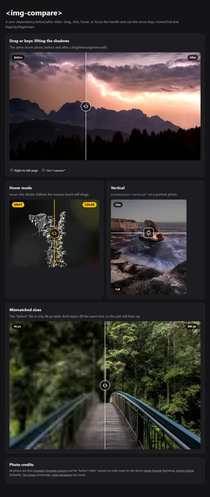
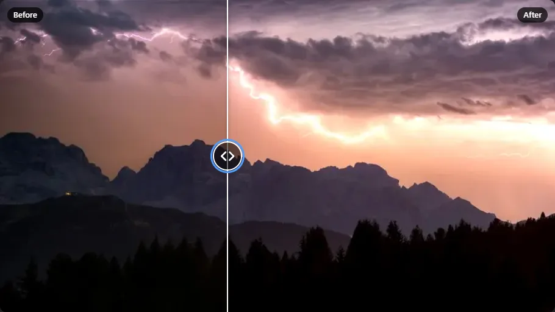
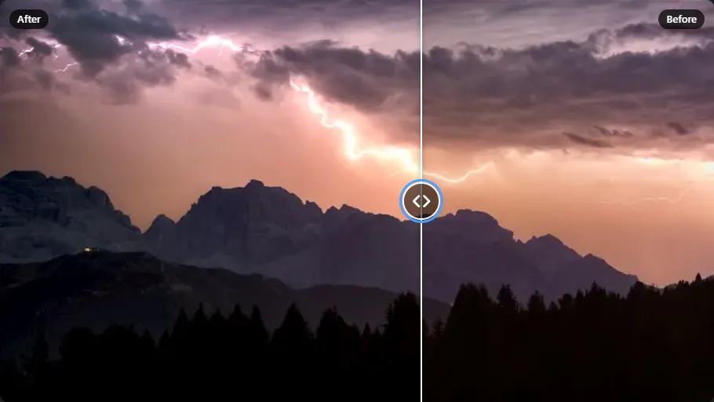

# Before/After Image Comparison Slider Component

**Category:** Web Development Showcase
**Difficulty:** I
**Status:** Implemented (JavaScript)

`` is a zero-dependency web component: two images in one box with a draggable
divider. It works with a mouse, pen, touch or keyboard, in either orientation, in left-to-right and
right-to-left pages, and it ships as a package (ESM, CJS, a `<script>`-tag IIFE and generated `.d.ts`)
rather than a snippet. The whole bundle is 14.5 KB minified, 4.8 KB gzipped.






## Use it

```html
<script type="module">
    import '@programming-challenges-6/img-compare'; // registers 
</script>

</img-compare>
```

From a plain `<script>` tag use `dist/index.global.js` (global `ImgCompare`). Importing the package on
a server (no DOM) is safe: nothing touches `HTMLElement` or `document` until an element is built,
and `define()` returns `false` there.

To try the demo: `npm install`, then `npm run demo` and open the printed URL. The demo imports the
built bundle, so it needs an http server (`dist/` is git-ignored; `npm run build` makes it).

### Attributes and properties

Every attribute has a property of the same name in camelCase, and setting either updates the other.

| Attribute                     | Default            | Meaning                                                                                                           |
| ----------------------------- | ------------------ | ----------------------------------------------------------------------------------------------------------------- |
| `before-src`, `after-src`     | none               | Image URLs. Leave one off and fill that side through its slot instead.                                            |
| `before-alt`, `after-alt`     | empty              | Alt text of each image.                                                                                           |
| `position`                    | `50`               | Percent of the box, from the start edge, showing the before image. Clamped to 0 to 100; junk keeps the old value. |
| `orientation`                 | `horizontal`       | `vertical` puts the before image on top.                                                                          |
| `hover`                       | off                | The divider follows an unpressed mouse or pen. Touch still drags.                                                 |
| `fit`                         | `cover`            | `contain` letterboxes instead of cropping.                                                                        |
| `ratio`                       | from the images    | `3/2`, `16 / 9` or `1.5`. Reserves the height before the images load (see below).                                 |
| `loading`                     | `lazy`             | `lazy` fetches once the slider is within 300 px of the viewport; `eager` fetches at once.                         |
| `label`                       | `Image comparison` | Accessible name of the slider.                                                                                    |
| `before-label`, `after-label` | `Before`, `After`  | The corner chips, and the words in `aria-valuetext` ("40% Before, 60% After").                                    |
| `step`, `big-step`            | `1`, `10`          | Keyboard step; the Shift+arrow and PageUp/PageDown step.                                                          |

Read-only: `status` (`loading`, `ready` or `error`), also mirrored as `data-status` on the host.

### Events

| Event         | When                                                                   | `detail`                         |
| ------------- | ---------------------------------------------------------------------- | -------------------------------- |
| `input`       | The position changes through the user (each pointer move, each key).   | `{ position }`                   |
| `change`      | A move ends: pointer release or cancel, a key press, hover-mode leave. | `{ position }`                   |
| `ready`       | Both images have loaded.                                               | none                             |
| `image-error` | An image failed, or its URL was refused.                               | `{ which: 'before' \| 'after' }` |

Setting `position` from code does not fire `input` or `change`, like a native input.

### Styling

Custom properties on the host: `--ic-accent`, `--ic-line-color`, `--ic-line-width`, `--ic-knob-size`,
`--ic-knob-bg`, `--ic-knob-color`, `--ic-focus-ring`, `--ic-label-bg`, `--ic-label-color`,
`--ic-radius`, `--ic-duration`.

Parts: `root`, `before`, `after`, `before-image`, `after-image`, `track`, `handle`, `line`, `knob`,
`label` (plus `label-before`, `label-after`), `error`.

Slots: `before` and `after` (any element, not just images), `handle` (the icon in the knob),
`label-before`, `label-after`, `error`.

```css
img-compare.warm { --ic-accent: #ffb703; --ic-knob-bg: #1d1d21; --ic-knob-color: #ffb703; }
img-compare.warm::part(label) { text-transform: uppercase; }
```

## Design notes

**One clip-path, no JavaScript layout.** The after image sits underneath; the before layer is the
same size, clipped with `clip-path: inset(...)` driven by a single `--ic-pos` custom property. Both
images are absolutely positioned and `object-fit` into the same box, so differently sized files
still line up (the demo pairs a 96 px file with an 800 px one). Dragging writes one property; the
divider, the clip and the ARIA values all follow from it.

**Direction without a flag.** The clip uses `:host(:dir(rtl))` so an `rtl` page mirrors it with no
JavaScript, and the divider's track is a zero-width flex box centred on its own origin, so it sits
on the boundary in either direction. Pointer maths and key handling read the computed `direction`.
In RTL the before image starts at the right edge.

**Pointer capture, and touch that does not steal the page scroll.** A press on the box jumps the
divider there and captures the pointer, so a drag keeps tracking outside the box. The box uses
`touch-action: pan-y` (`pan-x` when vertical) and the handle `touch-action: none`. A touch that
lands off the handle is only a tap or a drag candidate: it becomes a drag after 6 px of travel along
the slider axis, and ends as a tap (jump) if it lifts first. So a vertical swipe over a slider
scrolls the page and the divider does not move (tested with real touch events).

**Keyboard.** The divider is a `role="slider"` with `aria-valuenow`, `aria-valuetext`,
`aria-label` and `aria-orientation`, and is one tab stop. Arrows move the divider the way they
point (flipped in RTL). On a horizontal slider Up is also "more" and Down "less"; on a vertical one
Down moves it down and Right/Left mean more/less, which keeps the ARIA slider pattern's Up/Right
without making the handle move the wrong way on screen. Shift+arrow and PageUp/PageDown take the big
step; Home and End jump to the ends. Keys the slider does not own (Tab, Ctrl/Alt/Meta chords) are
left alone.

**Reduced motion.** Jumps (a tap, a key, setting `position`) glide over 140 ms, never during a
drag or in hover mode, and not at all under `prefers-reduced-motion: reduce`.

**Reserve the height with `ratio`.** Without it the box starts at 16/9 and takes the first loaded
image's shape. In the test, a 3:1 pair jumped from 338 px to 200 px when the images arrived; with
`ratio="3/1"` it stayed at 200 px throughout.

**Lazy loading is an IntersectionObserver on the host, not ``.** I started with
the native attribute and a slider at `position="0"` never loaded its before image: Chrome does not
fetch a lazy image inside a fully clipped `clip-path` (probed on Chrome 155: fully clipped, not
requested; half clipped or unclipped, requested; same inside a shadow root). That would have shown a
late pop-in on the first drag, so the component now fetches both images when the host comes within
300 px of the viewport. A browser without IntersectionObserver loads at once.

**Untrusted attributes.** Alt text, labels and the accessible name go through `setAttribute` and
`textContent`; the template is a static string with no value interpolated into it. Image URLs must
resolve to `http(s):`, `blob:`, `file:` or a relative path, or be a `data:image/*`; anything else
(`javascript:`, `data:text/html`, `ftp:`) is refused with an `image-error` and never reaches the
``.

**Reflection.** The attribute is the source of truth: the `position` property writes the attribute,
and `attributeChangedCallback` renders. Properties assigned before the element upgraded are kept.

## Tests

| Suite                     | Count | Runs in                         | Covers                                                                                                                                |
| ------------------------- | ----- | ------------------------------- | ------------------------------------------------------------------------------------------------------------------------------------- |
| `tests/position.test.js`  | 41    | Vitest, jsdom                   | The pure helpers: clamping, pointer maths incl. RTL/vertical, key mapping, `valueText`, ratio parsing, URL allow-list.                |
| `tests/component.test.js` | 34    | Vitest, jsdom                   | ARIA values, attribute/property reflection, keyboard, pointer and touch state machine, hover, image status, lazy-load, hostile input. |
| `tests/ssr.test.js`       | 1     | Vitest, Node (no DOM)           | Importing the module without a DOM.                                                                                                   |
| `e2e/slider.e2e.test.js`  | 40    | Vitest + puppeteer-core, Chrome | The built bundle in a real browser (below).                                                                                           |

`npm test` runs the first three (76 tests, about 1 s). `npm run test:e2e` builds, then drives an installed Chrome or Edge
(`CHROME_PATH` overrides discovery; the suite skips with a warning if none is found).

What the browser tests check:

- **Painted pixels.** Flat red/blue images, screenshot, sample: the before colour is on the start side
  of the divider and the after colour beyond it, at 0, 30 and 100, in RTL, vertical, and with
  slotted `div`s. The divider line sits within 1 px of the boundary at 10, 33, 50, 77 and 90.
- **Mouse.** Press jumps; moving far outside the box (and back past the other edge) still tracks and
  clamps at 0 and 100; exactly one `change` per drag; the right button is ignored; dragging selects
  no text; vertical and RTL; hover mode follows an unpressed mouse and ends with a `change`.
- **Touch** (real CDP touch events). A horizontal swipe off the handle drags; a vertical swipe over
  the slider scrolls the page by more than 50 px and leaves the position and events untouched; a tap
  jumps; the handle drags diagonally; a vertical slider drags on a vertical swipe.
- **Keyboard.** Tab reaches the handle in one stop, then arrows, Shift, PageUp, Home, End, and Tab
  leaves; arrow/Page keys do not scroll the page; a focus ring shows; RTL flips left/right.
- **Loading.** The box height comes from the images; `ratio` removes the shift; mismatched shapes
  fill the box; `fit="contain"`; a 404 shows the error overlay and sets `status`; `javascript:` is
  refused; nothing is fetched while the slider is 9000 px down the page and both images are fetched
  on scroll; hostile alt/label text stays text.
- **Motion and theming.** Computed `transition-duration` is 0.14 s at rest, 0 during a drag, 0 in hover
  mode and 0 under reduced motion; custom properties, `::part()` and slots change the line, knob,
  chips and handle; it works inside another shadow root and survives being moved in the DOM.
- **Accessibility.** axe-core reports no violations for the default, vertical, custom-label and
  hover sliders, nor while focused, in RTL, or in the error state.
- **The package.** `require('dist/index.cjs')` works in Node with no DOM, and the IIFE bundle
  defines a global from a plain `<script>`.

## Measured

On this machine (Windows 11, Core Ultra 7 255H, headless Chrome 155), from `npm run bench`:

| Measure                                              | Result                                                                                                       |
| ---------------------------------------------------- | ------------------------------------------------------------------------------------------------------------ |
| Bundle, `dist/index.js` (minified ESM)               | 14,511 B; 4,797 B gzip; 4,218 B brotli (CSS and markup included)                                             |
| One `pointermove` (7 runs of 2,000 synthetic events) | 0.042 ms mean; p95 0.1 ms, p99 0.2 ms (timer resolution is 0.1 ms); worst single event 2 to 5 ms across runs |
| Frames during a real mouse drag (CDP mouse moves)    | median 8.3 ms (the 120 Hz display), p95 8.4 ms, none over 25 ms in 243 frames; idle was the same             |
| The same drag with a 4x CPU throttle                 | median 8.3 ms, p95 8.4 ms, none over 25 ms in 245 frames                                                     |
| Create, attach and lay out 200 sliders               | 38.5 ms (0.19 ms each)                                                                                       |

The pointer cost includes the style and layout work each move forces (the next event reads the box)
but not paint. Frame pacing says the drag is not the bottleneck on this machine; the throttled run
looked identical, so on a much slower device or with huge images the cost would be in image
decoding and paint, which these numbers do not cover.

## Demo images

All photos are from [Unsplash](https://unsplash.com) and used under the
[Unsplash License](https://unsplash.com/license): free for commercial and non-commercial use,
modification allowed, no permission or attribution required (credit is shown anyway), and they
cannot be resold without significant modification. I checked each photo's page for the photographer
and subject.

The "before" and "after" files are **edits made for this demo**, not found before/after photographs:
`scripts/prepare-images.mjs` (sharp) derives them from the originals in `raw/`, into 265 KB of
WebP in `demo/img/` (`npm run images`).

| Pair       | Photographer    | Source                                                 | Before / after                                         |
| ---------- | --------------- | ------------------------------------------------------ | ------------------------------------------------------ |
| Lightning  | Marek Piwnicki  | [d-p06WttJJE](https://unsplash.com/photos/d-p06WttJJE) | Original / gamma 1.8, brightness 1.45, saturation 1.25 |
| Butterfly  | Dmytro Koplyk   | [R0PjjzRWWf8](https://unsplash.com/photos/R0PjjzRWWf8) | Grayscale / original                                   |
| Footbridge | Tim Swaan       | [eOpewngf68w](https://unsplash.com/photos/eOpewngf68w) | 96 px wide copy / 800 px original                      |
| Sea stack  | Karla Hernandez | [shn9z-172sM](https://unsplash.com/photos/shn9z-172sM) | Brightness 0.6, saturation 0.35 / original             |

## Not done, and limits

- Only Chrome 155 was driven. Firefox and Safari were not tested. The mirrored clip relies on
  `:dir()` (Chrome 120, Firefox 49, Safari 16.4 by their release notes; not verified here).
- The corner chips are clipped with their image rather than fading near an edge.
- `define(tag)` registers the one class under one tag name; a second name needs a subclass.
- The generated `.d.ts` does not augment `HTMLElementTagNameMap`, so `document.querySelector('img-compare')`
  is typed as a plain `Element` in TypeScript.
- Setting `position` reflects to the attribute on every pointer move; a `MutationObserver` on the
  host sees each one.
- The component fills its box with `object-fit`; there is no zoom or pan inside it.
- The `raw/` JPGs are committed so `npm run images` is reproducible (about 0.7 MB).

## Commands

```bash
npm install
npm run build          # tsup: dist/index.{js,cjs,global.js,d.ts}
npm test               # unit tests (jsdom + Node)
npm run test:e2e       # build, then the real-browser tests
npm run demo           # build and serve the demo
npm run bench          # build, then print the numbers above
npm run screenshots    # rewrite docs/*.webp from the demo
npm run images         # regenerate demo/img from raw/
```
