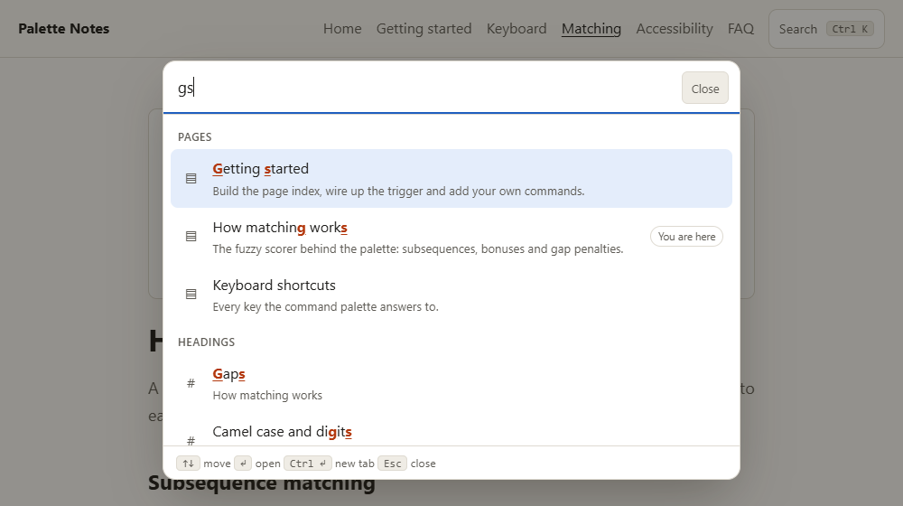
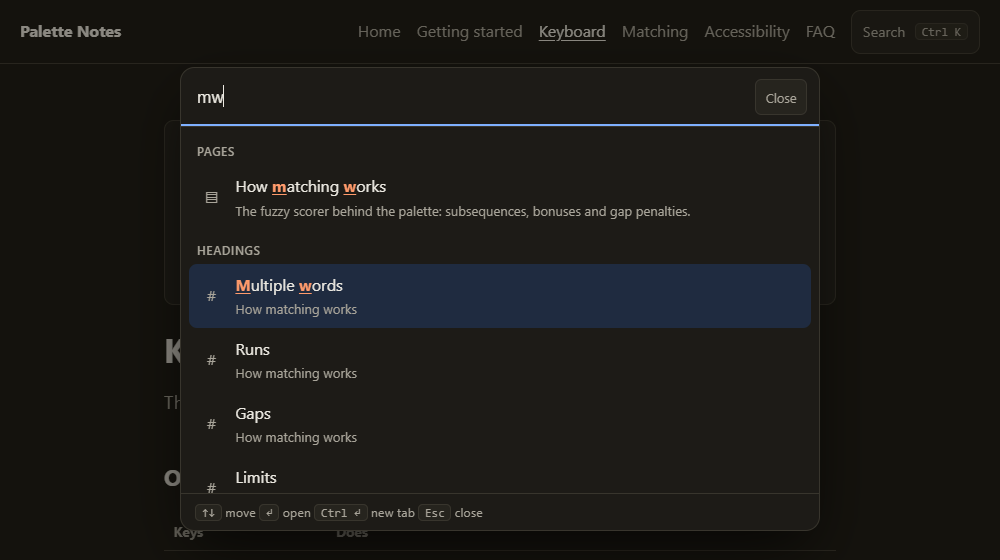
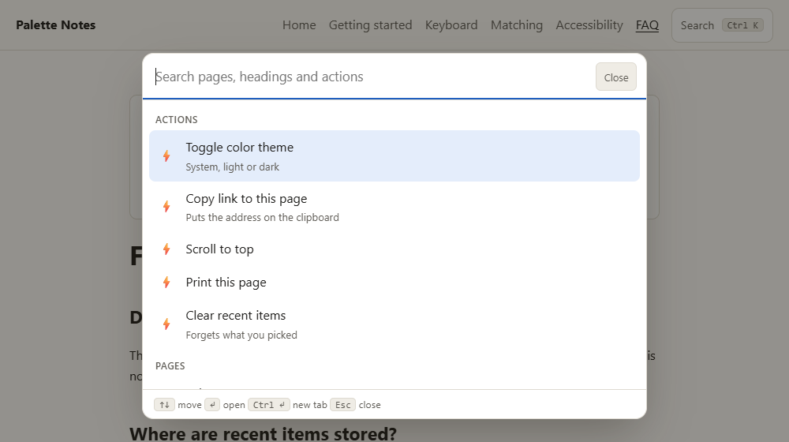
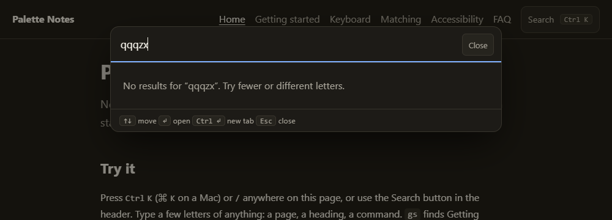

# Command Palette (Cmd+K) UI for a Static Site

**Category:** Web Development Showcase
**Difficulty:** I

**Status:** Implemented (JavaScript)

A Cmd/Ctrl+K palette for a small multi-page static site (*Palette Notes*, six pages of real notes
about the palette itself). It jumps to any page or heading and runs a few commands, driven by a
hand-written fuzzy matcher in the style of fzf and Sublime Text. The page index is built from the
HTML at build time, the UI is a native `<dialog>` with the ARIA combobox/listbox pattern, and the
matcher is measured against Fuse.js and uFuzzy rather than assumed to be good.



## Run it

```bash
cd "challenges/Web Development Showcase/Command Palette (Cmd+K) UI for a Static Site"
npm install
npm run dev          # the site with hot reload (regenerates the index first)
npm run build        # index + production build into dist/
npm test             # unit and component tests (jsdom), 90 tests
npm run test:e2e     # builds, then runs the real-Chrome tests, 40 tests
npm run bench        # the matcher against Fuse.js and uFuzzy (about two minutes)
node e2e/screenshots.mjs   # regenerates docs/ from a build
```

The browser tests drive an installed Chrome or Edge (nothing is downloaded); set `CHROME_PATH` to
point at one. Without a browser they skip with a message instead of failing.

## What it does

- **Opens from anywhere.** `Ctrl+K` / `Cmd+K` (also from inside a text field, and again to close),
  `/` when you are not typing, or the header button. The button ships `hidden` and the script
  reveals it, so with JavaScript off there is no dead control; the site itself is plain linked HTML.
- **Three kinds of results, in sections.** Pages, headings (`h2`/`h3` with the page they live on)
  and actions (toggle theme, copy link, scroll to top, print, clear recents). With a query, sections
  are ordered by their best match; with none, you see Recent, Actions and Pages.
- **Keyboard first.** Up/Down (wrapping), `Ctrl+N`/`Ctrl+P` and `Ctrl+J`/`Ctrl+K`, PageUp/PageDown,
  Home/End (list while the box is empty or with Ctrl, caret otherwise), Enter, `Ctrl`/`Cmd`/`Shift`+Enter for a
  new tab (palette stays open), Esc. Every shortcut is listed on the site's own Keyboard page.
- **Match highlighting without `innerHTML`.** The matcher returns positions; the UI wraps those code
  points in a span using text nodes, so a hostile title is only ever text (a test renders
  `` as a title).
- **Recent items** in `localStorage`, validated on every read (version, types, length, duplicates,
  cap of five); blocked or full storage falls back to memory. Corrupt data is treated as empty.
- **Same-page headings are a hash jump**, not a reload, and move focus to the heading.
- **Theme action** cycles system / light / dark, persisted, and re-applied by a tiny inline script
  in each page's head.

| Light, `gs`                                    | Dark, `mw`                                   |
| ---------------------------------------------- | -------------------------------------------- |
|              |              |
| **Empty query**                                | **No results**                               |
|  |  |

## The index

`scripts/build-index.mjs` reads every top-level `.html` file with jsdom and writes
`src/generated/search-index.json` (git-ignored, rebuilt by `dev`, `build`, `test` and `bench`):

```json
{ "id": "h:matching.html#gaps", "type": "heading", "title": "Gaps",
  "hint": "How matching works", "url": "matching.html#gaps" }
```

Pages also carry `description` (shown under the result, never searched, because long prose fuzzily
matches almost any short query) and optional `<meta name="keywords">`. A heading without an `id` fails the build
naming the page, instead of being quietly dropped. The index is imported with a dynamic `import()`, so
it is its own chunk (5.5 kB, 1.3 kB gzip for 6 pages and 32 headings) fetched when the palette first
needs it (at idle time, or on hover/focus of the button), and the whole palette JS is 16 kB (6.9 kB gzip).
Actions live in code, not in the index.

## The matcher

`src/fuzzy.js`. A query matches when its letters appear in the text in order. The score is what
makes it useful:

- every matched letter scores 16 plus a **position bonus**: 10 after whitespace, 9 after a
  delimiter (`/ , : ; | - _ .`), 8 after other symbols, 7 for a camelCase hump or the first digit of
  a number; the first query letter counts double;
- letters that follow each other form a **run** and inherit the bonus of the run's first letter, so
  `inst` for *Install* scores like four word starts;
- each **gap** costs 3 for its first skipped character and 1 for each further one;
- the best alignment comes from a dynamic program over (query letter, text position), not a
  left-to-right scan, so `ar` in `bar/arch` picks the word-start `ar`, not the `a` in `bar`;
- matching ignores case and diacritics (`cafe` finds *Café*) and positions count code points, so
  astral characters never split.

`src/search.js` adds the palette rules: the query is split on spaces and every word must match, each
in the title, the hint (the page a heading lives on) or the keywords, weighted 1, 0.5 and 0.6; ties go
to the shorter title, then to index order.

How sure is it that the DP is right? A brute-force oracle enumerates every alignment of small
random texts and re-scores each with the rules written out separately (`tests/oracle.js`). The
returned alignment always scores what the rules say and never more than the best one. Like fzf, it
keeps one run bonus per cell, so it is not guaranteed optimal: `node bench/optimality.mjs` runs
40,000 seeded random cases, 13,038 of which have a match, and it hit the true best score in 13,036
(the two misses were a point short). The property test asserts above 99%.

## Does it beat the libraries? Measured

`npm run bench`, Node 26.11.1 on an Intel Core Ultra 7 255H, Fuse.js 7.5.0 and uFuzzy 1.0.19. Each
matcher gets the same fields (title, page name, keywords) and is asked for its top 50.

- **Fuse.js (defaults)** and **Fuse.js (best of 20)**: the best-scoring of 20 option sets I tried on
  the demo queries (threshold 0.3 to 0.7, `ignoreLocation`, extended search, field weights): weights,
  `ignoreLocation`, threshold 0.7. That is tuned on the test set, which flatters Fuse.
- **uFuzzy (default)** and **uFuzzy (typo mode, `intraMode: 1`)**, with `outOfOrder: 3` so multi-word
  queries are not order-sensitive, and `infoThresh` raised so it ranks every match (at its default of
  1,000 matches uFuzzy stops ranking).

**Ranking quality on the demo site** (43 entries, 43 queries I labelled by hand before running
anything: prefixes, initials, letters from inside a word, skipped letters, several words,
keyword-only, typos). Rank is the position of the first acceptable answer.

| matcher              | top 1 | top 3 |  MRR | no result in top 50 |
| -------------------- | ----: | ----: | ---: | ------------------: |
| this palette         |   88% |   91% | 0.90 |                  9% |
| Fuse.js (defaults)   |   74% |   84% | 0.79 |                  7% |
| Fuse.js (best of 20) |   81% |   84% | 0.83 |                  0% |
| uFuzzy (default)     |   53% |   53% | 0.53 |                 47% |
| uFuzzy (typo mode)   |   72% |   72% | 0.72 |                 28% |

Top-3 by kind of query (counts in brackets):

| matcher              | prefix | initials | inside a word | skipped | several words | keyword |   typo |
| -------------------- | -----: | -------: | ------------: | ------: | ------------: | ------: | -----: |
| this palette         | 100(6) |   100(7) |        100(5) |  100(5) |        100(6) |  100(6) |  50(8) |
| Fuse.js (defaults)   | 100(6) |    29(7) |        100(5) |   80(5) |         83(6) |  100(6) | 100(8) |
| Fuse.js (best of 20) | 100(6) |     0(7) |        100(5) |  100(5) |        100(6) |  100(6) | 100(8) |
| uFuzzy (default)     | 100(6) |     0(7) |        100(5) |    0(5) |        100(6) |  100(6) |   0(8) |
| uFuzzy (typo mode)   | 100(6) |     0(7) |        100(5) |    0(5) |        100(6) |  100(6) | 100(8) |

**Read this with care.** I wrote both the matcher and the queries, 43 is small, and the set
includes initials and skipped-letter queries, which are exactly what an fzf-style scorer is built for
and the other two are not. The result that does not flatter the matcher is the typo column: `matchng`
(a letter missing) is still a subsequence and works, but `keybaord`, `shortcust` and `gettnig`
(letters swapped) and `bonnuses` (a letter doubled) are not, so the matcher finds nothing, where Fuse
and uFuzzy's typo mode recover them. It does not forgive typos; the site's Matching page says so.

**Synthetic, 1,000 entries** (360 queries derived from known targets in six kinds, from the rarest
word of the title; seeded, `bench/synthetic.mjs`). A one-word query still fits many titles, so these
are not absolute accuracies; they only compare matchers.

| matcher              | top 1 | top 3 | top 10 |  MRR | no result in top 50 |
| -------------------- | ----: | ----: | -----: | ---: | ------------------: |
| this palette         |   28% |   47% |    71% | 0.42 |                 17% |
| Fuse.js (defaults)   |    9% |   19% |    40% | 0.18 |                 39% |
| Fuse.js (best of 20) |   14% |   31% |    50% | 0.25 |                 34% |
| uFuzzy (default)     |   20% |   32% |    45% | 0.28 |                 50% |
| uFuzzy (typo mode)   |   28% |   47% |    63% | 0.40 |                 32% |

The matcher and uFuzzy's typo mode tie on top 3; the matcher is ahead on top 10 and uFuzzy's typo
mode wins typos by a wide margin (78% against 7% top-3). By kind, top-3: initials 47% (the others 0%),
skipped 63% (the others 0 to 12%), several words 90% (uFuzzy 95%), typos 7% (uFuzzy typo mode 78%).

**Latency per query** (median / 95th percentile; the last column is the 95th percentile for one- and
two-letter queries, which match almost everything):

| matcher              | demo site (43) | 1,000 entries  | 20,000 entries | 20,000, short queries |
| -------------------- | -------------- | -------------- | -------------- | --------------------: |
| this palette         | 9 µs / 20 µs   | 0.10 / 0.31 ms | 5.6 / 12.4 ms  |                 23 ms |
| Fuse.js (defaults)   | 0.15 / 0.53 ms | 2.5 / 6.3 ms   | 50 / 96 ms     |                 41 ms |
| Fuse.js (best of 20) | 0.14 / 0.46 ms | 2.6 / 5.4 ms   | 55 / 109 ms    |                 42 ms |
| uFuzzy (default)     | 9 / 18 µs      | 46 / 72 µs     | 0.79 / 1.8 ms  |                 30 ms |
| uFuzzy (typo mode)   | 20 / 48 µs     | 59 / 95 µs     | 0.95 / 2.1 ms  |                 26 ms |

Index build time at 20,000 entries is about 28 ms for the matcher (it pre-folds every title and
precomputes the bonus of every character), against 9 to 11 ms for Fuse and 2 to 3 ms for uFuzzy,
which keeps no index. The demo site is nowhere near this size; 20,000 only shows where the cost
goes. There the matcher is about 9 times faster than Fuse and about 7 times slower than uFuzzy on
ordinary queries, and 1 to 2 letters cost one or two frames (a full sort of every hit; a top-k
selection would cut it, not done). Ranking quality is not scored at 20,000: each word is in about
150 titles, so a one-word query cannot single out its target for any matcher.

Timings are one machine, one Node version and one run per figure (noisy at the microsecond level);
they are not browser numbers.

## Accessibility and robustness

Verified in real Chrome (`e2e/palette.e2e.test.js`, 40 tests, each page in its own browser context):

- Opens with Ctrl+K, Cmd+K (as the Meta key) and `/`; `/` types a slash when the palette's input has
  focus; Esc, backdrop click and the Close button close it; focus returns to the opener (header
  button, or a link that had focus).
- Tab and Shift+Tab stay inside the dialog (the browser makes the page inert; the palette wraps
  between its two controls).
- `aria-activedescendant` always points at the one `aria-selected` option.
- A heading on the current page is a hash jump (a sentinel set on `window` survives; the heading
  is focused and scrolled into view); one on another page loads it at that heading.
- Ctrl+Enter opens a new tab (checked through the browser's target-created event) and leaves the
  palette open.
- Theme persists across reload; the copy-link action puts the page URL on the clipboard; recents
  are written as `{"v":1,"ids":[...]}` and listed first next time.
- Corrupt stored recents are ignored; with `localStorage` throwing on access, navigation still
  works.
- axe-core (WCAG 2 A/AA, 2.1 AA and best practices, including colour contrast) reports nothing on
  all six pages in light and dark, and on the open palette with results and with none.
- `prefers-reduced-motion: reduce` turns the open animation off (computed `animation-name` is
  `none`, against `cp-in` otherwise).
- Phone-size touch emulation: the header button is at least 44px tall, a tap opens it, the
  palette fills the viewport with no horizontal scroll.
- JavaScript disabled: the six-link menu is there and the search button is not.
- An IME composition updates the results while it is in progress (through Chrome DevTools
  `Input.imeSetComposition`), and an Enter keydown flagged `isComposing` / keyCode 229 opens nothing.

**Not verified:** any real screen reader (NVDA, VoiceOver, TalkBack: axe cannot judge the spoken
result); a real Japanese/Chinese/Korean IME on a real keyboard (only the DevTools composition and a
synthetic flagged keydown); a real phone; any browser other than Chrome (Firefox and Safari: `<dialog>`,
`:has()` and `color-mix()` are used, all current, none tested); the Cmd key on a Mac. `Ctrl+N` is
documented on the Keyboard page as reserved by Chrome on Windows and Linux, which is the browser's
documented behaviour, not something tested here (the test browser sends the keys over DevTools,
where it works); `Ctrl+J`/`Ctrl+K` are the alternates.

## Layout

```
index.html ... faq.html   the demo site: six pages of real content
src/fuzzy.js              the scorer: DP alignment, bonuses, gaps, highlight runs
src/search.js             tokens, fields, sections, ranking
src/palette.js            the dialog, combobox/listbox, keyboard, focus, announcements
src/actions.js            the commands; recent.js, storage.js, theme.js, toast.js
src/main.js               global shortcuts, trigger buttons, same-page navigation
scripts/build-index.mjs   HTML to search-index.json (jsdom)
tests/                    90 unit and component tests (incl. fast-check properties, the oracle)
e2e/                      40 real-Chrome tests, screenshots.mjs
bench/                    the comparison against Fuse.js and uFuzzy; optimality.mjs
```

## Limits and choices

- **No typo tolerance** beyond skipped letters. A fallback (try one swap or insert when nothing
  matches) would recover most of the typo column at the cost of a second pass; not built.
- **Titles, headings and keywords only**, not page body text. Body search is a different problem
  (a tool such as Pagefind does it well).
- **Text is cut** at 32 letters per query word, six words, and a 256-character window for the exact
  alignment (longer titles fall back to a left-to-right scan).
- **No CI for this challenge.** The repository's test workflow only runs challenges with a
  `pyproject.toml`, so, like the other web challenges, `npm test` and `npm run test:e2e` run locally.
