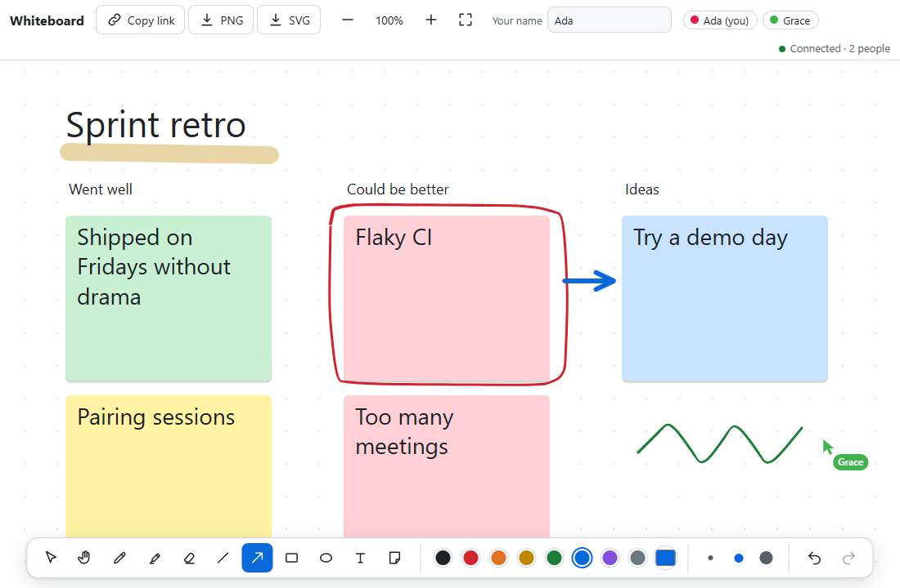
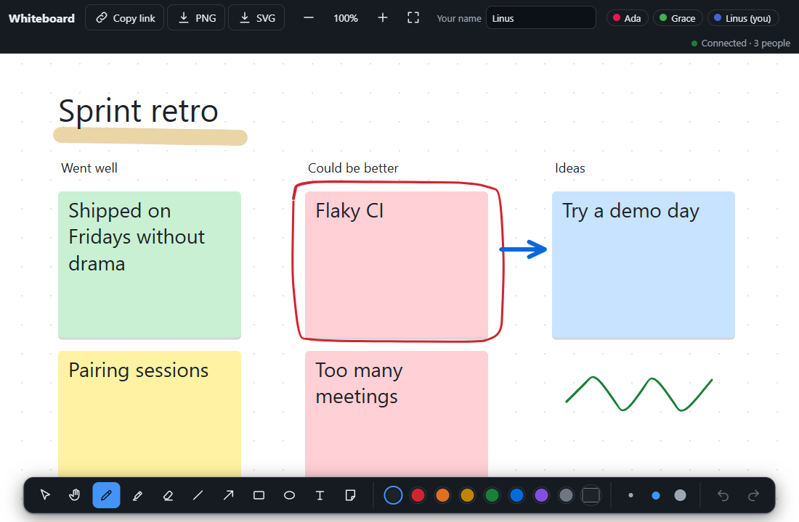
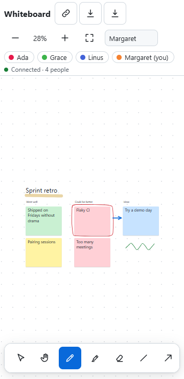

# Real-Time Collaborative Whiteboard

**Category:** Web Development Showcase
**Difficulty:** A

**Status:** Implemented (TypeScript)

A shared infinite whiteboard. Open one link in two browsers and draw: strokes grow on the other screen
while you draw them, cursors carry names, and strokes, shapes, sticky notes, edits, moves, erasures and
per-person undo are kept in the same order for everyone by a small Hono server over WebSocket. Lose the
connection and keep drawing: your changes stay on screen and are sent once when the server is back.







## Run it

Built and tested with Node v26.11.1 and pnpm 11.5.0 (the `packageManager` field pins it). The server is
TypeScript that Node runs directly (type stripping), so there is no server build. The browser tests
drive an installed Chrome or Edge; set `CHROME_PATH` if it is not in a standard location. Nothing is
downloaded for them.

```bash
pnpm install
pnpm run dev            # Vite on :5173 (hot reload) plus the Hono server on :8787
pnpm run build && pnpm start   # production: one server on :8787 serves the build and the sockets
pnpm test               # unit and integration tests (vitest; the integration ones use a real socket)
pnpm run test:e2e       # builds, then drives real Chrome with several "people" against the real server
pnpm run typecheck      # tsc 7 (native), about a second for the whole project
pnpm run bench          # builds, then measures the room, the socket and Chrome (see Measured)
pnpm run screenshots    # builds, then rewrites docs/*.png
```

Open `/` for a new board; the address becomes `/b/<id>`, and anyone with that address joins it. The
server reads `PORT` (8787), `HOST` (`127.0.0.1`, loopback only by default), `WHITEBOARD_DATA_DIR`
(`data/rooms`), `ALLOWED_ORIGINS` (comma-separated extra origins that may open a socket) and
`ALLOWED_HOSTS` (the host names it answers to; localhost names when it listens on loopback, so set it
when serving a real domain).

## What it does

- **Tools:** select and move, pan, pen (pressure from a stylus, smoothing from perfect-freehand),
  highlighter, whole-stroke eraser, line, arrow, rectangle, ellipse, text and sticky notes. Single-letter
  shortcuts (`V H P K E L A R O T N`), `Ctrl+Z` / `Ctrl+Shift+Z` for your own undo and redo. Hold `Shift`
  for straight lines and perfect squares or circles.
- **Infinite canvas:** wheel pans, `Ctrl`+wheel or a trackpad pinch zooms around the pointer, two fingers
  pinch and pan, `Space`+drag or the hand tool pans, arrow keys pan, `Shift+1` fits everything. Ink is
  stored in world units, so every person sees the same drawing at any zoom.
- **Together:** named cursors, a people list, strokes visible while they are being drawn, a colour per
  person, a link to copy. Names are editable and remembered.
- **Export:** PNG (drawn by the same code as the screen) and SVG (built from the stroke data).
- **Resilient:** auto-reconnect with jittered backoff, a heartbeat that notices a dead link, an offline
  queue, boards saved to disk and reloaded after a restart.

## How the sync works

The hard part of a shared canvas is not the drawing, it is agreeing on what the drawing is. This uses the
simplest design that gives every client the same board: **the server puts every change in one order**.

1. **A client asks, the server sequences.** Each change is an `op`: `add` an item, `del` items, `mv`
   (move by an offset), `edit` a note's text. The server validates it, gives it the next sequence number,
   applies it to its own board, and broadcasts it. Every client applies the same ops in the same order, so
   their confirmed boards are identical. `mv` adds offsets instead of overwriting positions, so two people
   dragging the same note do not clobber each other.
2. **Your own changes show immediately.** A client keeps the confirmed board plus a small layer of its own
   ops that have not come back yet (`src/doc.ts`). Drawing never waits for the network. When the server
   echoes the op (or refuses it with a `nack`), the layer entry goes away.
3. **Every op has an id, and resending is safe.** After a reconnect the client re-sends whatever it is not
   sure arrived. The server remembers recent op ids and answers a repeat with an `ack` instead of
   applying it again, so delivery is at-least-once but effect is exactly-once.
4. **Reconnects catch up, not restart.** A client says which sequence number it last saw. If the server's
   log still reaches back that far it sends only the missing ops, otherwise a full snapshot.
5. **Undo is decided by the server, per person.** The server keeps each person's undo and redo stack and
   turns `undo` into a concrete `del`, `res` (restore), `mv` or `edit` that everyone applies like any other
   op. An undo whose effect has already happened (someone else erased the stroke) is skipped, so pressing
   undo always changes something. It never touches anyone else's work.
6. **Strokes in progress are a separate, lossy channel.** While you draw, new points are sent a few times a
   second as `live` messages that are not sequenced or stored; the committed stroke replaces them. A lost
   chunk costs a flicker, never a wrong board.

`tests/convergence.test.ts` checks the central promise with a model-based fuzzer (fast-check): three
tabs and a real `Room` and `Doc`, random drawing, erasing, moving, editing, undo and redo, messages
delivered in random order, tabs dropping and reconnecting, and server restarts from the saved form. When
the network goes quiet every tab must show exactly what the server has, with nothing left pending. It
found that its own generator was too weak (with the default array sizes no run ever reconnected with
progress, so a deliberately broken catch-up passed); it now starts every run synced and forces long runs,
and the same deliberate breakage fails within five runs.

### Messages

| Direction | Message                                                       | Meaning                                                       |
| --------- | ------------------------------------------------------------- | ------------------------------------------------------------- |
| to server | `hello`                                                       | identity, name and the last sequence number seen              |
| to server | `op`                                                          | `add` / `del` / `mv` / `edit` with a client-made op id        |
| to server | `undo`, `redo`                                                | ask for your own history to be stepped                        |
| to server | `live`, `liveEnd`, `cur`                                      | stroke in progress, its cancel, and the cursor (not stored)   |
| to client | `welcome`                                                     | a snapshot or a catch-up, the people here, undo state         |
| to client | `op`                                                          | a sequenced op, with who made it and its op id                |
| to client | `ack`, `nack`                                                 | a repeat was already applied; or the op was refused (and why) |
| to client | `join`, `leave`, `rename`, `undoState`, `live`, `cur`, `pong` | presence and ephemeral relays                                 |

## Hardening

Everything a client sends crosses a trust boundary, so the server treats it as hostile (`server/`):

- **Every field is bounded** by a zod 4 schema (server side only, so it is not in the browser bundle):
  coordinates, sizes, point counts, text length, id shapes, ids per op. Colours must be `#rrggbb`. A
  client-supplied author is dropped and set from the connection. A client cannot send `res`.
- **Identity is a secret, and nobody else sees it.** A tab proves who it is with a random 128-bit secret
  (kept in `sessionStorage`); everyone else only ever sees a hash of it. Knowing a collaborator's id
  from a cursor or an op does not let you replace their connection or inherit their undo history.
- **Cross-site WebSocket hijacking and DNS rebinding:** a handshake whose `Origin` is neither the
  server's own host nor in `ALLOWED_ORIGINS` gets a 403, and a request whose `Host` is not a localhost
  name (when listening on loopback) gets a 421, so another website cannot drive the board through a
  visitor's browser, even by rebinding its own domain to `127.0.0.1`.
- **Limits that keep memory and disk bounded:** 256 KiB per frame; a token bucket per connection (ops
  and ephemeral messages, which includes name changes, pings and stroke cancels); strikes for invalid
  messages; 50 people per room; 20,000 visible items and a 64 MiB byte budget per room; accumulated
  moves capped so a saved file always loads; a live stroke relayed for at most 4,000 points; rooms in
  memory and on disk capped; an 8 MiB send-buffer cap that drops a client who cannot keep up; a hello
  timeout; and a heartbeat that terminates half-open sockets.
- **Erasing frees space.** Erased items stay as tombstones so undo can restore them, and are dropped
  from memory, from newcomers' snapshots and from the saved file once no undo or redo can bring them
  back.
- **Room ids never become paths.** Boards are saved under a hash of the id, so `../x` or a Windows name
  like `CON` cannot escape the data directory or name a device. Writes are temp-file-then-rename. A
  corrupt or mismatched file is moved aside and the room starts empty; loaded items pass the same schema
  as live ones.
- **Output is text.** Names and notes are drawn on a canvas or inserted with `textContent`; the SVG
  export escapes text and removes characters XML cannot carry; colours that are not `#rrggbb` never
  reach the file; names lose control, zero-width and bidirectional-override characters. The page ships
  a strict CSP (`default-src 'self'`, no inline script or style).

### An independent review, and what it found

A read-only security reviewer went through the server and client after the tests were green. It found
no injection, traversal or XSS problem, and it found things the tests I had written could not have:

- **One sticky note could freeze every client, and stay in the room.** A 2,000-letter word was split
  by trying every cut point, 124,125 text measurements per layout, with layouts recomputed on every
  repaint and click. Wrapping now binary-searches the cut (1,309 measurements, 95 times fewer) and
  layouts are cached per item. A test posts that note straight to the socket and checks that a real
  Chrome repaints in under 50 ms and can still erase it.
- **A collaborator's id was also the key to impersonate them** (it was both public and the only proof
  of identity). Now split into a secret and a public hash, as above.
- **Limits that counted items but not bytes**, erased items that counted against the cap forever, a
  peer's live stroke that could grow without bound, name changes and pings that skipped the rate
  limiter, and repeated moves that could push an offset past what the saved file accepts (which would
  have wiped the room on the next reload). All are now bounded, each with a test.

Not fixed, on purpose: there are no per-IP limits (the server cannot see through a proxy, so that
belongs there), so anonymous visitors can still fill the 200-loaded or 2,000-saved room caps and stop
new boards being created; and the token buckets are per connection, so many connections multiply them.

## Measured

On the machine this was built on (Intel Core Ultra 7 255H, Chrome on a 120 Hz display, Node 26),
`pnpm run bench`:

| Message          | Bytes |
| ---------------- | ----: |
| 20-point stroke  |   369 |
| 100-point stroke | 1,230 |
| 400-point stroke | 4,537 |
| Cursor move      |    33 |

| People in the room | JSON per recipient | JSON once (shipped) |
| -----------------: | -----------------: | ------------------: |
|                  2 |         21.3 µs/op |           6.9 µs/op |
|                 10 |         37.5 µs/op |           6.5 µs/op |
|                 50 |        165.7 µs/op |           8.4 µs/op |

The benchmark first showed the room serializing each broadcast once per recipient, which costs about
166 µs per stroke at 50 people. It now serializes once, so the cost no longer grows with the crowd
(about 120,000 sequenced strokes per second at 50 people, in memory).

- **Round trip** over a real loopback WebSocket, sender to server to another client, 100-point stroke:
  median 0.42 ms, p95 1.9 ms, p99 3.3 ms.
- **Drawing** while panning across a board of N strokes of 80 points (a Chrome frame is 8.3 ms here):

| Strokes | In view | Paint CPU | Frame interval median / p95 |
| ------: | ------: | --------: | --------------------------: |
|   1,000 |      70 |   0.30 ms |                8.3 / 8.5 ms |
|   5,000 |      60 |   0.80 ms |                8.3 / 8.4 ms |
|  20,000 |      70 |   2.40 ms |                8.3 / 8.5 ms |

The first run of this table had 8.6 ms of paint at 20,000 strokes: culling recomputed every stroke's
bounds on every frame. Strokes never change after they are added, so their bounds are now cached,
which brought it to 2.4 ms. 20,000 is also the server's cap on items per room.

- **Size:** the client is 49.7 kB of JavaScript (17.9 kB gzipped) and 1.9 kB of CSS gzipped, with
  perfect-freehand as its only runtime dependency.

## Tested

- `pnpm test`: 157 tests in 12 files. Rooms (joining, ops, undo and redo semantics, rate limits, replaced
  connections), the wire schema (valid messages and a list of hostile ones), persistence and eviction (fake timers,
  real files), the convergence fuzzer (520 long runs) plus exact reconnect scenarios, the client document
  model, camera maths (property tests), geometry and hit testing, text wrapping, SVG export (parsed back
  as XML), and the reconnecting socket with a fake WebSocket and fake timers. `tests/server.test.ts` runs
  the real server on a real port: collaboration, restart persistence, catch-up, foreign origins, bad
  room ids, oversized and binary frames, garbage, silence, identity takeover attempts, a foreign `Host`,
  static files and the CSP header. `tests/limits.test.ts` covers room size, compaction, the move range,
  live-stroke and name limits.
- `pnpm run test:e2e`: 21 tests in real Chrome against the production build, each "person" in its own
  browser context. They cover drawing and the pixels it leaves on the other screen, a stroke visible
  before it is finished, presence, every shape and the note editing and moving, the eraser, per-person
  undo, wheel and trackpad zoom around the pointer, space-drag, fit, a two-finger pinch that must not
  draw, late joiners, a server restart, **a server outage with offline drawing that must arrive exactly
  once**, PNG and SVG downloads (the PNG's signature and size, the SVG parsed, and both drawn into one
  canvas and compared pixel by pixel), names and notes full of markup that must stay text, a hostile
  client's oversized note, keyboard-only
  note creation, axe-core on a busy board at desktop and 360px, and the 360px layout.
- The e2e suite found real problems while it was being written: the first axe run flagged the
  screen-reader notes list as being outside any landmark, and a race where a test read the canvas before
  the next animation frame painted a synced stroke (the helper now waits for the pixels).

## Not done, and known limits

- **Only Chrome is tested.** Firefox and Safari are untested. `getCoalescedEvents` is feature-checked,
  and `roundRect` and `Path2D` from SVG path text are in current Firefox and Safari, but no one has
  tried it there.
- **No accounts or permissions.** Anyone with a board link can draw, and a board is as private as its
  10-character link (about 52 bits). There is no read-only link, and no way to remove a person. Names
  are not unique, so someone can call themselves "Ada" too.
- **One server process.** Rooms live in memory; running several would need sticky routing or a shared
  store. Saves are debounced by 400 ms, so a crash (not a normal stop, which flushes) can lose the last
  few strokes.
- **After a server restart** an op that was in flight and is not idempotent (a move, an undo) can apply
  twice, because remembered op ids are not saved. Undo history is also lost on restart, and identity is
  per tab, so closing a tab ends that person's undo history.
- **Selection is one item at a time**, shapes are not live-previewed to others (only freehand is), and the
  eraser removes whole strokes rather than parts of them.
- **Freehand cannot be done by keyboard.** Tools, notes, zoom, pan, undo and focus all have keyboard
  routes, and the board's text is available to screen readers as a list, but a drawing stroke needs a
  pointer.
- Text size in notes depends on the installed font; the layout uses measured widths so it stays
  internally consistent, but two machines with different fonts will wrap a note slightly differently.
- The board is always light paper; the interface around it follows the system colour scheme.

## Where this is actually used

**Figma's multiplayer design.** Figma's engineering write-up "How Figma's multiplayer
technology works" describes the same core decision: clients send changes to a server that
orders them and fans them out, rather than merging peer edits directly. Figma also explains
it chose this over operational transformation because a design canvas is not a text editor.
This board's op log, ack and nack messages, and per-person undo are the same family of
ideas, at a much smaller scale.

**Google Docs.** Google's 2010 relaunch of Docs used operational transformation, with a
server that transforms concurrent operations against each other. OT is the design
for character-level text, which is why the whiteboard's object-level ops, where moves add
offsets instead of overwriting positions, avoid most of its complexity.

**Yjs and CRDTs.** Yjs is an open-source CRDT library with shared types, offline editing,
undo and shared cursors, and it has bindings for ProseMirror and other editors. A CRDT
merges concurrent edits without a central sequencer, at the cost of larger state and more
work to delete things. A whiteboard that wants no server ordering would reach for it.

**Where this board falls short.** This runs one server process with a saved log. Figma runs
a process per document across a cluster, and the production path adds authentication, quotas
and persistence beyond a single file. The convergence fuzzer checks the protocol, not the
deployment.

## Layout

```
server/   app.ts (HTTP + WebSocket glue), room.ts (the sequencing, undo, presence; no sockets),
          rooms.ts (load, save, evict, caps), store.ts (atomic files), schema.ts (zod), bucket.ts
shared/   types.ts (the wire protocol), board.ts (the one reducer both sides run), limits.ts
src/      doc.ts (confirmed board + optimistic layer), whiteboard.ts (canvases, tools, input),
          connection.ts (reconnecting socket), render.ts, geometry.ts, camera.ts, export.ts, ui.ts
tests/    unit and integration (vitest)         e2e/  real Chrome (vitest + puppeteer-core)
bench/    the numbers above                     docs/ the screenshots
```
