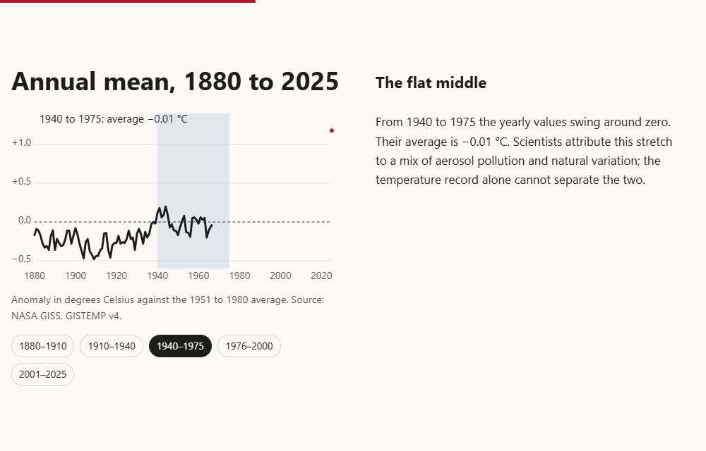
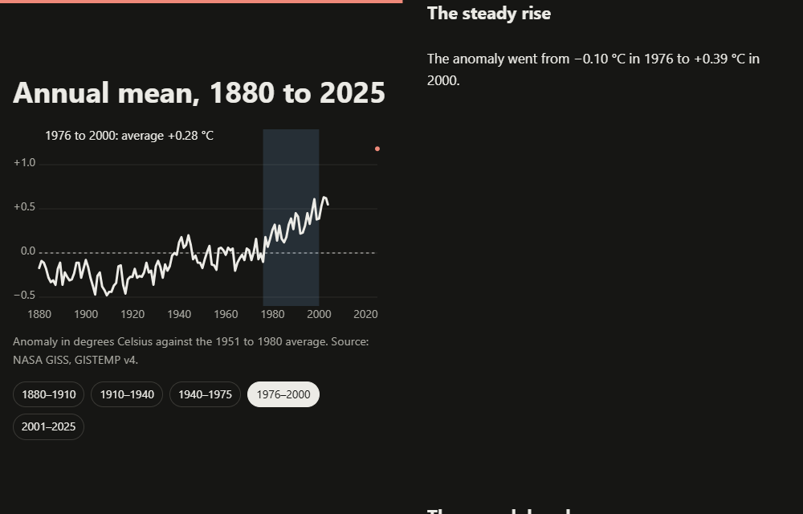
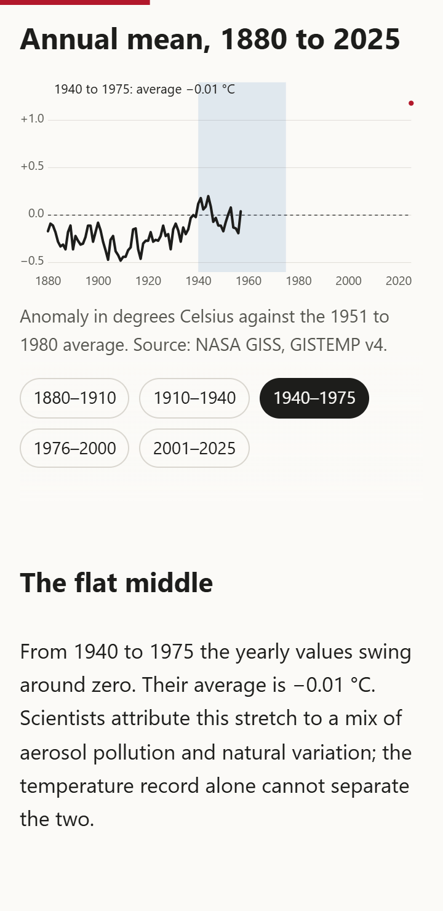

# Scroll-Linked Storytelling Page

**Category:** Web Development Showcase
**Difficulty:** I

**Status:** Implemented (JavaScript)

A scrollytelling page on NASA's annual global temperature record, 1880 to 2025. A chart is pinned
while five text steps scroll past it, and each step highlights its years on the chart. A warming
stripes strip closes the story. The same page runs on two engines that you can switch between
without a reload: native CSS scroll-driven animations, or GSAP ScrollTrigger. With no JavaScript at
all, the text, the chart and the table are all there and readable.







## Run it

Built and tested with Node v26.11.1 and pnpm 11.5.0 (the `packageManager` field pins it). The browser tests
drive an installed Chrome or Edge; set `CHROME_PATH` if it is not in a standard location. Nothing is
downloaded for them.

```bash
pnpm install
pnpm run dev            # local dev server
pnpm test               # unit and DOM tests (vitest, jsdom)
pnpm run build          # static build into dist/
pnpm run test:e2e       # builds, then drives real Chrome against dist/
pnpm run bench          # builds, then measures both engines (see Measured)
pnpm run screenshots    # builds, then rewrites docs/*.png
pnpm run data           # re-cleans data/GLB.Ts+dSST.csv into src/data/gistemp-annual.json
```

## Data

- **Source:** NASA GISS, GISTEMP v4, Land-Ocean Temperature Index, Global Means:
  `https://data.giss.nasa.gov/gistemp/tabledata_v4/GLB.Ts+dSST.csv`
- **Retrieved:** 2026-10-15 (the file's Last-Modified header says 2026-10-08). The raw CSV is
  committed at `data/GLB.Ts+dSST.csv`, so the build never needs the network.
- **Licence:** public domain (NASA GISS data). Attribution: NASA GISS, GISTEMP v4.
- **What is used:** the annual J-D mean for each complete year, 146 years from 1880 to 2025. The
  2026 row is only partly filled in, so it is left out. Months marked `***` are not used.
  `scripts/clean-gistemp.mjs` writes `src/data/gistemp-annual.json`; a unit test checks that the
  committed JSON matches the parser's output on the committed CSV.
- **Units:** degrees Celsius, anomaly against the 1951 to 1980 base period.

The numbers in the five step texts (for example, the 1940 to 1975 mean of −0.01 °C, and 2024 as the
warmest year at +1.28 °C) are checked against the data by a unit test. If the data changes, that
test fails first.

## What it does

1. **The cool start (1880 to 1910):** no year is above zero. The mean is −0.26 °C.
2. **The first climb (1910 to 1940):** from −0.44 °C to +0.12 °C.
3. **The flat middle (1940 to 1975):** the yearly values swing around zero, with a mean of −0.01 °C.
4. **The steady rise (1976 to 2000):** from −0.10 °C to +0.39 °C.
5. **The record decades (2001 to 2025):** a mean of +0.80 °C. Five years are above +1.0 °C. The
   warmest year on record is 2024, at +1.28 °C.

After the steps, the stripes section draws one stripe per year (blue cooler, red warmer than the
1951 to 1980 average), and a table of every value sits under a `<details>` element at the end.

## Method

**Layout and pinning.** The chart stage is pinned for the length of the chart section, and the
stripes strip is pinned for its own section. Under a motion-allowed media query and JavaScript, the
steps overlay the pinned stage. On a desktop, they sit in a second column beside it. On a phone,
the chart stays at the top and the step text is over its lower part.

**Two engines, one set of markup.**

- *Native CSS (default where supported):* `position: sticky` pins the stage. The line draws through
  a view timeline (`animation-timeline: view()`, with an `animation-range` that covers the middle of
  the track). The strip slides on a second view timeline. The progress bar uses
  `scroll(root block)`. All of this is inside `@supports (animation-timeline: view())`, so browsers
  without it never download the GSAP code.
- *GSAP ScrollTrigger:* loaded on demand with a dynamic `import()`, so the 44 kB gzip chunk only
  downloads when this engine is chosen. It pins the stage with `pinSpacing: false` and scrubs the
  line and the strip with `scrub: 1`. Everything it creates lives inside `gsap.matchMedia()` under
  `(prefers-reduced-motion: no-preference)`, so reverting it removes every trigger.

The toggle switches engines in place. It reverts the old engine's handle before mounting the new one,
and a toggle that is superseded while GSAP is still loading does not mount a stale engine. The choice
is stored in `localStorage`. Storage that throws (private windows, blocked site data) is treated as
no choice.

**Active step.** An `IntersectionObserver` with `rootMargin: '-50% 0px -50% 0px'` watches the five
steps. The step that crosses the middle line gets `aria-current="step"`, along with its jump link.
The chart's band moves to that step's years, and the note under the chart shows the step's mean. A
step that a neighbour's update reports as leaving the line keeps its current state, so the highlight
does not flicker between steps. Without `IntersectionObserver`, a scroll listener maps the scroll
progress through the story to a step instead.

**Progressive enhancement.** The SVG chart, the stripes and the data table are written into
`index.html` at build time (`vite.config.js`), so they render without JavaScript. The engine toggle
starts hidden and appears only once the script runs.

**Reduced motion.** With `prefers-reduced-motion: reduce`, nothing is pinned or scrubbed. The layout
is the plain flowing version, the chart is fully drawn, and GSAP creates no triggers.

## Measured

Machine: Windows 11, Chrome from the system install, headless. All numbers are from the commands
above on 2026-10-15. Unit and DOM tests run in jsdom.

| Check                                    | Result                                                         |
| ---------------------------------------- | -------------------------------------------------------------- |
| Unit and DOM tests (`pnpm test`)         | 7 files, 56 tests, all passing                                 |
| Real-browser tests (`pnpm run test:e2e`) | 15 tests, all passing                                          |
| Build (`pnpm run build`)                 | `index.html` 28.4 kB (5.4 kB gzip); CSS 5.98 kB (1.99 kB gzip) |

**Bundle sizes** (gzip, level 9, from `pnpm run bench`):

| Asset                  | Raw       | Gzip     |
| ---------------------- | --------- | -------- |
| Main JS (both engines) | 9.75 kB   | 3.73 kB  |
| CSS                    | 5.98 kB   | 1.99 kB  |
| GSAP engine chunk      | 113.58 kB | 44.14 kB |

The CSS engine ships 5.7 kB gzip of script and style. The GSAP engine ships 49.8 kB gzip, because
it downloads the GSAP chunk as well.

**In-page medians** (5 interleaved runs per engine, after one discarded warm-up each). Each run
scrolls the chart section in 40 steps, 120 ms apart, with `window.scrollTo`, then waits 600 ms for
GSAP's scrub to finish. Frame intervals come from `requestAnimationFrame`. The CDP counters come
from `page.metrics()`.

| Metric                                    | Native CSS | GSAP    |
| ----------------------------------------- | ---------- | ------- |
| Time until the engine is live             | 50 ms      | 73 ms   |
| Script time during the scroll sweep       | 24 ms      | 68 ms   |
| Task time during the scroll sweep         | 260 ms     | 278 ms  |
| Layout time during the scroll sweep       | 3.2 ms     | 4.4 ms  |
| Style recalc time during the scroll sweep | 6.6 ms     | 5.0 ms  |
| Long tasks (over 50 ms)                   | 0          | 0       |
| Dropped frames (interval over 33 ms)      | 0          | 0       |
| Worst frame interval                      | 16.7 ms    | 10.0 ms |

**Caveats on the benchmark.** It is one machine, one headless Chrome, and one programmatic scroll
pattern, not a real user's scroll. The frame counts (about 680 per run) imply the headless frame
clock ran well above 60 Hz, so "dropped frames" here is weak evidence. Task time includes the
harness's own per-frame callback and is about the same for both engines, so it is mostly a
baseline. The GSAP numbers include scrub smoothing, which lags the scroll by design. The time to
engine live for GSAP includes the chunk download from localhost, so it understates the cost on a
real network.

## Accessibility

- **Automated:** axe-core 4.14 finds no WCAG 2.0 or 2.1 A/AA violations, in light and dark colour
  schemes, with both engines (the tests in `e2e/story.e2e.test.js`). axe is not a substitute for
  manual testing.
- **Keyboard:** the first Tab stop is a skip link to the end of the page. Steps and jump links are
  ordinary links and headings.
- **Screen readers:** the chart and the stripes each have a text name and description (`role="img"`
  with `aria-labelledby` for the chart; `aria-label` for the strip). The data table is in the markup,
  with a caption, so the figures are readable without the graphic.
- **Motion:** reduced motion turns off every pin and scrub (see Method).
- **Small screens:** the page has no sideways scroll at 360 px wide, which the e2e tests check on
  both engines.

**Not verified:** Firefox, Safari, Edge (the e2e suite ran only in Chrome), iOS and Android devices,
touch-driven scrolling, screen readers (NVDA, JAWS, VoiceOver, TalkBack), and zoom above 200%. The
e2e tests use programmatic scroll positions, so they do not prove how the pins feel under a finger
or a wheel.

## Known limits

- The CSS engine's `animation-range` percentages are tuned to the current track heights: five
  viewports for the chart, three for the stripes. Changing the section heights means retuning them.
- The GSAP engine relies on those same track heights. It uses `pinSpacing: false`, so the layout
  is not reserved by GSAP itself.
- `window.__storyDebug` is a hook for the tests and the bench (it exposes the engine state and the
  trigger count). It is not part of the page's behaviour.
- The temperature data is annual means only. It shows nothing about regional change, uncertainty
  ranges, or the 2026 partial year.
