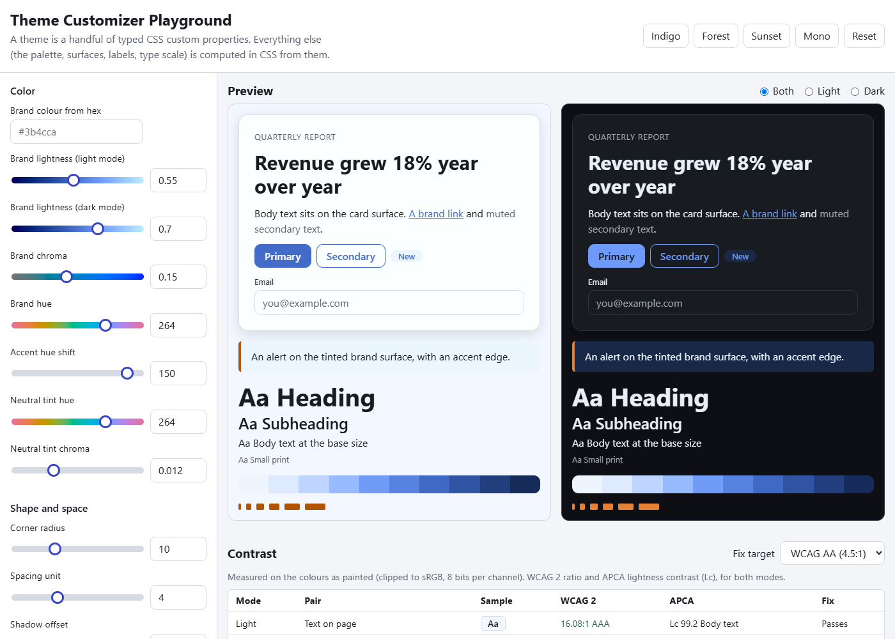
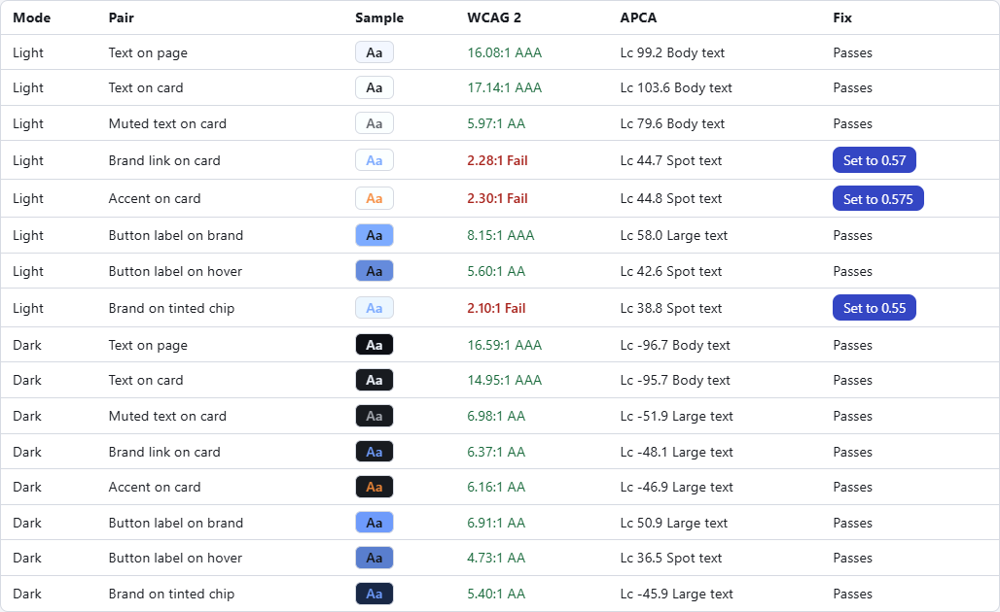
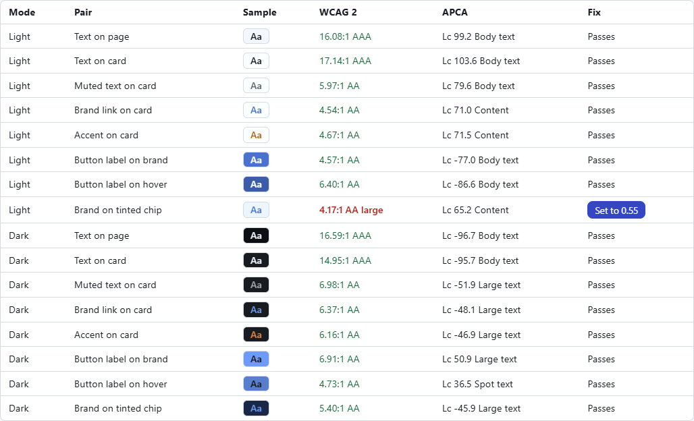
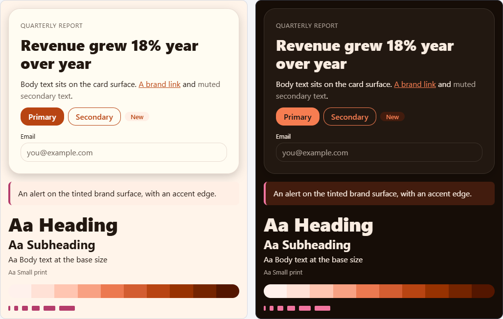
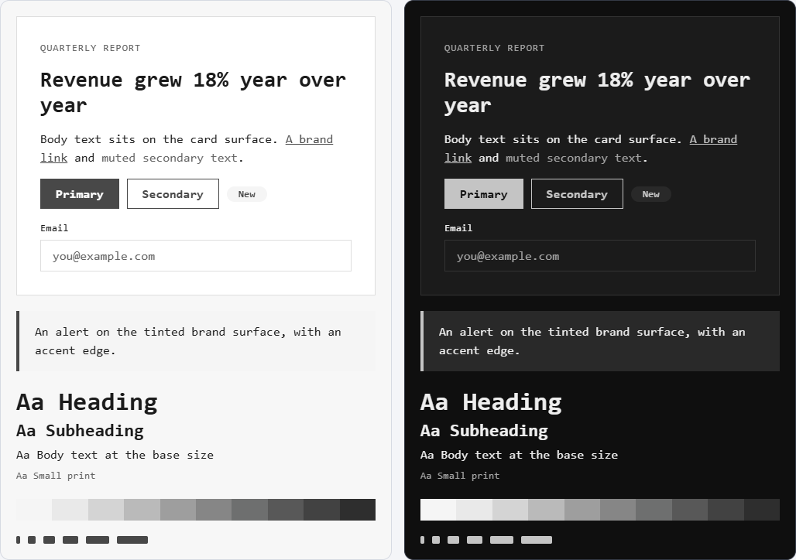

# Theme Customizer Playground

**Category:** Web Development Showcase
**Difficulty:** I

**Status:** Implemented (JavaScript)

A live editor for a CSS theme. A theme here is 17 typed inputs (brand colour in OKLCH, neutral tint,
radius, spacing, type scale, shadow, fonts). Everything else (a ten-step palette, surfaces, button
labels, hover colours, the type and spacing scales) is computed **in CSS** from them, with relative
colour syntax, `color-mix()` and `light-dark()`. You see it on a light and a dark preview at once,
check its contrast, and export it as a CSS file, a W3C design-tokens file or a Tailwind v4 theme.

No framework and no runtime dependencies: plain ES modules, Vite for the build, 27.7 kB of
JavaScript (10.6 kB gzipped) and 12.45 kB of CSS (3.3 kB gzipped).



## Run it

```bash
cd "challenges/Web Development Showcase/Theme Customizer Playground"
npm install
npm run dev          # the app, with hot reload
npm run build        # production build into dist/
npm test             # unit and property tests (node), 69 tests
npm run test:e2e     # builds, then runs the real-Chrome tests, 36 tests
npm run screenshots  # rebuilds the images in docs/
```

The browser tests drive an installed Chrome or Edge (no browser is downloaded). Set `CHROME_PATH`
to point at one; without any browser they skip with a message instead of failing.

## How the theme engine works

The inputs are registered with `@property`, so they are typed (`<number>`, `<length>`) and can
animate. `src/theme.css` holds the whole engine:

```css
--brand: light-dark(oklch(var(--brand-l) var(--brand-c) var(--brand-h)), oklch(var(--brand-l-dark) var(--brand-c) var(--brand-h)));
--brand-hover: color-mix(in oklch, var(--brand), black 14%);
--on-brand: oklch(from var(--brand) clamp(0.18, calc((0.62 - l) * 1000), 1) 0 h);   /* white or near-black */
--accent: oklch(from var(--brand) l c calc(h + var(--accent-shift)));
```

| Tokens                                               | Computed from                                                 |
| ---------------------------------------------------- | ------------------------------------------------------------- |
| `--brand`, `--brand-hover`, `--brand-subtle`         | brand lightness (per mode), chroma, hue                       |
| `--on-brand`                                         | the brand's own lightness: white below 0.62, near-black above |
| `--accent`                                           | the brand colour with its hue turned by the accent shift      |
| `--bg`, `--surface`, `--text`, `--muted`, `--border` | the neutral hue and chroma, at a fixed lightness per mode     |
| `--brand-50` to `--brand-900`                        | brand hue and chroma at ten fixed lightnesses                 |
| `--text-sm` to `--text-4xl`                          | base size and ratio                                           |
| `--space-1` to `--space-8`, `--radius-*`             | the spacing unit and radius                                   |
| `--shadow`                                           | offset, blur, opacity                                         |

A preset, import or reset **glides** to the new theme, because typed custom properties can be
transitioned. Dragging a slider never animates (it would lag behind the pointer), and with
`prefers-reduced-motion: reduce` nothing animates at all.

The editor's own styling uses a separate `--ui-*` set, so no theme can make the editor unreadable.

### A second implementation, on purpose

`src/derive.js` computes the same tokens in JavaScript. It feeds the contrast table, the exports
and the fallback below. Two implementations of one formula would normally drift, so a browser test
makes the real Chrome paint every token for 25 themes and compares (see Verification).

### Browsers without the CSS features

If the browser cannot compute OKLCH relative colours, `color-mix()` or `light-dark()` (checked with
`CSS.supports`), the app sets the JavaScript-computed colours as hex on each preview and shows a
banner saying so. `?fallback` forces this path, which is how it is tested. Only Chrome was tested;
Firefox and Safari were not run.

## Contrast

Every pair that matters (text, muted text, brand link, accent, button label on brand and on hover,
brand on its tinted chip) is checked in both modes, with two metrics:

- **WCAG 2.x** ratio, the one the standards require.
- **APCA** lightness contrast (Lc, constants of APCA-W3 0.0.98G-4g), which models light-on-dark
  differently and gives a negative Lc for light text.

Both are computed on the colours **as painted**: clipped to sRGB and rounded to 8 bits. A brand
colour outside sRGB (high chroma at a lightness where the gamut is narrow) gets a warning that says
what hex it really paints as. Chrome clips per channel rather than mapping chroma; a probe pinned
that down (`oklch(0.7 0.4 150)` paints as `0,214,0`) and `toRgb` matches it.

The **Fix target** menu picks what "passing" means (WCAG AA, AAA, APCA Lc 60 or 75). For a failing
pair that a brand input can move, the table offers a button that sets the **nearest** lightness that
passes, found by stepping outward in both directions from the current value; the button is
absent when nothing in range passes.





## Files: export, import, share

| Format                       | Export                                                                       | Import                              |
| ---------------------------- | ---------------------------------------------------------------------------- | ----------------------------------- |
| **CSS**                      | self-contained: the inputs on `:root`, typed `@property`, and the derivation | yes                                 |
| **Design tokens (W3C JSON)** | `theme` (the inputs) and `palette` (computed results, ignored on import)     | yes                                 |
| **Tailwind v4 `@theme`**     | resolved colours, type scale, radii, `--spacing`, shadow, fonts              | no (it is a one-way, resolved file) |
| **Share link**               | `#brandL=0.55&brandH=264&...`, readable, 17 keys                             | on load                             |

The token file follows the Design Tokens Format Module 2025.10 shapes as I read them (colours as
`{colorSpace: "oklch", components, hex}`, dimensions as `{value, unit}`, `shadow`, `fontFamily`,
`fontWeight`); I did not validate it against a third-party tool. The Tailwind file was compiled once,
by hand, with Tailwind CSS 4.3.3, and produced the utilities for its colours, sizes, radius, font and
shadow (`bg-brand-500`, `text-2xl`, `rounded-md`, `font-heading`, `shadow-card`); that check is not
part of the test suite.

### Imported files are untrusted

A theme file is **never** turned into a stylesheet or markup. It is read only for the values of the
17 known inputs, each parsed strictly (a number with an exact unit, or an exact allow-listed font
stack) and then range-checked, and only a validated theme reaches the DOM, as `setProperty` calls with
numbers and allow-listed strings. Fonts are stored as a key (`system`, `serif`, `mono`, `rounded`),
never as a CSS string. Selectors, other properties, `url()`, `@import`, comments and unknown
variables in a file are ignored. A file with one bad value changes nothing at all (no half-applied
themes), and the error list says what was wrong. A file over 100 kB is refused before it is parsed.
All text from files and storage is inserted with `textContent`.

Autosave uses `localStorage` with a version tag. What it holds is validated on load; corrupt data is
moved to a backup key (not deleted) with a notice, and a browser that blocks storage entirely gets a
notice while the app keeps working. The address bar always carries the current theme, and a bad link
is ignored with the reason shown.

## Verification

| Check                                                         | Result                                                                                       |
| ------------------------------------------------------------- | -------------------------------------------------------------------------------------------- |
| Unit and property tests (fast-check)                          | 69 passing                                                                                   |
| Real-Chrome tests                                             | 36 passing                                                                                   |
| OKLCH conversions against published values                    | red, green, blue, white, black, mid grey; every 8-bit colour round-trips                     |
| WCAG and APCA against published values                        | 21:1, #767676 = 4.54:1, #777777 = 4.48:1, APCA black on white 106.04, white on black -107.88 |
| Export then import is lossless                                | 200 random themes each, CSS and tokens                                                       |
| Hostile CSS and JSON                                          | break-out values, `url()`, `@import`, `__proto__`, wrong units, 150 kB file; nothing changes |
| CSS derivation (real Chrome 155) vs the JS mirror             | worst difference **1 of 255** over 25 themes x 2 modes x 20 tokens (1,000 paints)            |
| JS fallback (`?fallback`) vs the JS mirror, and vs native CSS | exact; sample UI elements within 2 of 255                                                    |
| Exported CSS in a bare page                                   | paints the same colours as the app (within 1)                                                |
| axe-core                                                      | no violations: default theme in light and dark editor chrome, and each of the four presets   |
| Keyboard                                                      | tabbing reaches the sliders, menus, export, import and share fields; arrow keys edit sliders |
| Phone width (375 px)                                          | no sideways scrolling                                                                        |
| A preset animates                                             | `--brand-h` read 120 ms into the 400 ms transition from 264 to 40: 143.5, then lands on 40   |
| Reduced motion                                                | transition duration is `0s`                                                                  |

The agreement test is sensitive: changing the hover mix in `theme.css` alone from 14% to 20% made
the worst difference 22 and failed the test (reverted).

Not covered: Firefox and Safari (only Chromium was run), real screen readers (axe checks the rules,
not the experience), validating the token file with another tool, and a test of the Tailwind file
(done once by hand, see above).

## What building it turned up

- **The first default theme painted outside sRGB.** Dark-mode lightness 0.75 with chroma 0.19 at
  hue 264 needs more chroma than sRGB has there (the limit is about 0.125), so the browser clipped
  it and the editor warned about its own default. The defaults are now 0.7 and 0.15, and a test
  checks that every preset sits inside sRGB.
- **Two themes failed their own contrast check.** The default's tinted chip (brand text on a
  0.95-lightness tint) measured 4.32:1 in a unit test, and the Sunset preset's chip 4.48:1, which axe
  also flagged. The tint is lighter, Sunset's brand is a little darker, and a test now requires every
  preset to pass WCAG AA on all 16 pairs.
- **WCAG and APCA disagree, and only in dark mode.** The default theme passes WCAG AA on all 16
  pairs, but with APCA 9 of 16 are under Lc 75 and 6 are under Lc 60, and all six of those are
  dark-mode pairs (muted text on the dark card is 6.98:1 but Lc -51.9; the dark button label on the
  hover colour is 4.73:1 but Lc 36.5). The two metrics weigh dark mode differently, which is the
  reason to show both.
- **Tests shared a browser profile.** The autosave made one test's theme leak into the next; every
  browser test now gets its own browser context.

## Limits and choices

- **System fonts only.** Four allow-listed stacks, no web-font loading. Free text would mean
  accepting CSS from the user.
- **Neutrals are fixed lightnesses.** Only their tint (hue, chroma) is editable, so surfaces and
  text always pass; the table says "derived from the neutral inputs" for those pairs.
- **The ramp is not the brand colour.** `--brand-50` to `--brand-900` follow the brand hue and chroma
  at fixed lightnesses, so no step is exactly `--brand` (which uses the lightness you chose).
- **Dark mode is a second brand lightness**, not a separate palette; hue and chroma are shared.
- **Tailwind export is one-way** and uses resolved colours, because Tailwind does not evaluate the
  CSS derivation.
- **Out-of-gamut colours are clipped, not mapped**, to match what Chrome paints (measured).

## Layout

```
index.html        page and the sample UI template
src/main.js       the UI: controls, panes, contrast table, import/export, state
src/theme.css     the theme engine (typed inputs and every derived token)
src/style.css     the editor's own look, and the sample UI's use of the tokens
src/schema.js     the one list of inputs: ranges, defaults, validation, CSS values
src/color.js      OKLCH <-> sRGB, hex, mixing, gamut check
src/contrast.js   WCAG 2 and APCA, targets, the nearest-passing search
src/derive.js     the JavaScript mirror of the CSS derivation; the contrast pairs
src/exporters.js  CSS, design tokens, Tailwind
src/importers.js  strict, value-only readers for CSS and tokens files
src/share.js      the URL hash
src/storage.js    versioned, validated autosave
src/presets.js    Indigo, Forest, Sunset, Mono
tests/            unit and property tests
e2e/              real-Chrome tests, helpers, and the screenshot script
docs/             screenshots
```




